<!-- Build inputs: the catalog and discovery metadata; do not edit. -->
```{=html}
<section class="prx-catalog" data-catalog>
<form class="prx-catalog-filters" hidden aria-label="Application catalog">
<label>Search<input type="search" name="query" placeholder="τ, intervals, posterior" autocomplete="off"></label>
<label>Category<select name="part"><option value="">All categories</option><option value="1">Uncertainty</option><option value="2">Grade reports</option><option value="3">Reporting rules</option><optgroup label="Multiple criteria"><option value="4">Common grades</option><option value="P">Domain profiles</option></optgroup><option value="5">Cases</option><option value="T">Tools</option></select></label>
<label>Concept<select name="topic"><option value="">All concepts</option><option value="evidence">Evidence and uncertainty</option><option value="pairs">Pairwise comparisons</option><option value="grades">Coherent grades and families</option><option value="loss">Loss and disclosure</option><option value="rules">Common rules</option><option value="criteria">Several criteria</option><option value="joint">Joint and composite claims</option><option value="computation">Computation and draws</option><option value="evaluation">Choosing and evaluating reports</option></select></label>
<label>Data<select name="data"><option value="">All data</option><option value="generated">Generated examples</option><option value="sites">Fictional six/thirty sites</option><option value="krw">KRW firms</option><option value="cde">California schools</option><option value="alabama">Alabama counties</option><option value="local">Your summaries or matrices</option><option value="profiles">Fictional forty-site profiles</option></select></label>
<button type="reset">Clear filters</button>
</form>
<p class="prx-catalog-count" role="status" aria-live="polite" aria-atomic="true">84 apps</p>
<p class="prx-catalog-empty" hidden>No applications match the selected filters.</p>
<div class="prx-cards"><article data-part="1" data-topics="grades evidence loss" data-data="krw" data-search="1.1 League tables and report cards Compare the directions stated by a strict ranking and by KRW’s report cards for 97 firms. A league table and a report card The same 97 firms in a league table and in KRW's report card: the two reports say different things about pairs of firms. Coherent grades and families Evidence and uncertainty Loss and disclosure KRW firms Race card Second place Last place By posterior mean Gender card" class="prx-card prx-card-built">
<a class="prx-card-thumb" href="pages/uncertainty/case-zero.html" tabindex="-1" aria-hidden="true">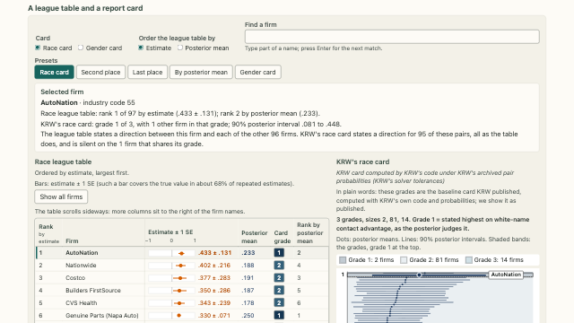</a>
<div class="prx-card-body">
<p class="prx-catalog-topics"><span>Coherent grades and families</span> <span>Evidence and uncertainty</span> <span>Loss and disclosure</span></p><p class="prx-catalog-data">KRW firms</p><p class="prx-card-id">1.1</p>
<h3><a href="pages/uncertainty/case-zero.html">League tables and report cards</a></h3>
<p>Compare the directions stated by a strict ranking and by KRW’s report cards for 97 firms.</p>
<p class="prx-card-credit">Data: Kline, Rose and Walters (2024) · CC-BY-NC</p>
<p class="prx-card-links"><a href="embed/case-zero.html">standalone</a></p>
</div>
</article>
<article data-part="1" data-topics="evidence" data-data="generated" data-search="1.2 Estimates and sampling error Repeated samples give different estimates of the same true value. The spread depends on the standard error. One number, two parts A reported estimate is its true value plus noise, and the noise changes each time the data are collected again. Evidence and uncertainty Generated examples SE .20 200 draws Seed 2 SE .10 SE .05" class="prx-card prx-card-built">
<a class="prx-card-thumb" href="pages/uncertainty/noisy-estimate.html" tabindex="-1" aria-hidden="true">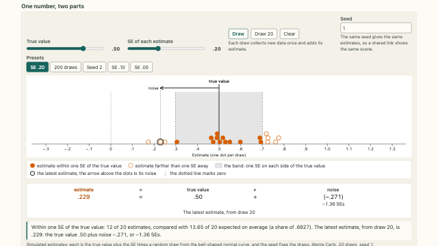</a>
<div class="prx-card-body">
<p class="prx-catalog-topics"><span>Evidence and uncertainty</span></p><p class="prx-catalog-data">Generated examples</p><p class="prx-card-id">1.2</p>
<h3><a href="pages/uncertainty/noisy-estimate.html">Estimates and sampling error</a></h3>
<p>Repeated samples give different estimates of the same true value. The spread depends on the standard error.</p>
<p class="prx-card-links"><a href="embed/noisy-estimate.html">standalone</a></p>
</div>
</article>
<article data-part="1" data-topics="evidence computation" data-data="generated" data-search="1.3 Ranking noisy estimates Units estimated with less precision can appear at the extremes of a league table more often. Ranking noisy estimates Ranking noisy estimates sends more of the noisiest units to the top and bottom places than their true values would, and replays show it is not one draw's luck. Evidence and uncertainty Computation and draws Generated examples First draw True values Twenty replays Replay 11 Extremes highlighted" class="prx-card prx-card-built">
<a class="prx-card-thumb" href="pages/uncertainty/noisy-league.html" tabindex="-1" aria-hidden="true">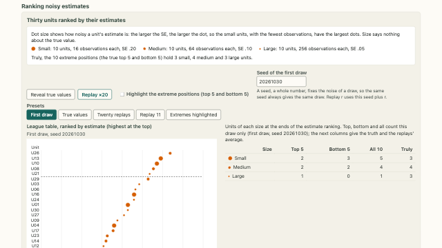</a>
<div class="prx-card-body">
<p class="prx-catalog-topics"><span>Evidence and uncertainty</span> <span>Computation and draws</span></p><p class="prx-catalog-data">Generated examples</p><p class="prx-card-id">1.3</p>
<h3><a href="pages/uncertainty/noisy-league.html">Ranking noisy estimates</a></h3>
<p>Units estimated with less precision can appear at the extremes of a league table more often.</p>
<p class="prx-card-links"><a href="embed/noisy-league.html">standalone</a></p>
</div>
</article>
<article data-part="1" data-topics="evidence" data-data="generated" data-search="1.4 Selection bias at the extremes of a ranking Selecting the highest or lowest estimates can introduce bias. The choice of prior changes the bias after shrinkage. Too good to be true at the top Units that reach the top by their estimates have estimates above their true values on average; a posterior mean whose prior matches the true values' center and spread takes back about all of it. Evidence and uncertainty Generated examples Top 3 Replay 9 Top 1 Bottom 3 Prior SD .05" class="prx-card prx-card-built">
<a class="prx-card-thumb" href="pages/uncertainty/winners-curse.html" tabindex="-1" aria-hidden="true">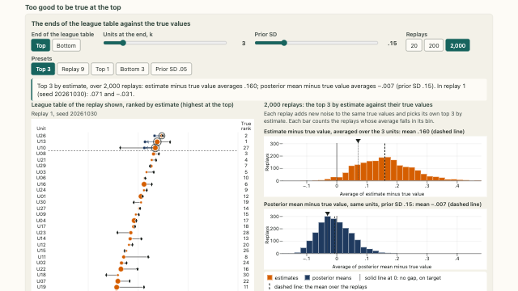</a>
<div class="prx-card-body">
<p class="prx-catalog-topics"><span>Evidence and uncertainty</span></p><p class="prx-catalog-data">Generated examples</p><p class="prx-card-id">1.4</p>
<h3><a href="pages/uncertainty/winners-curse.html">Selection bias at the extremes of a ranking</a></h3>
<p>Selecting the highest or lowest estimates can introduce bias. The choice of prior changes the bias after shrinkage.</p>
<p class="prx-card-links"><a href="embed/winners-curse.html">standalone</a></p>
</div>
</article>
<article data-part="1" data-topics="evidence" data-data="generated" data-search="1.5 Normal–normal posterior shrinkage Larger standard errors give the prior mean more weight. The units can change order after shrinkage. What a posterior adds With one prior shared by all units, the posterior mean pulls imprecise estimates further toward the prior mean than precise ones, so it can reorder units, and only units whose precisions differ. Evidence and uncertainty Generated examples Prior SD .15 Prior SD .05 Every SE .10 Against the true values Too narrow a prior" class="prx-card prx-card-built">
<a class="prx-card-thumb" href="pages/uncertainty/shrinkage.html" tabindex="-1" aria-hidden="true">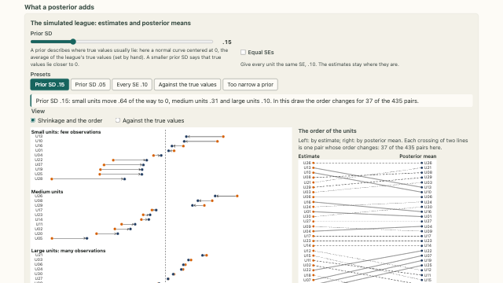</a>
<div class="prx-card-body">
<p class="prx-catalog-topics"><span>Evidence and uncertainty</span></p><p class="prx-catalog-data">Generated examples</p><p class="prx-card-id">1.5</p>
<h3><a href="pages/uncertainty/shrinkage.html">Normal–normal posterior shrinkage</a></h3>
<p>Larger standard errors give the prior mean more weight. The units can change order after shrinkage.</p>
<p class="prx-card-links"><a href="embed/shrinkage.html">standalone</a></p>
</div>
</article>
<article data-part="1" data-topics="evidence evaluation" data-data="generated" data-search="1.6 Sensitivity to the prior standard deviation A change in the prior standard deviation affects squared error and the certainty of pairwise comparisons differently. How much to shrink The prior SD is set or estimated by the producer: over many draws the distance to the true values is smallest near the true spread (prior centered on their average), and the pair probabilities postrank reads move with it. Evidence and uncertainty Choosing and evaluating reports Generated examples Near the true spread Much too narrow Too narrow Too wide Another draw" class="prx-card prx-card-built">
<a class="prx-card-thumb" href="pages/uncertainty/shrinkage-price.html" tabindex="-1" aria-hidden="true">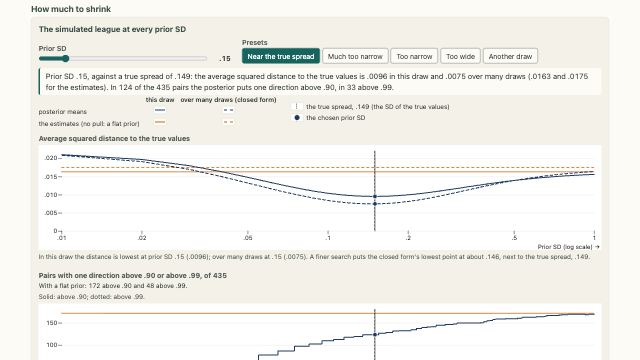</a>
<div class="prx-card-body">
<p class="prx-catalog-topics"><span>Evidence and uncertainty</span> <span>Choosing and evaluating reports</span></p><p class="prx-catalog-data">Generated examples</p><p class="prx-card-id">1.6</p>
<h3><a href="pages/uncertainty/shrinkage-price.html">Sensitivity to the prior standard deviation</a></h3>
<p>A change in the prior standard deviation affects squared error and the certainty of pairwise comparisons differently.</p>
<p class="prx-card-links"><a href="embed/shrinkage-price.html">standalone</a></p>
</div>
</article>
<article data-part="1" data-topics="evidence computation joint" data-data="generated" data-search="1.7 From data to posterior decisions Follow two estimates through posterior shrinkage to a decision about whether to state their order. Where the posterior comes from Of data, model, posterior and decision, postrank does only the last step: it reads a posterior and makes grades. Evidence and uncertainty Computation and draws Joint and composite claims Generated examples Box 1 (Data) Box 2 (Model) Box 3 (Posterior) B more precise Box 4 (Decision) τ .10 Prior SD .05" class="prx-card prx-card-built">
<a class="prx-card-thumb" href="pages/uncertainty/posterior-pipeline.html" tabindex="-1" aria-hidden="true">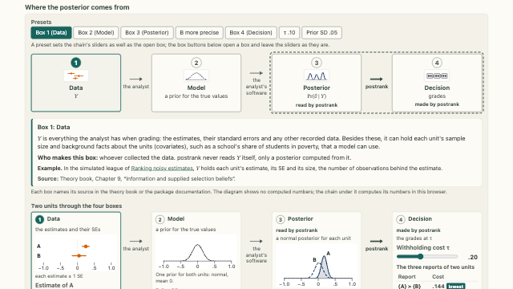</a>
<div class="prx-card-body">
<p class="prx-catalog-topics"><span>Evidence and uncertainty</span> <span>Computation and draws</span> <span>Joint and composite claims</span></p><p class="prx-catalog-data">Generated examples</p><p class="prx-card-id">1.7</p>
<h3><a href="pages/uncertainty/posterior-pipeline.html">From data to posterior decisions</a></h3>
<p>Follow two estimates through posterior shrinkage to a decision about whether to state their order.</p>
<p class="prx-card-links"><a href="embed/posterior-pipeline.html">standalone</a></p>
</div>
</article>
<article data-part="1" data-topics="pairs evidence" data-data="generated" data-search="1.8 Pairwise posterior direction probabilities With two independent normal posteriors, the probability that A is higher depends on the mean and standard deviation of their difference. Two units, one probability One number, π = Pr(θ_A &gt; θ_B ∣ Y), says how sure we are of a direction between two units. Pairwise comparisons Evidence and uncertainty Generated examples Means .30 and .10, SDs .20 and .20 Means .30 and .10, SDs .20 and .60 (B much less precise) Means .20 and .20, SDs .20 and .40 Means 1.20 and .95, SDs .20 and .20 (tutorial sites A and B)" class="prx-card prx-card-built">
<a class="prx-card-thumb" href="pages/uncertainty/two-units.html" tabindex="-1" aria-hidden="true">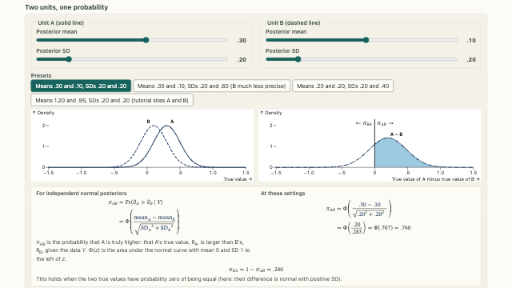</a>
<div class="prx-card-body">
<p class="prx-catalog-topics"><span>Pairwise comparisons</span> <span>Evidence and uncertainty</span></p><p class="prx-catalog-data">Generated examples</p><p class="prx-card-id">1.8</p>
<h3><a href="pages/uncertainty/two-units.html">Pairwise posterior direction probabilities</a></h3>
<p>With two independent normal posteriors, the probability that A is higher depends on the mean and standard deviation of their difference.</p>
<p class="prx-card-links"><a href="embed/two-units.html">standalone</a></p>
</div>
</article>
<article data-part="1" data-topics="pairs joint" data-data="generated" data-search="1.9 Posterior dependence and pairwise comparisons Changing posterior correlation can change the probability that one unit is higher even when both marginal distributions stay fixed. When two posteriors move together When two jointly normal posteriors are correlated, the SD of their difference changes and π moves away from or toward one half, but never crosses it. Pairwise comparisons Joint and composite claims Generated examples Correlation .50 Independent Correlation .95 Correlation −.95 Shared prior mean" class="prx-card prx-card-built">
<a class="prx-card-thumb" href="pages/uncertainty/correlated-units.html" tabindex="-1" aria-hidden="true">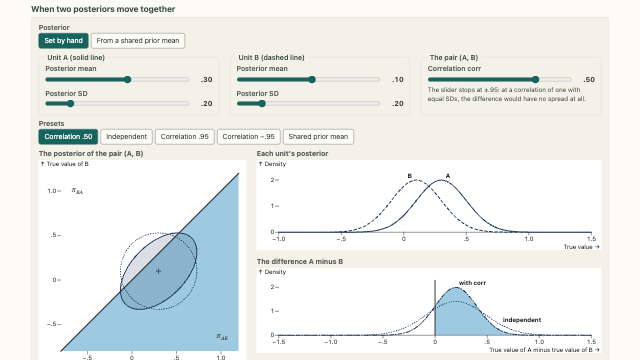</a>
<div class="prx-card-body">
<p class="prx-catalog-topics"><span>Pairwise comparisons</span> <span>Joint and composite claims</span></p><p class="prx-catalog-data">Generated examples</p><p class="prx-card-id">1.9</p>
<h3><a href="pages/uncertainty/correlated-units.html">Posterior dependence and pairwise comparisons</a></h3>
<p>Changing posterior correlation can change the probability that one unit is higher even when both marginal distributions stay fixed.</p>
<p class="prx-card-links"><a href="embed/correlated-units.html">standalone</a></p>
</div>
</article>
<article data-part="1" data-topics="pairs evidence" data-data="generated" data-search="1.10 Marginal summaries and joint direction probabilities Two examples show how posterior shape and dependence can change direction probabilities at fixed marginal means. Same means, different directions Two posteriors with the same margins can give opposite directions (1/3 against 2/3), and a two-bump posterior can have the larger mean but the smaller chance of being higher. Pairwise comparisons Evidence and uncertainty Generated examples Law 1 Law 2 Independent Always equal w .50" class="prx-card prx-card-built">
<a class="prx-card-thumb" href="pages/uncertainty/beyond-normal.html" tabindex="-1" aria-hidden="true">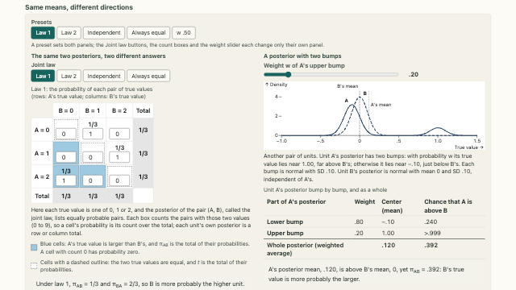</a>
<div class="prx-card-body">
<p class="prx-catalog-topics"><span>Pairwise comparisons</span> <span>Evidence and uncertainty</span></p><p class="prx-catalog-data">Generated examples</p><p class="prx-card-id">1.10</p>
<h3><a href="pages/uncertainty/beyond-normal.html">Marginal summaries and joint direction probabilities</a></h3>
<p>Two examples show how posterior shape and dependence can change direction probabilities at fixed marginal means.</p>
<p class="prx-card-links"><a href="embed/beyond-normal.html">standalone</a></p>
</div>
</article>
<article data-part="1" data-topics="pairs evidence" data-data="generated" data-search="1.11 Marginal interval overlap and direction probabilities The probability that one unit is higher can be substantial even when their marginal credible intervals overlap. Intervals do not decide directions Two posterior intervals can overlap while one direction is very likely. Pairwise comparisons Evidence and uncertainty Generated examples Just touch, 90% Just touch, 95% Means 2 SDs apart Means 1 SD apart" class="prx-card prx-card-built">
<a class="prx-card-thumb" href="pages/uncertainty/interval-overlap.html" tabindex="-1" aria-hidden="true">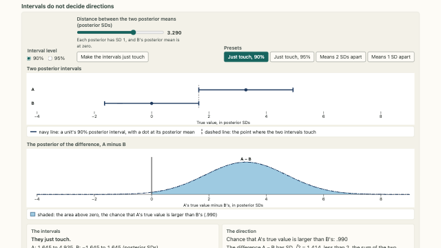</a>
<div class="prx-card-body">
<p class="prx-catalog-topics"><span>Pairwise comparisons</span> <span>Evidence and uncertainty</span></p><p class="prx-catalog-data">Generated examples</p><p class="prx-card-id">1.11</p>
<h3><a href="pages/uncertainty/interval-overlap.html">Marginal interval overlap and direction probabilities</a></h3>
<p>The probability that one unit is higher can be substantial even when their marginal credible intervals overlap.</p>
<p class="prx-card-links"><a href="embed/interval-overlap.html">standalone</a></p>
</div>
</article>
<article data-part="1" data-topics="pairs evidence" data-data="generated" data-search="1.12 Interval overlap across 435 pairs Compare interval overlap and posterior direction probabilities for all 435 pairs in a simulated league. 435 pairs: overlap against direction Sorting the league's 435 pairs by interval overlap and by direction probability shows that overlapping intervals often hide a likely direction. Pairwise comparisons Evidence and uncertainty Generated examples Overlap, highest probability U06 and U20 U04 and U18 95% intervals Prior SD .05" class="prx-card prx-card-built">
<a class="prx-card-thumb" href="pages/uncertainty/overlap-in-the-league.html" tabindex="-1" aria-hidden="true">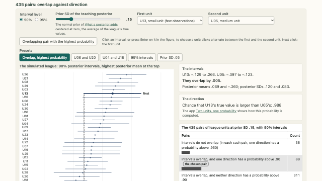</a>
<div class="prx-card-body">
<p class="prx-catalog-topics"><span>Pairwise comparisons</span> <span>Evidence and uncertainty</span></p><p class="prx-catalog-data">Generated examples</p><p class="prx-card-id">1.12</p>
<h3><a href="pages/uncertainty/overlap-in-the-league.html">Interval overlap across 435 pairs</a></h3>
<p>Compare interval overlap and posterior direction probabilities for all 435 pairs in a simulated league.</p>
<p class="prx-card-links"><a href="embed/overlap-in-the-league.html">standalone</a></p>
</div>
</article>
<article data-part="1" data-topics="pairs grades" data-data="generated sites" data-search="1.13 The matrix of pairwise posterior probabilities Reordering the units moves the cells of the matrix while preserving the probability attached to each pair. All pairs at once With every pair's π in one matrix ordered by posterior mean, the uncertain pairs gather near the diagonal (for independent normal posteriors). Pairwise comparisons Coherent grades and families Generated examples Fictional six/thirty sites Six sites, by posterior mean Six sites, by label League, by label League, by posterior mean Two imprecise units" class="prx-card prx-card-built">
<a class="prx-card-thumb" href="pages/uncertainty/pairwise-matrix.html" tabindex="-1" aria-hidden="true">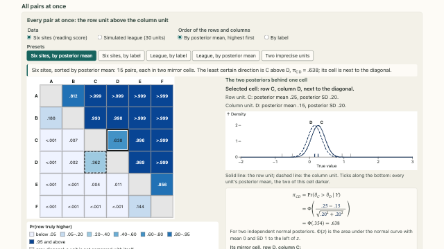</a>
<div class="prx-card-body">
<p class="prx-catalog-topics"><span>Pairwise comparisons</span> <span>Coherent grades and families</span></p><p class="prx-catalog-data">Generated examples · Fictional six/thirty sites</p><p class="prx-card-id">1.13</p>
<h3><a href="pages/uncertainty/pairwise-matrix.html">The matrix of pairwise posterior probabilities</a></h3>
<p>Reordering the units moves the cells of the matrix while preserving the probability attached to each pair.</p>
<p class="prx-card-links"><a href="embed/pairwise-matrix.html">standalone</a></p>
</div>
</article>
<article data-part="1" data-topics="grades pairs" data-data="generated" data-search="1.14 Alternative rankings from a posterior distribution Ranking units by posterior mean, expected rank, or probability of reaching a top group can produce different orders. Three rankings from one posterior One posterior can rank units differently by posterior mean, by expected rank and by the chance of being on top when the posteriors differ in width or shape, and each unit's own rank is uncertain. Coherent grades and families Pairwise comparisons Generated examples Three-unit law, posterior mean Three-unit law, first place Three-unit law, √θ League, expected rank League, top ten League, exp(10θ)" class="prx-card prx-card-built">
<a class="prx-card-thumb" href="pages/uncertainty/which-ranking.html" tabindex="-1" aria-hidden="true">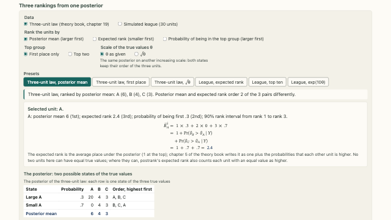</a>
<div class="prx-card-body">
<p class="prx-catalog-topics"><span>Coherent grades and families</span> <span>Pairwise comparisons</span></p><p class="prx-catalog-data">Generated examples</p><p class="prx-card-id">1.14</p>
<h3><a href="pages/uncertainty/which-ranking.html">Alternative rankings from a posterior distribution</a></h3>
<p>Ranking units by posterior mean, expected rank, or probability of reaching a top group can produce different orders.</p>
<p class="prx-card-links"><a href="embed/which-ranking.html">standalone</a></p>
</div>
</article>
<article data-part="1" data-topics="grades pairs" data-data="generated krw" data-search="1.15 Majority comparisons and expected ranks A count of pairwise majority wins records which direction is more likely. Expected rank also uses the size of each probability. Majority wins and expected rank For independent normal posteriors, counting the pairs each unit more likely wins gives the posterior-mean order; on KRW's race gaps it gives an order of its own, which KRW's λ = 1 race card follows. Coherent grades and families Pairwise comparisons Generated examples KRW firms Law on orders League League, prior SD .30 KRW, race KRW, gender" class="prx-card prx-card-built">
<a class="prx-card-thumb" href="pages/uncertainty/majority-wins.html" tabindex="-1" aria-hidden="true">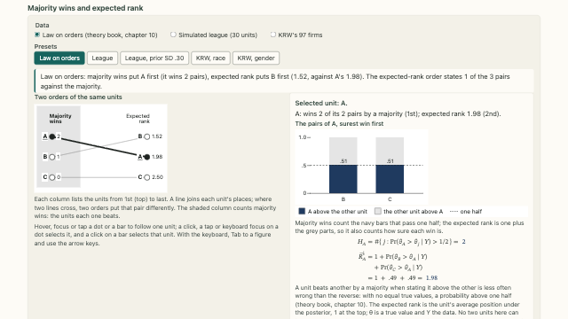</a>
<div class="prx-card-body">
<p class="prx-catalog-topics"><span>Coherent grades and families</span> <span>Pairwise comparisons</span></p><p class="prx-catalog-data">Generated examples · KRW firms</p><p class="prx-card-id">1.15</p>
<h3><a href="pages/uncertainty/majority-wins.html">Majority comparisons and expected ranks</a></h3>
<p>A count of pairwise majority wins records which direction is more likely. Expected rank also uses the size of each probability.</p>
<p class="prx-card-credit">Data: Kline, Rose and Walters (2024) · CC-BY-NC</p>
<p class="prx-card-links"><a href="embed/majority-wins.html">standalone</a></p>
</div>
</article>
<article data-part="1" data-topics="pairs evaluation" data-data="generated sites krw cde" data-search="1.16 Expected errors in a strict ranking Add the posterior error probabilities for all pairwise directions in a strict ranking to find its expected wrong count. A ranking makes many claims A strict ranking of n units makes n(n − 1)/2 claims, and the posterior expects many of them to be wrong. Pairwise comparisons Choosing and evaluating reports Generated examples Fictional six/thirty sites KRW firms California schools 97 firms Top 10 by posterior mean Six sites League of 30" class="prx-card prx-card-built">
<a class="prx-card-thumb" href="pages/uncertainty/ranking-claims.html" tabindex="-1" aria-hidden="true">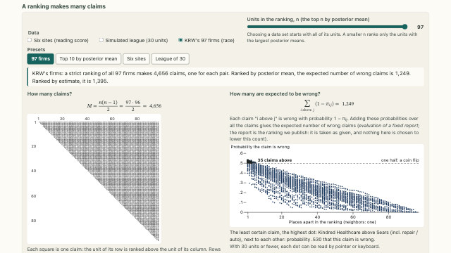</a>
<div class="prx-card-body">
<p class="prx-catalog-topics"><span>Pairwise comparisons</span> <span>Choosing and evaluating reports</span></p><p class="prx-catalog-data">Generated examples · Fictional six/thirty sites · KRW firms · California schools</p><p class="prx-card-id">1.16</p>
<h3><a href="pages/uncertainty/ranking-claims.html">Expected errors in a strict ranking</a></h3>
<p>Add the posterior error probabilities for all pairwise directions in a strict ranking to find its expected wrong count.</p>
<p class="prx-card-credit">Data: Kline, Rose and Walters (2024) · CC-BY-NC · California Department of Education, 2026 California School Dashboard chronic absenteeism data, academic year 2025–26 · No CDE endorsement is implied</p>
<p class="prx-card-links"><a href="embed/ranking-claims.html">standalone</a></p>
</div>
</article>
<article data-part="1" data-topics="computation pairs" data-data="generated sites" data-search="1.17 Monte Carlo error in pairwise probabilities With a finite set of posterior draws, sampling error can change the report chosen near a decision boundary. Probabilities from draws carry noise An error probability estimated from posterior draws has Monte Carlo error; pairs near τ can flip between runs, but the report need not change with them. Computation and draws Pairwise comparisons Generated examples Fictional six/thirty sites S 1,000 All reports S 100 S 4,000 C–D at τ .35 Both scores" class="prx-card prx-card-built">
<a class="prx-card-thumb" href="pages/uncertainty/mc-error.html" tabindex="-1" aria-hidden="true">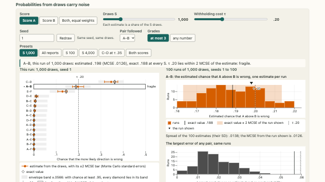</a>
<div class="prx-card-body">
<p class="prx-catalog-topics"><span>Computation and draws</span> <span>Pairwise comparisons</span></p><p class="prx-catalog-data">Generated examples · Fictional six/thirty sites</p><p class="prx-card-id">1.17</p>
<h3><a href="pages/uncertainty/mc-error.html">Monte Carlo error in pairwise probabilities</a></h3>
<p>With a finite set of posterior draws, sampling error can change the report chosen near a decision boundary.</p>
<p class="prx-card-links"><a href="embed/mc-error.html">standalone</a></p>
</div>
</article>
<article data-part="1" data-topics="computation evidence" data-data="generated" data-search="1.18 Monte Carlo error with dependent draws Draws from a stationary two-state Markov chain show how dependence affects estimates of a direction probability. Draws that remember Successive MCMC draws are usually positively correlated, so a pair probability estimated from them carries more Monte Carlo error than the iid formula says, and an iid error bound can fail far more often than its α. Computation and draws Evidence and uncertainty Generated examples Stay .99 Stay .99, chain-aware A stuck chain Stay .50 1,000 draws postrank's chains" class="prx-card prx-card-built">
<a class="prx-card-thumb" href="pages/uncertainty/chain-draws.html" tabindex="-1" aria-hidden="true">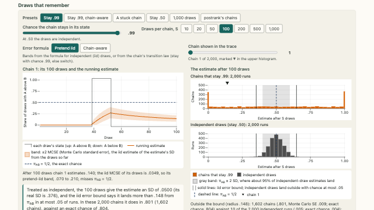</a>
<div class="prx-card-body">
<p class="prx-catalog-topics"><span>Computation and draws</span> <span>Evidence and uncertainty</span></p><p class="prx-catalog-data">Generated examples</p><p class="prx-card-id">1.18</p>
<h3><a href="pages/uncertainty/chain-draws.html">Monte Carlo error with dependent draws</a></h3>
<p>Draws from a stationary two-state Markov chain show how dependence affects estimates of a direction probability.</p>
<p class="prx-card-links"><a href="embed/chain-draws.html">standalone</a></p>
</div>
</article>
<article data-part="2" data-topics="pairs loss" data-data="generated" data-search="2.1 The decision for an isolated pair The cheapest action for a single pair depends on its posterior direction probabilities and the cost of withholding. One pair: state or withhold For a pair on its own, state a direction only when its chance of being wrong is below the withholding cost τ. Pairwise comparisons Loss and disclosure Generated examples π .85, τ .10 π .85, τ .20 π .80, τ .20 π .50, τ .50" class="prx-card prx-card-built">
<a class="prx-card-thumb" href="pages/grades/one-pair.html" tabindex="-1" aria-hidden="true">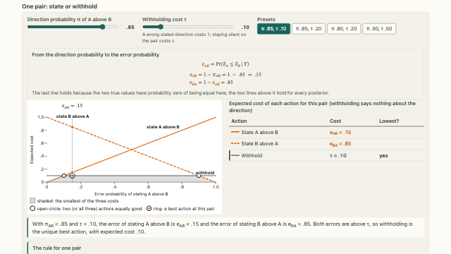</a>
<div class="prx-card-body">
<p class="prx-catalog-topics"><span>Pairwise comparisons</span> <span>Loss and disclosure</span></p><p class="prx-catalog-data">Generated examples</p><p class="prx-card-id">2.1</p>
<h3><a href="pages/grades/one-pair.html">The decision for an isolated pair</a></h3>
<p>The cheapest action for a single pair depends on its posterior direction probabilities and the cost of withholding.</p>
<p class="prx-card-links"><a href="embed/one-pair.html">standalone</a></p>
</div>
</article>
<article data-part="2" data-topics="grades pairs" data-data="sites" data-search="2.2 Grade reports as pairwise decisions Assign units to ordered grades to see which pairwise directions the report states and which it leaves open. A report is many pair decisions Moving units between grade boxes states every pair across grades and withholds every pair inside a grade. Coherent grades and families Pairwise comparisons Fictional six/thirty sites A, then B to E, then F Three grades of two sites Four sites: 1/2/2/2 Beyond letter order" class="prx-card prx-card-built">
<a class="prx-card-thumb" href="pages/grades/report-builder.html" tabindex="-1" aria-hidden="true">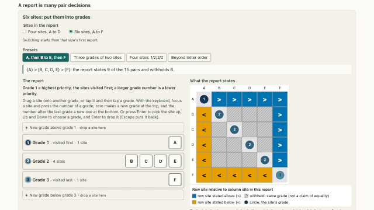</a>
<div class="prx-card-body">
<p class="prx-catalog-topics"><span>Coherent grades and families</span> <span>Pairwise comparisons</span></p><p class="prx-catalog-data">Fictional six/thirty sites</p><p class="prx-card-id">2.2</p>
<h3><a href="pages/grades/report-builder.html">Grade reports as pairwise decisions</a></h3>
<p>Assign units to ordered grades to see which pairwise directions the report states and which it leaves open.</p>
<p class="prx-card-links"><a href="embed/report-builder.html">standalone</a></p>
</div>
</article>
<article data-part="2" data-topics="grades computation" data-data="generated" data-search="2.3 The number of ordered grade reports Count the possible reports and see how a grade cap or a fixed order reduces the number of candidates. How many grade reports are there? Grade reports far outnumber strict rankings (13 for three units, 4,683 for six, 545,835 for eight), while a cap or a fixed order leaves far fewer (for eight units, 6,051 with at most three grades, 128 along one order). Coherent grades and families Computation and draws Generated examples Three units Six units Eight units Twelve units An empty exact family" class="prx-card prx-card-built">
<a class="prx-card-thumb" href="pages/grades/how-many-reports.html" tabindex="-1" aria-hidden="true">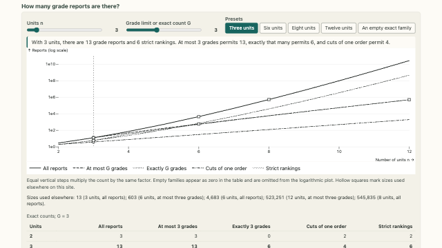</a>
<div class="prx-card-body">
<p class="prx-catalog-topics"><span>Coherent grades and families</span> <span>Computation and draws</span></p><p class="prx-catalog-data">Generated examples</p><p class="prx-card-id">2.3</p>
<h3><a href="pages/grades/how-many-reports.html">The number of ordered grade reports</a></h3>
<p>Count the possible reports and see how a grade cap or a fixed order reduces the number of candidates.</p>
<p class="prx-card-links"><a href="embed/how-many-reports.html">standalone</a></p>
</div>
</article>
<article data-part="2" data-topics="loss grades" data-data="sites" data-search="2.4 Reporting risk and withholding cost Reporting risk adds expected wrong directions to the cost of leaving comparisons unstated. The price of silence With a price τ on silence, risk is E/M + τ(M − N)/M, and the best report moves with τ; your own report can be scored beside it. Loss and disclosure Coherent grades and families Fictional six/thirty sites τ .20, at most 3 grades τ .20, no cap τ .40, no cap τ .30, no cap" class="prx-card prx-card-built">
<a class="prx-card-thumb" href="pages/grades/price-of-silence.html" tabindex="-1" aria-hidden="true">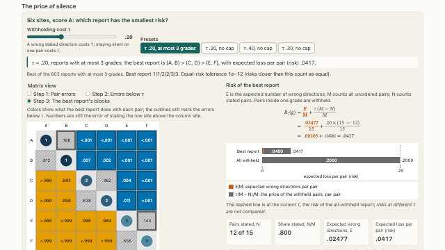</a>
<div class="prx-card-body">
<p class="prx-catalog-topics"><span>Loss and disclosure</span> <span>Coherent grades and families</span></p><p class="prx-catalog-data">Fictional six/thirty sites</p><p class="prx-card-id">2.4</p>
<h3><a href="pages/grades/price-of-silence.html">Reporting risk and withholding cost</a></h3>
<p>Reporting risk adds expected wrong directions to the cost of leaving comparisons unstated.</p>
<p class="prx-card-links"><a href="embed/price-of-silence.html">standalone</a></p>
</div>
</article>
<article data-part="2" data-topics="loss grades" data-data="sites" data-search="2.5 Optimal reports along the withholding-cost path A report’s risk is a line in the withholding cost. The optimal report changes where the lowest line switches. The best report along τ Each report's risk is a straight line in τ; where the lower envelope bends, the best report changes. Loss and disclosure Coherent grades and families Fictional six/thirty sites Overview Before the first bend Small cost, coherent report Exactly at a bend Three-grade cap" class="prx-card prx-card-built">
<a class="prx-card-thumb" href="pages/grades/tau-path.html" tabindex="-1" aria-hidden="true">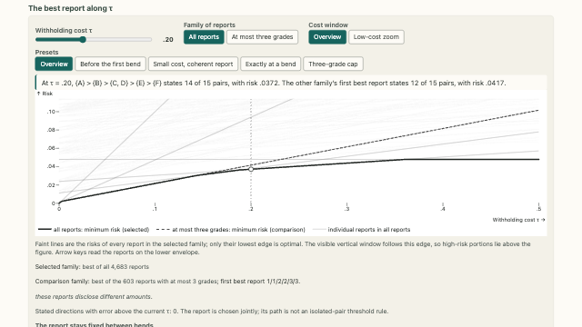</a>
<div class="prx-card-body">
<p class="prx-catalog-topics"><span>Loss and disclosure</span> <span>Coherent grades and families</span></p><p class="prx-catalog-data">Fictional six/thirty sites</p><p class="prx-card-id">2.5</p>
<h3><a href="pages/grades/tau-path.html">Optimal reports along the withholding-cost path</a></h3>
<p>A report’s risk is a line in the withholding cost. The optimal report changes where the lowest line switches.</p>
<p class="prx-card-links"><a href="embed/tau-path.html">standalone</a></p>
</div>
</article>
<article data-part="2" data-topics="grades pairs" data-data="generated" data-search="2.6 Coherence constraints on pairwise decisions Decisions made one pair at a time can conflict with the ordering required by a grade report. Why a report must be coherent Choices made pair by pair can be impossible to print as a grade report, and the best printable report then costs more. Coherent grades and families Pairwise comparisons Generated examples Middle at 1.00 Middle at .50 Middle at .80 Middle at 1.00, τ .10 Middle at 1.00, τ .25" class="prx-card prx-card-built">
<a class="prx-card-thumb" href="pages/grades/coherence.html" tabindex="-1" aria-hidden="true">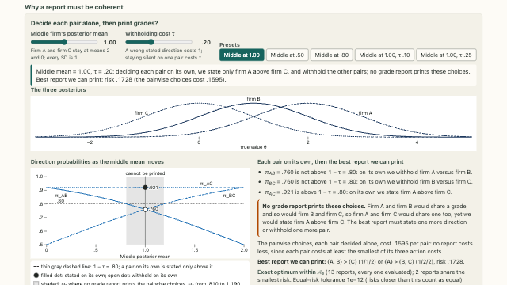</a>
<div class="prx-card-body">
<p class="prx-catalog-topics"><span>Coherent grades and families</span> <span>Pairwise comparisons</span></p><p class="prx-catalog-data">Generated examples</p><p class="prx-card-id">2.6</p>
<h3><a href="pages/grades/coherence.html">Coherence constraints on pairwise decisions</a></h3>
<p>Decisions made one pair at a time can conflict with the ordering required by a grade report.</p>
<p class="prx-card-links"><a href="embed/coherence.html">standalone</a></p>
</div>
</article>
<article data-part="2" data-topics="grades computation" data-data="generated" data-search="2.7 Coherence in a finite three-unit example Evaluate all 13 reports for three units under the same four-state posterior. Thirteen reports for three units Under one finite three-unit law, for τ between 1/10 and 1/4 no report prints the pairwise choices; all 13 reports show what the best printable one costs (11/60 against 1/6 at τ = 1/5). Coherent grades and families Computation and draws Generated examples τ .20 τ .10 τ .25 τ .30" class="prx-card prx-card-built">
<a class="prx-card-thumb" href="pages/grades/coherence-finite.html" tabindex="-1" aria-hidden="true">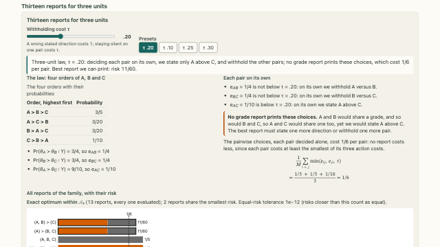</a>
<div class="prx-card-body">
<p class="prx-catalog-topics"><span>Coherent grades and families</span> <span>Computation and draws</span></p><p class="prx-catalog-data">Generated examples</p><p class="prx-card-id">2.7</p>
<h3><a href="pages/grades/coherence-finite.html">Coherence in a finite three-unit example</a></h3>
<p>Evaluate all 13 reports for three units under the same four-state posterior.</p>
<p class="prx-card-links"><a href="embed/coherence-finite.html">standalone</a></p>
</div>
</article>
<article data-part="2" data-topics="loss evaluation" data-data="generated sites" data-search="2.8 Expected and realized errors among stated directions Compare the expected wrong share, the wrong count in a posterior state, and the probability that every stated direction is correct. How often are stated directions wrong? E/N is the share of stated directions expected to be wrong, and for the exact best report of a family that can withhold every pair it is at most τ; draws of the true values make it concrete. The chance that every stated direction is right depends on the joint law, beyond these pairwise errors. Loss and disclosure Choosing and evaluating reports Generated examples Fictional six/thirty sites Start without draws Best report, draws All withheld Three-unit law Another coupling" class="prx-card prx-card-built">
<a class="prx-card-thumb" href="pages/grades/disclosed-errors.html" tabindex="-1" aria-hidden="true">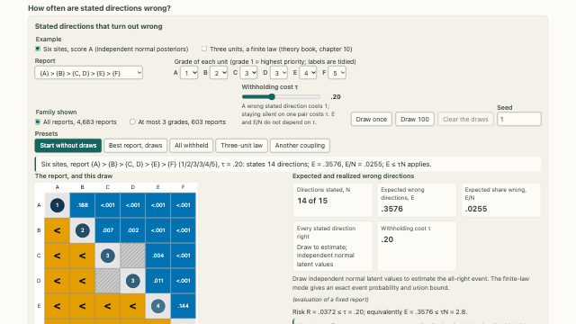</a>
<div class="prx-card-body">
<p class="prx-catalog-topics"><span>Loss and disclosure</span> <span>Choosing and evaluating reports</span></p><p class="prx-catalog-data">Generated examples · Fictional six/thirty sites</p><p class="prx-card-id">2.8</p>
<h3><a href="pages/grades/disclosed-errors.html">Expected and realized errors among stated directions</a></h3>
<p>Compare the expected wrong share, the wrong count in a posterior state, and the probability that every stated direction is correct.</p>
<p class="prx-card-links"><a href="embed/disclosed-errors.html">standalone</a></p>
</div>
</article>
<article data-part="2" data-topics="evaluation joint" data-data="generated" data-search="2.9 Reported error and reference-law evaluation Compare what the posterior predicts about errors with the errors observed when the true values are held fixed. Reported and realized error For a fixed report, its claimed wrong share and its expectation under an explicit reference law differ by at most the largest pair-error probability gap; a single fixed-truth realization can lie on either side. Choosing and evaluating reports Joint and composite claims Generated examples Same conditional laws Narrow prior, five grades Lower cost, two grades One grade, no disclosure" class="prx-card prx-card-built">
<a class="prx-card-thumb" href="pages/grades/reported-and-realized.html" tabindex="-1" aria-hidden="true">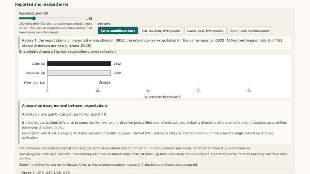</a>
<div class="prx-card-body">
<p class="prx-catalog-topics"><span>Choosing and evaluating reports</span> <span>Joint and composite claims</span></p><p class="prx-catalog-data">Generated examples</p><p class="prx-card-id">2.9</p>
<h3><a href="pages/grades/reported-and-realized.html">Reported error and reference-law evaluation</a></h3>
<p>Compare what the posterior predicts about errors with the errors observed when the true values are held fixed.</p>
<p class="prx-card-links"><a href="embed/reported-and-realized.html">standalone</a></p>
</div>
</article>
<article data-part="2" data-topics="loss evaluation" data-data="sites" data-search="2.10 The error–disclosure frontier The lower convex boundary shows the smallest expected wrong count attainable at each mean number of stated pairs. The frontier Every report as a point (N, E): the lower hull is the frontier, and τ is the slope of a line that touches it. Loss and disclosure Choosing and evaluating reports Fictional six/thirty sites τ .20, all reports τ .15, all reports τ .40, all reports τ .20, at most 3 grades" class="prx-card prx-card-built">
<a class="prx-card-thumb" href="pages/grades/frontier.html" tabindex="-1" aria-hidden="true">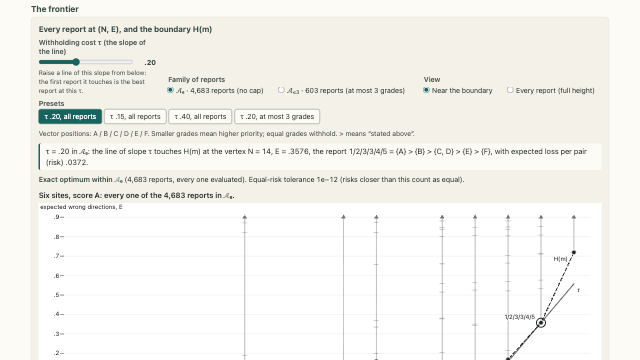</a>
<div class="prx-card-body">
<p class="prx-catalog-topics"><span>Loss and disclosure</span> <span>Choosing and evaluating reports</span></p><p class="prx-catalog-data">Fictional six/thirty sites</p><p class="prx-card-id">2.10</p>
<h3><a href="pages/grades/frontier.html">The error–disclosure frontier</a></h3>
<p>The lower convex boundary shows the smallest expected wrong count attainable at each mean number of stated pairs.</p>
<p class="prx-card-links"><a href="embed/frontier.html">standalone</a></p>
</div>
</article>
<article data-part="2" data-topics="loss joint" data-data="generated sites" data-search="2.11 Mixtures of frontier reports Choose between two complete reports at random to reach an intermediate expected number of stated pairs. Mixtures between frontier corners Between two vertices the frontier is a mixture of two complete reports (on the six sites no report lies there); with all reports and no latent ties it ends at a strict ranking, on a line of slope 1/2. Loss and disclosure Joint and composite claims Generated examples Fictional six/thirty sites Six sites, mean 10 Six sites, mean 9 Six sites, mean 12 Four units, mean 4 At most 3 grades, mean 9" class="prx-card prx-card-built">
<a class="prx-card-thumb" href="pages/grades/frontier-mixtures.html" tabindex="-1" aria-hidden="true">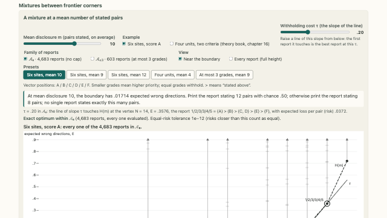</a>
<div class="prx-card-body">
<p class="prx-catalog-topics"><span>Loss and disclosure</span> <span>Joint and composite claims</span></p><p class="prx-catalog-data">Generated examples · Fictional six/thirty sites</p><p class="prx-card-id">2.11</p>
<h3><a href="pages/grades/frontier-mixtures.html">Mixtures of frontier reports</a></h3>
<p>Choose between two complete reports at random to reach an intermediate expected number of stated pairs.</p>
<p class="prx-card-links"><a href="embed/frontier-mixtures.html">standalone</a></p>
</div>
</article>
<article data-part="2" data-topics="grades computation" data-data="generated sites" data-search="2.12 Restrictions on the report family Grade caps, exact grade counts, and fixed orders restrict the search in different ways. The minimum risk depends on the family. Families of reports An optimum is always the best within a stated family of reports: all reports, at most G grades, exactly G grades, or cuts of one order. Coherent grades and families Computation and draws Generated examples Fictional six/thirty sites Exactly six At most three B before A Two criteria A dominating set" class="prx-card prx-card-built">
<a class="prx-card-thumb" href="pages/grades/families.html" tabindex="-1" aria-hidden="true">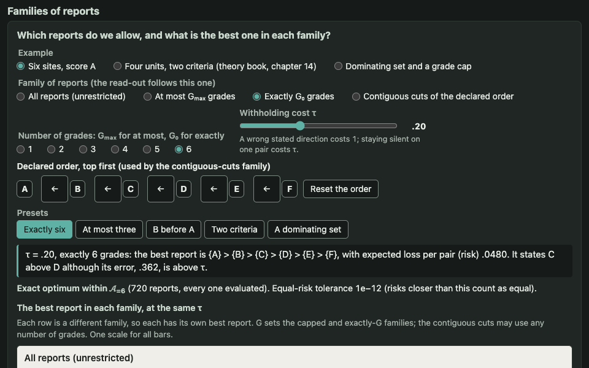</a>
<div class="prx-card-body">
<p class="prx-catalog-topics"><span>Coherent grades and families</span> <span>Computation and draws</span></p><p class="prx-catalog-data">Generated examples · Fictional six/thirty sites</p><p class="prx-card-id">2.12</p>
<h3><a href="pages/grades/families.html">Restrictions on the report family</a></h3>
<p>Grade caps, exact grade counts, and fixed orders restrict the search in different ways. The minimum risk depends on the family.</p>
<p class="prx-card-links"><a href="embed/families.html">standalone</a></p>
</div>
</article>
<article data-part="2" data-topics="grades evidence" data-data="sites" data-search="2.13 Posterior summaries in a grade report The card shows each unit’s posterior interval and the expected error of comparisons between grades. Reading a report card A report card shows the grades, each unit's posterior interval and the expected share of directions between two grades that are wrong. Coherent grades and families Evidence and uncertainty Fictional six/thirty sites Six sites Reveal by grade Thirty sites" class="prx-card prx-card-built">
<a class="prx-card-thumb" href="pages/grades/report-card.html" tabindex="-1" aria-hidden="true">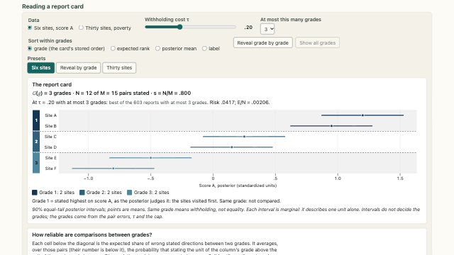</a>
<div class="prx-card-body">
<p class="prx-catalog-topics"><span>Coherent grades and families</span> <span>Evidence and uncertainty</span></p><p class="prx-catalog-data">Fictional six/thirty sites</p><p class="prx-card-id">2.13</p>
<h3><a href="pages/grades/report-card.html">Posterior summaries in a grade report</a></h3>
<p>The card shows each unit’s posterior interval and the expected error of comparisons between grades.</p>
<p class="prx-card-links"><a href="embed/report-card.html">standalone</a></p>
</div>
</article>
<article data-part="2" data-topics="loss evaluation" data-data="sites krw" data-search="2.14 Error rates under two denominators The same expected wrong count can be expressed per possible pair or per stated pair. The two rates answer different questions. Wrong among stated, wrong among all KRW's DR divides expected wrong directions by all pairs and E/N by the stated pairs, so a card that states few pairs can show a small DR beside a large E/N: DR = (N/M) × E/N. Loss and disclosure Choosing and evaluating reports Fictional six/thirty sites KRW firms τ .25 KRW setting All pairs stated" class="prx-card prx-card-built">
<a class="prx-card-thumb" href="pages/grades/two-denominators.html" tabindex="-1" aria-hidden="true">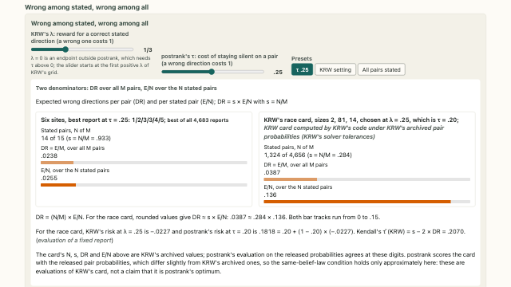</a>
<div class="prx-card-body">
<p class="prx-catalog-topics"><span>Loss and disclosure</span> <span>Choosing and evaluating reports</span></p><p class="prx-catalog-data">Fictional six/thirty sites · KRW firms</p><p class="prx-card-id">2.14</p>
<h3><a href="pages/grades/two-denominators.html">Error rates under two denominators</a></h3>
<p>The same expected wrong count can be expressed per possible pair or per stated pair. The two rates answer different questions.</p>
<p class="prx-card-credit">Data: Kline, Rose and Walters (2024) · CC-BY-NC</p>
<p class="prx-card-links"><a href="embed/two-denominators.html">standalone</a></p>
</div>
</article>
<article data-part="2" data-topics="pairs grades" data-data="generated" data-search="2.15 Posterior equality and withholding Positive probability of equality changes the cost of making a strict statement. The preferred action depends on how equality is scored. When true values can be equal When true values can be exactly equal, a shared grade still claims no equality, and postrank's equality-neutral risk prices stated and withheld pairs differently from the weak loss. Pairwise comparisons Coherent grades and families Generated examples Equality .40, weak loss Equality .40, neutral loss No equality Equality .90 Certain equality" class="prx-card prx-card-built">
<a class="prx-card-thumb" href="pages/grades/ties-and-withholding.html" tabindex="-1" aria-hidden="true">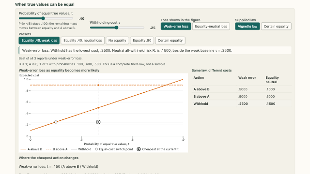</a>
<div class="prx-card-body">
<p class="prx-catalog-topics"><span>Pairwise comparisons</span> <span>Coherent grades and families</span></p><p class="prx-catalog-data">Generated examples</p><p class="prx-card-id">2.15</p>
<h3><a href="pages/grades/ties-and-withholding.html">Posterior equality and withholding</a></h3>
<p>Positive probability of equality changes the cost of making a strict statement. The preferred action depends on how equality is scored.</p>
<p class="prx-card-links"><a href="embed/ties-and-withholding.html">standalone</a></p>
</div>
</article>
<article data-part="2" data-topics="computation grades" data-data="generated sites" data-search="2.16 Computation of optimal grade reports Enumeration, cuts of a fixed order, and a joint search give different kinds of answers about which report is best. How the best report is found This browser searches small families report by report, dynamic programming cuts one declared order exactly, and postrank's solver takes the joint problem and reports its status, bound and gap. Computation and draws Coherent grades and families Generated examples Fictional six/thirty sites DP: six sites, τ .20 DP: inspect one cell Twelve units A broken binary pattern Joint search: twenty units Joint: six units" class="prx-card prx-card-built">
<a class="prx-card-thumb" href="pages/grades/computing-grades.html" tabindex="-1" aria-hidden="true">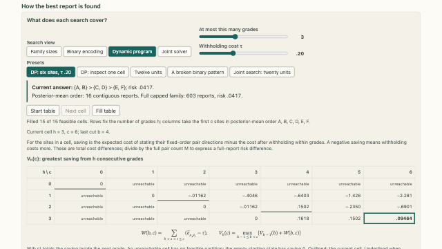</a>
<div class="prx-card-body">
<p class="prx-catalog-topics"><span>Computation and draws</span> <span>Coherent grades and families</span></p><p class="prx-catalog-data">Generated examples · Fictional six/thirty sites</p><p class="prx-card-id">2.16</p>
<h3><a href="pages/grades/computing-grades.html">Computation of optimal grade reports</a></h3>
<p>Enumeration, cuts of a fixed order, and a joint search give different kinds of answers about which report is best.</p>
<p class="prx-card-links"><a href="embed/computing-grades.html">standalone</a></p>
</div>
</article>
<article data-part="2" data-topics="evaluation loss" data-data="generated sites" data-search="2.17 Evaluation under an alternative posterior law Evaluate the same report under two posterior laws to see how its risk and regret change. Judging a report under another law A report chosen under one posterior and judged under another can have a different risk; within the same family its regret is at most twice the largest weighted gap between the two laws' pair error probabilities, plus the optimizer's gap. Choosing and evaluating reports Loss and disclosure Generated examples Fictional six/thirty sites Same laws Move C upward Wider evaluation law C +.40, no cap Small change, new report" class="prx-card prx-card-built">
<a class="prx-card-thumb" href="pages/grades/another-law.html" tabindex="-1" aria-hidden="true">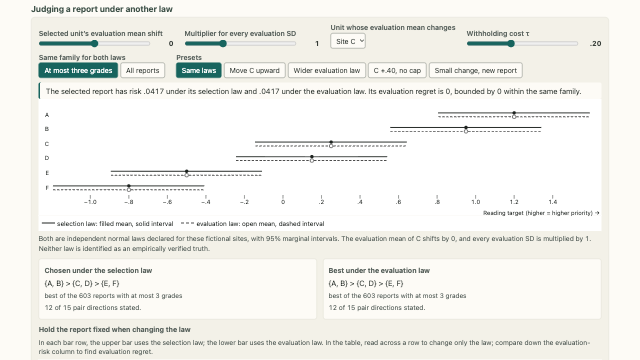</a>
<div class="prx-card-body">
<p class="prx-catalog-topics"><span>Choosing and evaluating reports</span> <span>Loss and disclosure</span></p><p class="prx-catalog-data">Generated examples · Fictional six/thirty sites</p><p class="prx-card-id">2.17</p>
<h3><a href="pages/grades/another-law.html">Evaluation under an alternative posterior law</a></h3>
<p>Evaluate the same report under two posterior laws to see how its risk and regret change.</p>
<p class="prx-card-links"><a href="embed/another-law.html">standalone</a></p>
</div>
</article>
<article data-part="2" data-topics="evaluation computation" data-data="generated sites" data-search="2.18 Selection and evaluation using posterior draws A report can look better on the draws that selected it than when evaluated under the exact posterior law. Scored on the draws that chose it A report chosen on posterior draws can look better or worse on them than under the exact law, though better on average; the gap is at most N/M times the draws' largest pair-probability error, which shrinks as draws grow. Choosing and evaluating reports Computation and draws Generated examples Fictional six/thirty sites Own draws Looks worse More draws Tighter family Both scores" class="prx-card prx-card-built">
<a class="prx-card-thumb" href="pages/grades/chosen-and-judged.html" tabindex="-1" aria-hidden="true">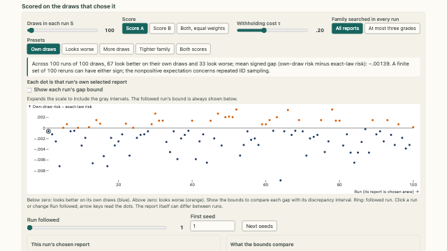</a>
<div class="prx-card-body">
<p class="prx-catalog-topics"><span>Choosing and evaluating reports</span> <span>Computation and draws</span></p><p class="prx-catalog-data">Generated examples · Fictional six/thirty sites</p><p class="prx-card-id">2.18</p>
<h3><a href="pages/grades/chosen-and-judged.html">Selection and evaluation using posterior draws</a></h3>
<p>A report can look better on the draws that selected it than when evaluated under the exact posterior law.</p>
<p class="prx-card-links"><a href="embed/chosen-and-judged.html">standalone</a></p>
</div>
</article>
<article data-part="2" data-topics="evaluation joint" data-data="generated" data-search="2.19 Averaging error shares across reports When reports state different numbers of pairs, pooling their errors and averaging their error shares can give different answers. Three ways to average a wrong share Over datasets, or outcomes of a randomized report, the wrong share of stated directions has three averages that generally differ: a ratio of expected counts, a mean over datasets that state something, and a mean counting silent ones as zero. Choosing and evaluating reports Joint and composite claims Generated examples Three outcomes More weight on errors A complete-report lottery All silent Twenty datasets" class="prx-card prx-card-built">
<a class="prx-card-thumb" href="pages/grades/averaging-errors.html" tabindex="-1" aria-hidden="true">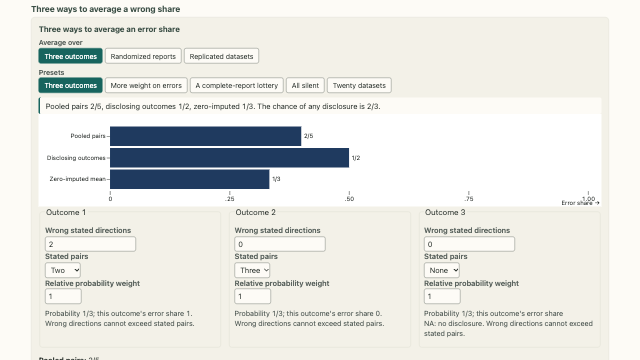</a>
<div class="prx-card-body">
<p class="prx-catalog-topics"><span>Choosing and evaluating reports</span> <span>Joint and composite claims</span></p><p class="prx-catalog-data">Generated examples</p><p class="prx-card-id">2.19</p>
<h3><a href="pages/grades/averaging-errors.html">Averaging error shares across reports</a></h3>
<p>When reports state different numbers of pairs, pooling their errors and averaging their error shares can give different answers.</p>
<p class="prx-card-links"><a href="embed/averaging-errors.html">standalone</a></p>
</div>
</article>
<article data-part="2" data-topics="pairs grades" data-data="generated sites" data-search="2.20 Sensitivity to corrections and unit removal Compare which pairwise statements change after revising one unit’s marginal distribution or removing a unit. One correction moves other grades Grades are chosen together, so correcting one unit's input, or dropping a unit, can change the relation between two other units. Pairwise comparisons Coherent grades and families Generated examples Fictional six/thirty sites Correct a mean No correction More uncertainty Drop a unit Drop U15 from the league Two scores, drop C" class="prx-card prx-card-built">
<a class="prx-card-thumb" href="pages/grades/one-correction.html" tabindex="-1" aria-hidden="true">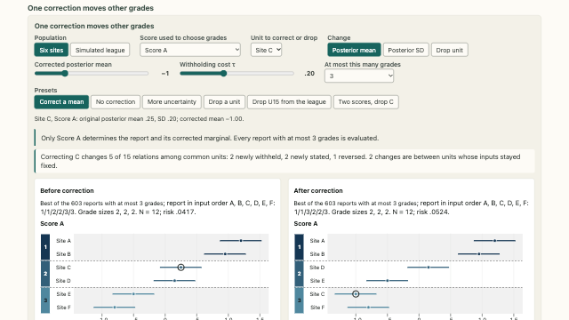</a>
<div class="prx-card-body">
<p class="prx-catalog-topics"><span>Pairwise comparisons</span> <span>Coherent grades and families</span></p><p class="prx-catalog-data">Generated examples · Fictional six/thirty sites</p><p class="prx-card-id">2.20</p>
<h3><a href="pages/grades/one-correction.html">Sensitivity to corrections and unit removal</a></h3>
<p>Compare which pairwise statements change after revising one unit’s marginal distribution or removing a unit.</p>
<p class="prx-card-links"><a href="embed/one-correction.html">standalone</a></p>
</div>
</article>
<article data-part="3" data-topics="rules grades" data-data="generated" data-search="3.1 Fixed quantile tiers Group the estimates by quantiles, then use the posterior to count the expected mistakes in the resulting report. Fixed tiers A quantile-tier rule is a grade report chosen without the posterior, and the posterior still says how many of its stated directions to expect wrong. Common rules Coherent grades and families Generated examples Three tiers Ten tiers, marks on Four tiers Two tiers Thirty tiers" class="prx-card prx-card-built">
<a class="prx-card-thumb" href="pages/rules/fixed-tiers.html" tabindex="-1" aria-hidden="true">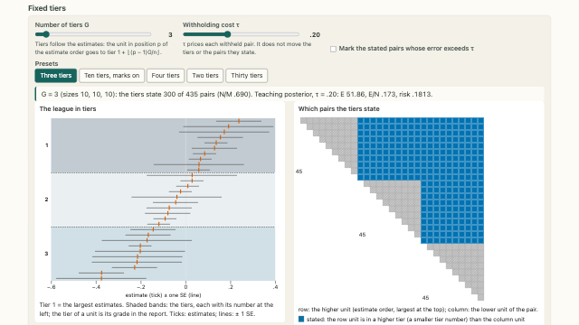</a>
<div class="prx-card-body">
<p class="prx-catalog-topics"><span>Common rules</span> <span>Coherent grades and families</span></p><p class="prx-catalog-data">Generated examples</p><p class="prx-card-id">3.1</p>
<h3><a href="pages/rules/fixed-tiers.html">Fixed quantile tiers</a></h3>
<p>Group the estimates by quantiles, then use the posterior to count the expected mistakes in the resulting report.</p>
<p class="prx-card-links"><a href="embed/fixed-tiers.html">standalone</a></p>
</div>
</article>
<article data-part="3" data-topics="rules loss" data-data="generated" data-search="3.2 Disclosure determined by tier sizes The number of stated pairs depends on the sizes of the tiers. Compare counts across all ordered size choices. Tier sizes fix disclosure Tier sizes alone set how many pairs a rule states, whatever the estimates (when no two are equal); for a given number of tiers, balanced sizes state the most. Common rules Loss and disclosure Generated examples Balanced thirty Two tiny tiers Four tiers Balanced twelve Unbalanced twelve" class="prx-card prx-card-built">
<a class="prx-card-thumb" href="pages/rules/tier-sizes.html" tabindex="-1" aria-hidden="true">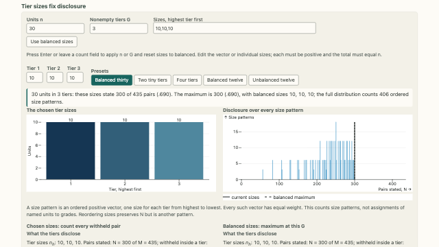</a>
<div class="prx-card-body">
<p class="prx-catalog-topics"><span>Common rules</span> <span>Loss and disclosure</span></p><p class="prx-catalog-data">Generated examples</p><p class="prx-card-id">3.2</p>
<h3><a href="pages/rules/tier-sizes.html">Disclosure determined by tier sizes</a></h3>
<p>The number of stated pairs depends on the sizes of the tiers. Compare counts across all ordered size choices.</p>
<p class="prx-card-links"><a href="embed/tier-sizes.html">standalone</a></p>
</div>
</article>
<article data-part="3" data-topics="rules evidence" data-data="generated" data-search="3.3 Grades based on standardized evidence Turn estimates and standard errors into evidence flags, then examine the pairwise directions the flags imply. Flags from standardized evidence A flag rule on standardized evidence is a report with at most three grades (flagged above, not flagged, flagged below), and precision moves units across the flags. Common rules Evidence and uncertainty Generated examples Two units, flat prior Same flags, teaching prior B’s SE .15 Cutoff 2.576" class="prx-card prx-card-built">
<a class="prx-card-thumb" href="pages/rules/evidence-flags.html" tabindex="-1" aria-hidden="true">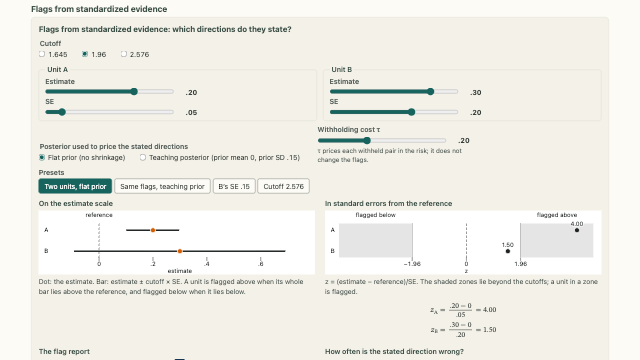</a>
<div class="prx-card-body">
<p class="prx-catalog-topics"><span>Common rules</span> <span>Evidence and uncertainty</span></p><p class="prx-catalog-data">Generated examples</p><p class="prx-card-id">3.3</p>
<h3><a href="pages/rules/evidence-flags.html">Grades based on standardized evidence</a></h3>
<p>Turn estimates and standard errors into evidence flags, then examine the pairwise directions the flags imply.</p>
<p class="prx-card-links"><a href="embed/evidence-flags.html">standalone</a></p>
</div>
</article>
<article data-part="3" data-topics="rules evidence" data-data="generated" data-search="3.4 Standardized-evidence flags in a league Evaluate the directions and posterior risk of a flag report for a simulated league of thirty units. Flags in a league In a league, a flag rule can state directions that run against the order of the estimates. Common rules Evidence and uncertainty Generated examples League, cutoff 1.96 Same flags, flat prior League, cutoff 2.576 Same report, τ .10" class="prx-card prx-card-built">
<a class="prx-card-thumb" href="pages/rules/flags-in-the-league.html" tabindex="-1" aria-hidden="true">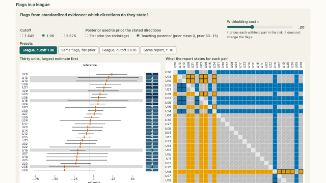</a>
<div class="prx-card-body">
<p class="prx-catalog-topics"><span>Common rules</span> <span>Evidence and uncertainty</span></p><p class="prx-catalog-data">Generated examples</p><p class="prx-card-id">3.4</p>
<h3><a href="pages/rules/flags-in-the-league.html">Standardized-evidence flags in a league</a></h3>
<p>Evaluate the directions and posterior risk of a flag report for a simulated league of thirty units.</p>
<p class="prx-card-links"><a href="embed/flags-in-the-league.html">standalone</a></p>
</div>
</article>
<article data-part="3" data-topics="rules evidence" data-data="generated sites" data-search="3.5 Tiers and optimized cuts of posterior rankings Compare fixed tiers, boundaries chosen along a posterior order, and a search over reports that can change that order. Tiers from posterior summaries At one τ and cap, the risk never rises from posterior-mean tiers to the best cuts of their order to the best report of all, as each family holds the one before; on the eight units the last two coincide. Common rules Evidence and uncertainty Generated examples Fictional six/thirty sites Eight units: optimal cuts League: fixed tiers Thirty sites: rank cuts Eight units: all reports" class="prx-card prx-card-built">
<a class="prx-card-thumb" href="pages/rules/posterior-tiers.html" tabindex="-1" aria-hidden="true">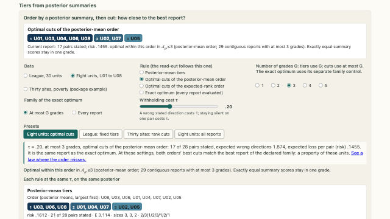</a>
<div class="prx-card-body">
<p class="prx-catalog-topics"><span>Common rules</span> <span>Evidence and uncertainty</span></p><p class="prx-catalog-data">Generated examples · Fictional six/thirty sites</p><p class="prx-card-id">3.5</p>
<h3><a href="pages/rules/posterior-tiers.html">Tiers and optimized cuts of posterior rankings</a></h3>
<p>Compare fixed tiers, boundaries chosen along a posterior order, and a search over reports that can change that order.</p>
<p class="prx-card-links"><a href="embed/posterior-tiers.html">standalone</a></p>
</div>
</article>
<article data-part="3" data-topics="rules computation" data-data="generated" data-search="3.6 Restrictions imposed by a fixed order At some withholding costs in this example, cuts of the posterior-mean order miss the best unrestricted report. When the order misses the best report On a three-unit law, for τ above .15 the best cuts of the posterior-mean order miss the best report of all, which a cut of the expected-rank order attains; one example, not a general failing of posterior means. Common rules Computation and draws Generated examples Mean order: τ .25 Expected ranks: τ .25 Equal risk: τ .30 Mean order: τ .50 Mean order: τ .10" class="prx-card prx-card-built">
<a class="prx-card-thumb" href="pages/rules/order-misses.html" tabindex="-1" aria-hidden="true">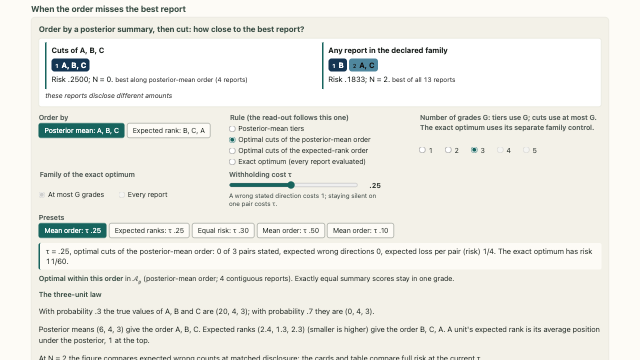</a>
<div class="prx-card-body">
<p class="prx-catalog-topics"><span>Common rules</span> <span>Computation and draws</span></p><p class="prx-catalog-data">Generated examples</p><p class="prx-card-id">3.6</p>
<h3><a href="pages/rules/order-misses.html">Restrictions imposed by a fixed order</a></h3>
<p>At some withholding costs in this example, cuts of the posterior-mean order miss the best unrestricted report.</p>
<p class="prx-card-links"><a href="embed/order-misses.html">standalone</a></p>
</div>
</article>
<article data-part="3" data-topics="rules evaluation" data-data="generated" data-search="3.7 Comparison at matched disclosure For each rule, compare its expected wrong count with the frontier at the same number of stated pairs. Compare rules at the same disclosure A rule is compared with the frontier at its own disclosure, the lowest expected wrong count a report or a mixture of two in the family attains with as many stated pairs, not with the best report at some τ. Common rules Choosing and evaluating reports Generated examples Same N, τ .20 Estimate tiers Flags Posterior-mean cuts Strict order, τ .05 At most three grades Four tiers outside the cap All-withheld" class="prx-card prx-card-built">
<a class="prx-card-thumb" href="pages/rules/rule-comparison.html" tabindex="-1" aria-hidden="true">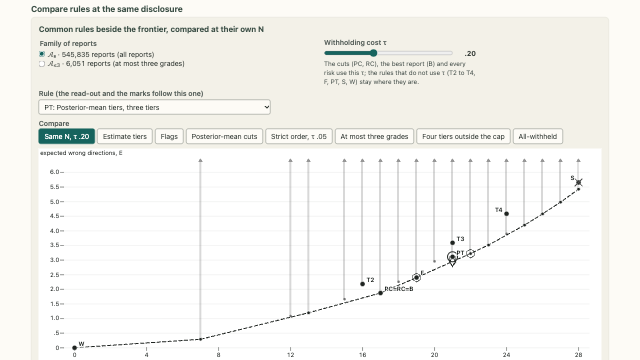</a>
<div class="prx-card-body">
<p class="prx-catalog-topics"><span>Common rules</span> <span>Choosing and evaluating reports</span></p><p class="prx-catalog-data">Generated examples</p><p class="prx-card-id">3.7</p>
<h3><a href="pages/rules/rule-comparison.html">Comparison at matched disclosure</a></h3>
<p>For each rule, compare its expected wrong count with the frontier at the same number of stated pairs.</p>
<p class="prx-card-links"><a href="embed/rule-comparison.html">standalone</a></p>
</div>
</article>
<article data-part="3" data-topics="rules loss" data-data="generated" data-search="3.8 Common withholding cost and matched disclosure A common withholding cost compares risk. A common number of stated pairs compares expected errors at the same disclosure. Same price or same disclosure? At one τ a rule's risk also charges it for the pairs it leaves unsaid; at its own N only its expected wrong directions are set against the frontier. Common rules Loss and disclosure Generated examples Same τ, .20 Same N, eight units Thirty units, one order Thirty units, same τ Strict order, τ .05 At most three grades Flags outside the order All-withheld" class="prx-card prx-card-built">
<a class="prx-card-thumb" href="pages/rules/same-tau-or-same-n.html" tabindex="-1" aria-hidden="true">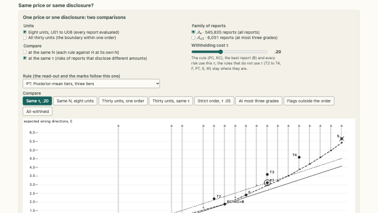</a>
<div class="prx-card-body">
<p class="prx-catalog-topics"><span>Common rules</span> <span>Loss and disclosure</span></p><p class="prx-catalog-data">Generated examples</p><p class="prx-card-id">3.8</p>
<h3><a href="pages/rules/same-tau-or-same-n.html">Common withholding cost and matched disclosure</a></h3>
<p>A common withholding cost compares risk. A common number of stated pairs compares expected errors at the same disclosure.</p>
<p class="prx-card-links"><a href="embed/same-tau-or-same-n.html">standalone</a></p>
</div>
</article>
<article data-part="3" data-topics="rules evaluation" data-data="krw" data-search="3.9 Deciles and quartiles of posterior means Compare deciles and quartiles of posterior means on KRW’s measures of discordance and informativeness. Deciles and quartiles of posterior means Deciles and quartiles of KRW's posterior means sit inside the curve traced by KRW's cards along λ: for each, some card has a lower discordance rate and a higher informativeness. Common rules Choosing and evaluating reports KRW firms Race quartiles, card λ .60 Race deciles, card λ .82 Gender quartiles, card λ .64 Gender deciles, card λ .80" class="prx-card prx-card-built">
<a class="prx-card-thumb" href="pages/rules/deciles-quartiles.html" tabindex="-1" aria-hidden="true">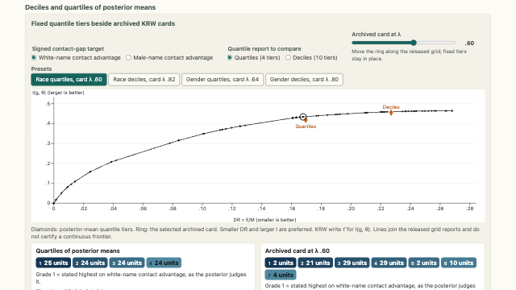</a>
<div class="prx-card-body">
<p class="prx-catalog-topics"><span>Common rules</span> <span>Choosing and evaluating reports</span></p><p class="prx-catalog-data">KRW firms</p><p class="prx-card-id">3.9</p>
<h3><a href="pages/rules/deciles-quartiles.html">Deciles and quartiles of posterior means</a></h3>
<p>Compare deciles and quartiles of posterior means on KRW’s measures of discordance and informativeness.</p>
<p class="prx-card-credit">Data: Kline, Rose and Walters (2024) · CC-BY-NC</p>
<p class="prx-card-links"><a href="embed/deciles-quartiles.html">standalone</a></p>
</div>
</article>
<article data-part="3" data-topics="pairs grades" data-data="krw" data-search="3.10 Coherence of pairwise threshold decisions Pairwise thresholds can produce incompatible triples. KRW’s archived cards show which directions a coherent report states. Pairwise thresholds no report can print Thresholding each pair on its own leaves triples of firms that no grade report can print; the card's grade blocks repair them by withholding some confident pairs and stating some doubtful ones. Pairwise comparisons Coherent grades and families KRW firms Race λ .25 Race λ .10 Race λ .50 Race λ .75 Race λ .25, card blocks Gender λ .25 Gender λ 1.00" class="prx-card prx-card-built">
<a class="prx-card-thumb" href="pages/rules/naive-thresholding.html" tabindex="-1" aria-hidden="true">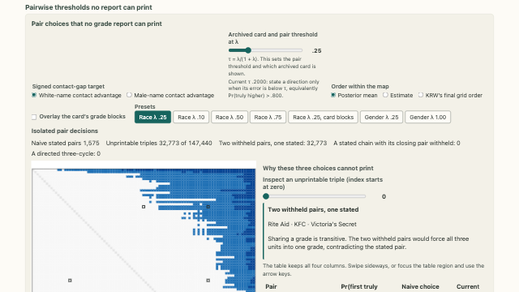</a>
<div class="prx-card-body">
<p class="prx-catalog-topics"><span>Pairwise comparisons</span> <span>Coherent grades and families</span></p><p class="prx-catalog-data">KRW firms</p><p class="prx-card-id">3.10</p>
<h3><a href="pages/rules/naive-thresholding.html">Coherence of pairwise threshold decisions</a></h3>
<p>Pairwise thresholds can produce incompatible triples. KRW’s archived cards show which directions a coherent report states.</p>
<p class="prx-card-credit">Data: Kline, Rose and Walters (2024) · CC-BY-NC</p>
<p class="prx-card-links"><a href="embed/naive-thresholding.html">standalone</a></p>
</div>
</article>
<article data-part="3" data-topics="evaluation joint" data-data="generated sites" data-search="3.11 Expected and state-specific reporting loss A report with smaller posterior expected loss can still have larger loss in an individual posterior draw. Better on average, not in every draw The best report has the smallest expected loss within its family under the law that chose it; in a single draw, a common rule can do better. Choosing and evaluating reports Joint and composite claims Generated examples Fictional six/thirty sites Inside the family Outside the family Two-state law A short run A silent common rule Identical reports" class="prx-card prx-card-built">
<a class="prx-card-thumb" href="pages/rules/better-on-average.html" tabindex="-1" aria-hidden="true">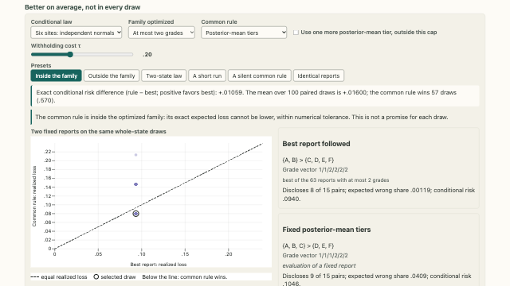</a>
<div class="prx-card-body">
<p class="prx-catalog-topics"><span>Choosing and evaluating reports</span> <span>Joint and composite claims</span></p><p class="prx-catalog-data">Generated examples · Fictional six/thirty sites</p><p class="prx-card-id">3.11</p>
<h3><a href="pages/rules/better-on-average.html">Expected and state-specific reporting loss</a></h3>
<p>A report with smaller posterior expected loss can still have larger loss in an individual posterior draw.</p>
<p class="prx-card-links"><a href="embed/better-on-average.html">standalone</a></p>
</div>
</article>
<article data-part="3" data-topics="rules evidence" data-data="generated" data-search="3.12 Report stability under repeated measurement Repeat measurement at fixed true values to see which directions are newly stated, withheld, or reversed. Measure again, grade again Measuring again and grading again changes some pair relations; stability has to be read beside disclosure, because withholding every pair is perfectly stable. Common rules Evidence and uncertainty Generated examples Optimal cuts Estimate tiers Prior SD .05 Withhold every pair τ .05" class="prx-card prx-card-built">
<a class="prx-card-thumb" href="pages/rules/stability.html" tabindex="-1" aria-hidden="true">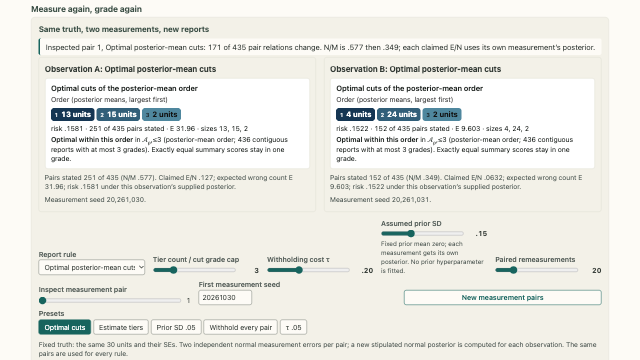</a>
<div class="prx-card-body">
<p class="prx-catalog-topics"><span>Common rules</span> <span>Evidence and uncertainty</span></p><p class="prx-catalog-data">Generated examples</p><p class="prx-card-id">3.12</p>
<h3><a href="pages/rules/stability.html">Report stability under repeated measurement</a></h3>
<p>Repeat measurement at fixed true values to see which directions are newly stated, withheld, or reversed.</p>
<p class="prx-card-links"><a href="embed/stability.html">standalone</a></p>
</div>
</article>
<article data-part="3" data-topics="grades evaluation" data-data="generated" data-search="3.13 Reporting, allocation and classification Reporting a direction, allocating a place, and classifying a unit at a threshold use different decision rules. A grade is not an allocation With a fixed number of places or a fixed threshold, posterior means, the chances of being in the top or above the threshold, and the grades can pick differently; using grades for either needs one more rule. Coherent grades and families Choosing and evaluating reports Generated examples Three units, reporting objective Three units, mean-value order Two units, τ .25 Two units, τ .40 Equal classification costs False-negative cost 3 Threshold 4 Equal reporting risk, different classifications League, five places League, top-set order" class="prx-card prx-card-built">
<a class="prx-card-thumb" href="pages/rules/one-place.html" tabindex="-1" aria-hidden="true"></a>
<div class="prx-card-body">
<p class="prx-catalog-topics"><span>Coherent grades and families</span> <span>Choosing and evaluating reports</span></p><p class="prx-catalog-data">Generated examples</p><p class="prx-card-id">3.13</p>
<h3><a href="pages/rules/one-place.html">Reporting, allocation and classification</a></h3>
<p>Reporting a direction, allocating a place, and classifying a unit at a threshold use different decision rules.</p>
<p class="prx-card-links"><a href="embed/one-place.html">standalone</a></p>
</div>
</article>
<article data-part="4" data-topics="criteria evidence" data-data="sites" data-search="4.1 Posterior profiles on multiple criteria Compare the same units on two scores. Their posterior order and direction probabilities can differ by score. Units measured on several criteria Units can be ordered differently on different criteria, and each criterion has its own pair probabilities. Several criteria Evidence and uncertainty Fictional six/thirty sites Thirty sites Six sites, B–C Six sites, B–D Reverse score B Wider intervals" class="prx-card prx-card-built">
<a class="prx-card-thumb" href="pages/criteria/several-criteria.html" tabindex="-1" aria-hidden="true"></a>
<div class="prx-card-body">
<p class="prx-catalog-topics"><span>Several criteria</span> <span>Evidence and uncertainty</span></p><p class="prx-catalog-data">Fictional six/thirty sites</p><p class="prx-card-id">4.1</p>
<h3><a href="pages/criteria/several-criteria.html">Posterior profiles on multiple criteria</a></h3>
<p>Compare the same units on two scores. Their posterior order and direction probabilities can differ by score.</p>
<p class="prx-card-links"><a href="embed/several-criteria.html">standalone</a></p>
</div>
</article>
<article data-part="4" data-topics="criteria pairs" data-data="sites" data-search="4.2 Opposing criterion directions When two criteria favor different directions, compare the posterior evidence and the costs of stating either one. Where criteria disagree When criteria disagree about a pair's direction, stating either direction costs something even with no uncertainty, when both sides carry positive weight; on a posterior, uncertainty and conflict mix. Several criteria Pairwise comparisons Fictional six/thirty sites Six sites, B–C Thirty sites Certain opposition Uncertain agreement Zero error weight Three actions share the minimum Certain B–C conflict Latent equality" class="prx-card prx-card-built">
<a class="prx-card-thumb" href="pages/criteria/conflict-pairs.html" tabindex="-1" aria-hidden="true"></a>
<div class="prx-card-body">
<p class="prx-catalog-topics"><span>Several criteria</span> <span>Pairwise comparisons</span></p><p class="prx-catalog-data">Fictional six/thirty sites</p><p class="prx-card-id">4.2</p>
<h3><a href="pages/criteria/conflict-pairs.html">Opposing criterion directions</a></h3>
<p>When two criteria favor different directions, compare the posterior evidence and the costs of stating either one.</p>
<p class="prx-card-links"><a href="embed/conflict-pairs.html">standalone</a></p>
</div>
</article>
<article data-part="4" data-topics="criteria grades" data-data="sites" data-search="4.3 A common grade report for two scores Use one grade column for both scores and see how its expected errors are distributed across the criteria. One grade for two scores One grade report for two scores: the weight decides how much each score's wrong directions count, and so which conflicting pairs are stated. Several criteria Coherent grades and families Fictional six/thirty sites Equal weights No cap A-heavy Score A only w .70 w .50 Score B only" class="prx-card prx-card-built">
<a class="prx-card-thumb" href="pages/criteria/two-scores.html" tabindex="-1" aria-hidden="true"></a>
<div class="prx-card-body">
<p class="prx-catalog-topics"><span>Several criteria</span> <span>Coherent grades and families</span></p><p class="prx-catalog-data">Fictional six/thirty sites</p><p class="prx-card-id">4.3</p>
<h3><a href="pages/criteria/two-scores.html">A common grade report for two scores</a></h3>
<p>Use one grade column for both scores and see how its expected errors are distributed across the criteria.</p>
<p class="prx-card-links"><a href="embed/two-scores.html">standalone</a></p>
</div>
</article>
<article data-part="4" data-topics="criteria loss" data-data="sites" data-search="4.4 Optimal reports along the criterion-weight path As the criterion weights change, a different report can minimize risk. The graph marks the weight ranges for each report. The best report along the weight Moving the weight changes the best report a few times, and each score's error share moves in steps. Several criteria Loss and disclosure Fictional six/thirty sites Equal weights Lower A weight Higher A weight Score B only No cap Higher withholding cost" class="prx-card prx-card-built">
<a class="prx-card-thumb" href="pages/criteria/weight-path.html" tabindex="-1" aria-hidden="true"></a>
<div class="prx-card-body">
<p class="prx-catalog-topics"><span>Several criteria</span> <span>Loss and disclosure</span></p><p class="prx-catalog-data">Fictional six/thirty sites</p><p class="prx-card-id">4.4</p>
<h3><a href="pages/criteria/weight-path.html">Optimal reports along the criterion-weight path</a></h3>
<p>As the criterion weights change, a different report can minimize risk. The graph marks the weight ranges for each report.</p>
<p class="prx-card-links"><a href="embed/weight-path.html">standalone</a></p>
</div>
</article>
<article data-part="4" data-topics="criteria loss" data-data="sites" data-search="4.5 Criterion-specific excess risk of a common report Compare each criterion’s risk under the common grades with its minimum risk in the same report family. What each criterion gives up Under a common report, each criterion's risk is at least as high as under its own best report in the same family; the difference is Δ_k. Several criteria Loss and disclosure Fictional six/thirty sites Equal weights Score A only w .70 w .50 Score B only Thirty sites, higher price Thirty sites, lower price" class="prx-card prx-card-built">
<a class="prx-card-thumb" href="pages/criteria/common-grade-cost.html" tabindex="-1" aria-hidden="true"></a>
<div class="prx-card-body">
<p class="prx-catalog-topics"><span>Several criteria</span> <span>Loss and disclosure</span></p><p class="prx-catalog-data">Fictional six/thirty sites</p><p class="prx-card-id">4.5</p>
<h3><a href="pages/criteria/common-grade-cost.html">Criterion-specific excess risk of a common report</a></h3>
<p>Compare each criterion’s risk under the common grades with its minimum risk in the same report family.</p>
<p class="prx-card-links"><a href="embed/common-grade-cost.html">standalone</a></p>
</div>
</article>
<article data-part="4" data-topics="criteria joint" data-data="generated sites" data-search="4.6 Composite targets and criterion directions A statement about a weighted composite and a statement about the component criteria can favor different reports. Composite or criterion directions? Getting the direction of a weighted composite right and getting each criterion's directions right are different goals and can pick different reports. Several criteria Joint and composite claims Generated examples Fictional six/thirty sites Different targets Rescale the second criterion Change composite coefficients Composite equality Two reports, same disclosure Transform the whole law Independent Normal composite Rescale the Normal composite" class="prx-card prx-card-built">
<a class="prx-card-thumb" href="pages/criteria/composite-or-criterion.html" tabindex="-1" aria-hidden="true"></a>
<div class="prx-card-body">
<p class="prx-catalog-topics"><span>Several criteria</span> <span>Joint and composite claims</span></p><p class="prx-catalog-data">Generated examples · Fictional six/thirty sites</p><p class="prx-card-id">4.6</p>
<h3><a href="pages/criteria/composite-or-criterion.html">Composite targets and criterion directions</a></h3>
<p>A statement about a weighted composite and a statement about the component criteria can favor different reports.</p>
<p class="prx-card-links"><a href="embed/composite-or-criterion.html">standalone</a></p>
</div>
</article>
<article data-part="4" data-topics="criteria loss" data-data="sites" data-search="4.7 Criterion-specific expected-error budgets An error limit on each criterion restricts which grade reports can be selected. A budget for each criterion A budget on each criterion's expected error share removes reports, so the best remaining report has a weighted risk at least as high. Several criteria Loss and disclosure Fictional six/thirty sites Loose budget Tight budget Exactly three Both budgets Zero weight No budget At most .15 At most .10 At most .05" class="prx-card prx-card-built">
<a class="prx-card-thumb" href="pages/criteria/error-budgets.html" tabindex="-1" aria-hidden="true"></a>
<div class="prx-card-body">
<p class="prx-catalog-topics"><span>Several criteria</span> <span>Loss and disclosure</span></p><p class="prx-catalog-data">Fictional six/thirty sites</p><p class="prx-card-id">4.7</p>
<h3><a href="pages/criteria/error-budgets.html">Criterion-specific expected-error budgets</a></h3>
<p>An error limit on each criterion restricts which grade reports can be selected.</p>
<p class="prx-card-links"><a href="embed/error-budgets.html">standalone</a></p>
</div>
</article>
<article data-part="4" data-topics="criteria joint" data-data="sites" data-search="4.8 A random-criterion representation of weighted risk For a fixed report, weighting criterion risks gives the same expected risk as randomly drawing a criterion with those weights. Weights as a randomly chosen criterion Choosing one auxiliary criterion for an entire fixed report reproduces its weighted risk. Opposing criteria can make both strict directions costly, while a coherent report can still state either. Several criteria Joint and composite claims Fictional six/thirty sites Weighted report Certain opposition Three actions tie Two against one The one-third boundary Zero error weight No-cap coherence Score B only" class="prx-card prx-card-built">
<a class="prx-card-thumb" href="pages/criteria/criterion-mixture.html" tabindex="-1" aria-hidden="true"></a>
<div class="prx-card-body">
<p class="prx-catalog-topics"><span>Several criteria</span> <span>Joint and composite claims</span></p><p class="prx-catalog-data">Fictional six/thirty sites</p><p class="prx-card-id">4.8</p>
<h3><a href="pages/criteria/criterion-mixture.html">A random-criterion representation of weighted risk</a></h3>
<p>For a fixed report, weighting criterion risks gives the same expected risk as randomly drawing a criterion with those weights.</p>
<p class="prx-card-links"><a href="embed/criterion-mixture.html">standalone</a></p>
</div>
</article>
<article data-part="4" data-topics="criteria loss" data-data="sites" data-search="4.9 Minimizing the largest criterion risk Compare the report that minimizes weighted risk with the report that minimizes the largest criterion risk. Guarding the worse criterion Instead of the weighted best, one can choose the report that makes the worse criterion's risk smallest. Several criteria Loss and disclosure Fictional six/thirty sites w .90 w .70 w .30 Score B only Book low Book high Book minimax Zero error weight Certain opposition" class="prx-card prx-card-built">
<a class="prx-card-thumb" href="pages/criteria/worst-criterion.html" tabindex="-1" aria-hidden="true"></a>
<div class="prx-card-body">
<p class="prx-catalog-topics"><span>Several criteria</span> <span>Loss and disclosure</span></p><p class="prx-catalog-data">Fictional six/thirty sites</p><p class="prx-card-id">4.9</p>
<h3><a href="pages/criteria/worst-criterion.html">Minimizing the largest criterion risk</a></h3>
<p>Compare the report that minimizes weighted risk with the report that minimizes the largest criterion risk.</p>
<p class="prx-card-links"><a href="embed/worst-criterion.html">standalone</a></p>
</div>
</article>
<article data-part="4" data-topics="criteria computation" data-data="sites" data-search="4.10 Sensitivity to costs, weights and grade restrictions Change withholding costs, weights, and grade restrictions separately to see why the chosen report changes. Choosing τ, the cap and the weights Within one fixed family a larger τ never lowers the exact best report's disclosure. Changing τ or weights changes the loss; changing the cap changes the feasible family. The grid separates these effects. Several criteria Computation and draws Fictional six/thirty sites Equal weights A higher price A still higher price At most two grades Thirty-site archive Tutorial archive" class="prx-card prx-card-built">
<a class="prx-card-thumb" href="pages/criteria/choosing-settings.html" tabindex="-1" aria-hidden="true"></a>
<div class="prx-card-body">
<p class="prx-catalog-topics"><span>Several criteria</span> <span>Computation and draws</span></p><p class="prx-catalog-data">Fictional six/thirty sites</p><p class="prx-card-id">4.10</p>
<h3><a href="pages/criteria/choosing-settings.html">Sensitivity to costs, weights and grade restrictions</a></h3>
<p>Change withholding costs, weights, and grade restrictions separately to see why the chosen report changes.</p>
<p class="prx-card-links"><a href="embed/choosing-settings.html">standalone</a></p>
</div>
</article>
<article data-part="4" data-topics="computation joint" data-data="generated" data-search="4.11 Pairwise errors from joint posterior draws Pairwise errors depend on which unit values occur together in the same posterior draw. From draws to pair errors Each posterior draw is one joint state of every unit on every criterion; counting orders within each criterion gives the pair errors the weighted risk needs, and shuffling one unit's draws keeps its margins but changes them. Computation and draws Joint and composite claims Generated examples Original states Shift one unit Move states together Short prefix Unshifted pair Full cycle" class="prx-card prx-card-built">
<a class="prx-card-thumb" href="pages/criteria/draws-to-errors.html" tabindex="-1" aria-hidden="true"></a>
<div class="prx-card-body">
<p class="prx-catalog-topics"><span>Computation and draws</span> <span>Joint and composite claims</span></p><p class="prx-catalog-data">Generated examples</p><p class="prx-card-id">4.11</p>
<h3><a href="pages/criteria/draws-to-errors.html">Pairwise errors from joint posterior draws</a></h3>
<p>Pairwise errors depend on which unit values occur together in the same posterior draw.</p>
<p class="prx-card-links"><a href="embed/draws-to-errors.html">standalone</a></p>
</div>
</article>
<article data-part="4" data-topics="pairs grades" data-data="generated sites krw cde" data-search="4.12 Reasons for a withheld comparison A pair can share a grade because of its own error probabilities, a conflict between criteria, or restrictions on the full report. Why do these two share a grade? A shared grade can come from an uncertain direction, from criteria that conflict, from coherence with other pairs or from the family's limits, and the grade does not say which. Pairwise comparisons Coherent grades and families Generated examples Fictional six/thirty sites KRW firms California schools Coherence Cap three Certain conflict Uncertainty Fixed order Indivisible block CDE subset KRW fixed order" class="prx-card prx-card-built">
<a class="prx-card-thumb" href="pages/criteria/why-withheld.html" tabindex="-1" aria-hidden="true"></a>
<div class="prx-card-body">
<p class="prx-catalog-topics"><span>Pairwise comparisons</span> <span>Coherent grades and families</span></p><p class="prx-catalog-data">Generated examples · Fictional six/thirty sites · KRW firms · California schools</p><p class="prx-card-id">4.12</p>
<h3><a href="pages/criteria/why-withheld.html">Reasons for a withheld comparison</a></h3>
<p>A pair can share a grade because of its own error probabilities, a conflict between criteria, or restrictions on the full report.</p>
<p class="prx-card-credit">Data: California Department of Education, 2026 California School Dashboard chronic absenteeism data, academic year 2025–26 · No CDE endorsement is implied · Kline, Rose and Walters (2024) · CC-BY-NC</p>
<p class="prx-card-links"><a href="embed/why-withheld.html">standalone</a></p>
</div>
</article>
<article data-part="4" data-topics="joint pairs" data-data="generated" data-search="4.13 Quantities not identified by pairwise probabilities The same pairwise probabilities can accompany different probabilities for a composite direction or for all statements being correct. What pair probabilities leave open Pair probabilities fix the weighted risk but not the chance that a composite direction is right or that every stated direction is right; those need the joint law. Joint and composite claims Pairwise comparisons Generated examples Together Opposite Halfway One zero error weight Select withholding Five statements" class="prx-card prx-card-built">
<a class="prx-card-thumb" href="pages/criteria/pairs-leave-open.html" tabindex="-1" aria-hidden="true"></a>
<div class="prx-card-body">
<p class="prx-catalog-topics"><span>Joint and composite claims</span> <span>Pairwise comparisons</span></p><p class="prx-catalog-data">Generated examples</p><p class="prx-card-id">4.13</p>
<h3><a href="pages/criteria/pairs-leave-open.html">Quantities not identified by pairwise probabilities</a></h3>
<p>The same pairwise probabilities can accompany different probabilities for a composite direction or for all statements being correct.</p>
<p class="prx-card-links"><a href="embed/pairs-leave-open.html">standalone</a></p>
</div>
</article>
<article data-part="4" data-topics="criteria computation" data-data="generated sites" data-search="4.14 Error budgets under estimated pairwise probabilities When a proposed bound on Monte Carlo error holds, it identifies reports that meet an error budget under the exact probabilities. A budget met on estimated probabilities With pair probabilities estimated from draws, a report can meet an error budget on the estimates yet fail it under the exact law; when the draws' error bound holds, inner and outer families bracket the compliant reports. Several criteria Computation and draws Generated examples Fictional six/thirty sites Estimated pass Negative inner Exactly two Radius too small Raw comparisons Fixed-S IID" class="prx-card prx-card-built">
<a class="prx-card-thumb" href="pages/criteria/estimated-budgets.html" tabindex="-1" aria-hidden="true"></a>
<div class="prx-card-body">
<p class="prx-catalog-topics"><span>Several criteria</span> <span>Computation and draws</span></p><p class="prx-catalog-data">Generated examples · Fictional six/thirty sites</p><p class="prx-card-id">4.14</p>
<h3><a href="pages/criteria/estimated-budgets.html">Error budgets under estimated pairwise probabilities</a></h3>
<p>When a proposed bound on Monte Carlo error holds, it identifies reports that meet an error budget under the exact probabilities.</p>
<p class="prx-card-links"><a href="embed/estimated-budgets.html">standalone</a></p>
</div>
</article>
<article data-part="P" data-topics="criteria grades loss" data-data="generated" data-search="P.1 Common or profile? Compare one shared grade column with two domain columns under the same posterior and loss. Common or profile? Common grades or separate priorities. Several criteria Coherent grades and families Loss and disclosure Generated examples Aligned priorities Crossed priorities Lower withholding cost Greater weight on S" class="prx-card prx-card-built">
<a class="prx-card-thumb" href="pages/profiles/profile-common-vs-domain.html" tabindex="-1" aria-hidden="true"></a>
<div class="prx-card-body">
<p class="prx-catalog-topics"><span>Several criteria</span> <span>Coherent grades and families</span> <span>Loss and disclosure</span></p><p class="prx-catalog-data">Generated examples</p><p class="prx-card-id">P.1</p>
<h3><a href="pages/profiles/profile-common-vs-domain.html">Common or profile?</a></h3>
<p>Compare one shared grade column with two domain columns under the same posterior and loss.</p>
<p class="prx-card-links"><a href="embed/profile-common-vs-domain.html">standalone</a></p>
</div>
</article>
<article data-part="P" data-topics="criteria joint computation" data-data="generated" data-search="P.2 Separate or joint? Separate domain choices can minimize additive loss. A joint error limit can make their combination infeasible. Separate or joint? Additive loss. A joint guard can change the choices. Several criteria Joint and composite claims Computation and draws Generated examples Dependent domains, separate choices Different dependence, same minimum Zero loss weight in S Independent domains with a joint guard Joint guard with coincident failures" class="prx-card prx-card-built">
<a class="prx-card-thumb" href="pages/profiles/profile-separability.html" tabindex="-1" aria-hidden="true"></a>
<div class="prx-card-body">
<p class="prx-catalog-topics"><span>Several criteria</span> <span>Joint and composite claims</span> <span>Computation and draws</span></p><p class="prx-catalog-data">Generated examples</p><p class="prx-card-id">P.2</p>
<h3><a href="pages/profiles/profile-separability.html">Separate or joint?</a></h3>
<p>Separate domain choices can minimize additive loss. A joint error limit can make their combination infeasible.</p>
<p class="prx-card-links"><a href="embed/profile-separability.html">standalone</a></p>
</div>
</article>
<article data-part="P" data-topics="criteria joint loss" data-data="generated" data-search="P.3 Error overlap The same domain posteriors can lead to different best profiles when their errors overlap differently. Error overlap Same domain laws. Different decisions. Several criteria Joint and composite claims Loss and disclosure Generated examples Disjoint failures Independent domains At the joint cap Coincident failures" class="prx-card prx-card-built">
<a class="prx-card-thumb" href="pages/profiles/profile-dependence.html" tabindex="-1" aria-hidden="true"></a>
<div class="prx-card-body">
<p class="prx-catalog-topics"><span>Several criteria</span> <span>Joint and composite claims</span> <span>Loss and disclosure</span></p><p class="prx-catalog-data">Generated examples</p><p class="prx-card-id">P.3</p>
<h3><a href="pages/profiles/profile-dependence.html">Error overlap</a></h3>
<p>The same domain posteriors can lead to different best profiles when their errors overlap differently.</p>
<p class="prx-card-links"><a href="embed/profile-dependence.html">standalone</a></p>
</div>
</article>
<article data-part="P" data-topics="criteria joint evaluation" data-data="generated" data-search="P.4 Budget and grades A looser error limit can increase reporting detail in one domain and reduce it in another. Budget and grades More budget can shift detail between domains. Several criteria Joint and composite claims Choosing and evaluating reports Generated examples Tighter joint budget Larger joint budget Both domains disclosed More posterior reversals" class="prx-card prx-card-built">
<a class="prx-card-thumb" href="pages/profiles/profile-resolution.html" tabindex="-1" aria-hidden="true"></a>
<div class="prx-card-body">
<p class="prx-catalog-topics"><span>Several criteria</span> <span>Joint and composite claims</span> <span>Choosing and evaluating reports</span></p><p class="prx-catalog-data">Generated examples</p><p class="prx-card-id">P.4</p>
<h3><a href="pages/profiles/profile-resolution.html">Budget and grades</a></h3>
<p>A looser error limit can increase reporting detail in one domain and reduce it in another.</p>
<p class="prx-card-links"><a href="embed/profile-resolution.html">standalone</a></p>
</div>
</article>
<article data-part="P" data-topics="criteria pairs evaluation" data-data="profiles" data-search="P.5 Site profiles Read two grades for each of forty fictional sites and compare the directions stated within each domain. Site profiles Forty sites. Two priorities. Saved fictional reports. Several criteria Pairwise comparisons Choosing and evaluating reports Fictional forty-site profiles Primary saved card Wider-threshold saved card Crossed site profiles Composition comparison withheld An empty profile cell" class="prx-card prx-card-built">
<a class="prx-card-thumb" href="pages/profiles/fictional-site-profiles.html" tabindex="-1" aria-hidden="true"></a>
<div class="prx-card-body">
<p class="prx-catalog-topics"><span>Several criteria</span> <span>Pairwise comparisons</span> <span>Choosing and evaluating reports</span></p><p class="prx-catalog-data">Fictional forty-site profiles</p><p class="prx-card-id">P.5</p>
<h3><a href="pages/profiles/fictional-site-profiles.html">Site profiles</a></h3>
<p>Read two grades for each of forty fictional sites and compare the directions stated within each domain.</p>
<p class="prx-card-links"><a href="embed/fictional-site-profiles.html">standalone</a></p>
</div>
</article>
<article data-part="5" data-topics="loss pairs" data-data="generated sites" data-search="5.1 KRW's reward and postrank's withholding cost Convert KRW’s reward to postrank’s withholding cost under the assumptions that make the two losses comparable. KRW's λ and postrank's τ KRW's reward λ for a correct direction and postrank's withholding cost τ = λ/(1 + λ) pick the same reports under the same posterior and the same family, when true values cannot be equal. Loss and disclosure Pairwise comparisons Generated examples Fictional six/thirty sites λ .25 (KRW's card) λ .08 λ .10 λ .50 λ 1 τ .40" class="prx-card prx-card-built">
<a class="prx-card-thumb" href="pages/cases/lambda-tau.html" tabindex="-1" aria-hidden="true"></a>
<div class="prx-card-body">
<p class="prx-catalog-topics"><span>Loss and disclosure</span> <span>Pairwise comparisons</span></p><p class="prx-catalog-data">Generated examples · Fictional six/thirty sites</p><p class="prx-card-id">5.1</p>
<h3><a href="pages/cases/lambda-tau.html">KRW's reward and postrank's withholding cost</a></h3>
<p>Convert KRW’s reward to postrank’s withholding cost under the assumptions that make the two losses comparable.</p>
<p class="prx-card-links"><a href="embed/lambda-tau.html">standalone</a></p>
</div>
</article>
<article data-part="5" data-topics="loss evaluation" data-data="sites krw" data-search="5.2 Equivalent reporting-loss scales The two losses order the six-site reports in the same way under the stated assumptions. Two ways to score a report Scoring the 4,683 reports of six sites by KRW's loss at λ and by postrank's risk at τ = λ/(1 + λ) orders them the same way: one is an increasing linear function of the other. Loss and disclosure Choosing and evaluating reports Fictional six/thirty sites KRW firms λ 1, flat line λ .25 τ .25, whole grid λ .08 τ .40" class="prx-card prx-card-built">
<a class="prx-card-thumb" href="pages/cases/krw-axes.html" tabindex="-1" aria-hidden="true"></a>
<div class="prx-card-body">
<p class="prx-catalog-topics"><span>Loss and disclosure</span> <span>Choosing and evaluating reports</span></p><p class="prx-catalog-data">Fictional six/thirty sites · KRW firms</p><p class="prx-card-id">5.2</p>
<h3><a href="pages/cases/krw-axes.html">Equivalent reporting-loss scales</a></h3>
<p>The two losses order the six-site reports in the same way under the stated assumptions.</p>
<p class="prx-card-credit">Data: Kline, Rose and Walters (2024) · CC-BY-NC</p>
<p class="prx-card-links"><a href="embed/krw-axes.html">standalone</a></p>
</div>
</article>
<article data-part="5" data-topics="grades evidence" data-data="krw" data-search="5.3 KRW's race and gender report cards Read the posterior intervals and directions in KRW’s published race and gender report cards for 97 firms. KRW's race and gender cards On KRW's cards for 97 firms, grade 1 is the end the posterior places highest, yet coherence also states doubtful directions; three on the gender card, whose end grades hold gaps of opposite sign, are more likely wrong than right. Coherent grades and families Evidence and uncertainty KRW firms Published race card Reveal grade 1 Sort by estimate KRW figure order λ .08: first race split λ .10 λ .30 Published gender card One grade" class="prx-card prx-card-built">
<a class="prx-card-thumb" href="pages/cases/krw-card.html" tabindex="-1" aria-hidden="true"></a>
<div class="prx-card-body">
<p class="prx-catalog-topics"><span>Coherent grades and families</span> <span>Evidence and uncertainty</span></p><p class="prx-catalog-data">KRW firms</p><p class="prx-card-id">5.3</p>
<h3><a href="pages/cases/krw-card.html">KRW's race and gender report cards</a></h3>
<p>Read the posterior intervals and directions in KRW’s published race and gender report cards for 97 firms.</p>
<p class="prx-card-credit">Data: Kline, Rose and Walters (2024) · CC-BY-NC</p>
<p class="prx-card-links"><a href="embed/krw-card.html">standalone</a></p>
</div>
</article>
<article data-part="5" data-topics="pairs grades" data-data="krw" data-search="5.4 Firm-pair probabilities and report-card blocks Compare pairwise thresholds with the directions actually stated by KRW’s archived grade reports. Which firm pairs the card states Laying the card's blocks over the 4,656 pair probabilities shows the pairs it states and the confident pairs it leaves unsaid. Pairwise comparisons Coherent grades and families KRW firms All direction probabilities Above the threshold Add the card blocks λ .50 blocks λ .08 blocks Gender blocks" class="prx-card prx-card-built">
<a class="prx-card-thumb" href="pages/cases/krw-heatmap.html" tabindex="-1" aria-hidden="true"></a>
<div class="prx-card-body">
<p class="prx-catalog-topics"><span>Pairwise comparisons</span> <span>Coherent grades and families</span></p><p class="prx-catalog-data">KRW firms</p><p class="prx-card-id">5.4</p>
<h3><a href="pages/cases/krw-heatmap.html">Firm-pair probabilities and report-card blocks</a></h3>
<p>Compare pairwise thresholds with the directions actually stated by KRW’s archived grade reports.</p>
<p class="prx-card-credit">Data: Kline, Rose and Walters (2024) · CC-BY-NC</p>
<p class="prx-card-links"><a href="embed/krw-heatmap.html">standalone</a></p>
</div>
</article>
<article data-part="5" data-topics="loss grades" data-data="krw" data-search="5.5 KRW's archived reward path As the reward for correct directions changes, KRW’s archived cards state different numbers of pairs and incur different expected errors. KRW's cards along λ Along KRW's λ grid, cards with larger λ tend to state more pairs, with a larger share of them expected wrong. Loss and disclosure Coherent grades and families KRW firms λ .25: published race card λ .08: first race split λ .01: one grade λ .10: next split λ .30: statements and silence λ .97 λ .98: disclosure dip λ .99 λ 1: end of grid Gender grid" class="prx-card prx-card-built">
<a class="prx-card-thumb" href="pages/cases/krw-lambda.html" tabindex="-1" aria-hidden="true"></a>
<div class="prx-card-body">
<p class="prx-catalog-topics"><span>Loss and disclosure</span> <span>Coherent grades and families</span></p><p class="prx-catalog-data">KRW firms</p><p class="prx-card-id">5.5</p>
<h3><a href="pages/cases/krw-lambda.html">KRW's archived reward path</a></h3>
<p>As the reward for correct directions changes, KRW’s archived cards state different numbers of pairs and incur different expected errors.</p>
<p class="prx-card-credit">Data: Kline, Rose and Walters (2024) · CC-BY-NC</p>
<p class="prx-card-links"><a href="embed/krw-lambda.html">standalone</a></p>
</div>
</article>
<article data-part="5" data-topics="evidence pairs" data-data="krw" data-search="5.6 Signed and absolute gender-gap targets A signed gap and its absolute size are different targets. Their pairwise probabilities and fixed-order reports can differ. Signed or absolute gender gap Grading the signed gender gap and grading its size answer different questions: which firm has the larger gap in size does not follow from the signed pair probabilities. Evidence and uncertainty Pairwise comparisons KRW firms Both target-specific cards Every changed pair All firm summaries" class="prx-card prx-card-built">
<a class="prx-card-thumb" href="pages/cases/signed-or-absolute.html" tabindex="-1" aria-hidden="true"></a>
<div class="prx-card-body">
<p class="prx-catalog-topics"><span>Evidence and uncertainty</span> <span>Pairwise comparisons</span></p><p class="prx-catalog-data">KRW firms</p><p class="prx-card-id">5.6</p>
<h3><a href="pages/cases/signed-or-absolute.html">Signed and absolute gender-gap targets</a></h3>
<p>A signed gap and its absolute size are different targets. Their pairwise probabilities and fixed-order reports can differ.</p>
<p class="prx-card-credit">Data: Kline, Rose and Walters (2024) · CC-BY-NC</p>
<p class="prx-card-links"><a href="embed/signed-or-absolute.html">standalone</a></p>
</div>
</article>
<article data-part="5" data-topics="criteria grades" data-data="krw" data-search="5.7 A common report for race and gender gaps Compare a common grade report with KRW’s separate race and gender cards using the same weighted expected loss. Race and gender: one common grade At the default loss, a common grade beats withholding every pair while each fixed KRW card does so only when its own gap receives enough weight. Several criteria Coherent grades and families KRW firms Equal weights Race .80 Gender .80" class="prx-card prx-card-built">
<a class="prx-card-thumb" href="pages/cases/krw-two.html" tabindex="-1" aria-hidden="true"></a>
<div class="prx-card-body">
<p class="prx-catalog-topics"><span>Several criteria</span> <span>Coherent grades and families</span></p><p class="prx-catalog-data">KRW firms</p><p class="prx-card-id">5.7</p>
<h3><a href="pages/cases/krw-two.html">A common report for race and gender gaps</a></h3>
<p>Compare a common grade report with KRW’s separate race and gender cards using the same weighted expected loss.</p>
<p class="prx-card-credit">Data: Kline, Rose and Walters (2024) · CC-BY-NC</p>
<p class="prx-card-links"><a href="embed/krw-two.html">standalone</a></p>
</div>
</article>
<article data-part="5" data-topics="rules grades" data-data="cde" data-search="5.8 School tertiles and minimum-risk grades For twelve schools, compare chronic absence tertiles with the grades that minimize risk under the same posterior. Twelve schools: tiers and grades Dragging two cuts through the twelve schools' posterior order shows that at τ .20 the tertiles state three more pairs than the best report with at most three grades but expect far more wrong directions. Common rules Coherent grades and families California schools Tertiles Archived grades One boundary Higher withholding cost" class="prx-card prx-card-built">
<a class="prx-card-thumb" href="pages/cases/cde-cuts.html" tabindex="-1" aria-hidden="true"></a>
<div class="prx-card-body">
<p class="prx-catalog-topics"><span>Common rules</span> <span>Coherent grades and families</span></p><p class="prx-catalog-data">California schools</p><p class="prx-card-id">5.8</p>
<h3><a href="pages/cases/cde-cuts.html">School tertiles and minimum-risk grades</a></h3>
<p>For twelve schools, compare chronic absence tertiles with the grades that minimize risk under the same posterior.</p>
<p class="prx-card-credit">Data: California Department of Education, 2026 California School Dashboard chronic absenteeism data, academic year 2025–26 · No CDE endorsement is implied</p>
<p class="prx-card-links"><a href="embed/cde-cuts.html">standalone</a></p>
</div>
</article>
<article data-part="5" data-topics="loss evaluation" data-data="cde" data-search="5.9 School reports at matched disclosure Compare expected wrong counts across three-grade reports that all state 48 school pairs. At one disclosure the tertiles win Of the 34,650 three-grade reports that state 48 pairs, the most three grades allow for twelve schools, the tertiles expect the fewest wrong directions. Loss and disclosure Choosing and evaluating reports California schools At the tertiles’ disclosure Between feasible disclosures A lower mixture Other cuts, full range" class="prx-card prx-card-built">
<a class="prx-card-thumb" href="pages/cases/cde-one-disclosure.html" tabindex="-1" aria-hidden="true"></a>
<div class="prx-card-body">
<p class="prx-catalog-topics"><span>Loss and disclosure</span> <span>Choosing and evaluating reports</span></p><p class="prx-catalog-data">California schools</p><p class="prx-card-id">5.9</p>
<h3><a href="pages/cases/cde-one-disclosure.html">School reports at matched disclosure</a></h3>
<p>Compare expected wrong counts across three-grade reports that all state 48 school pairs.</p>
<p class="prx-card-credit">Data: California Department of Education, 2026 California School Dashboard chronic absenteeism data, academic year 2025–26 · No CDE endorsement is implied</p>
<p class="prx-card-links"><a href="embed/cde-one-disclosure.html">standalone</a></p>
</div>
</article>
<article data-part="5" data-topics="pairs grades" data-data="cde" data-search="5.10 A high-probability school comparison withheld See how requiring the report to put school F above school I changes the best report in the same family. A sure pair left unsaid At τ = .20, the best report with at most three grades leaves the near-certain F–I direction unsaid. The cheapest report stating it in the same family has slightly higher risk; the four-grade comparison within the posterior-mean order also states it. Pairwise comparisons Coherent grades and families California schools F above I I above F The tertiles state it The higher-cost optimum" class="prx-card prx-card-built">
<a class="prx-card-thumb" href="pages/cases/cde-pair.html" tabindex="-1" aria-hidden="true"></a>
<div class="prx-card-body">
<p class="prx-catalog-topics"><span>Pairwise comparisons</span> <span>Coherent grades and families</span></p><p class="prx-catalog-data">California schools</p><p class="prx-card-id">5.10</p>
<h3><a href="pages/cases/cde-pair.html">A high-probability school comparison withheld</a></h3>
<p>See how requiring the report to put school F above school I changes the best report in the same family.</p>
<p class="prx-card-credit">Data: California Department of Education, 2026 California School Dashboard chronic absenteeism data, academic year 2025–26 · No CDE endorsement is implied</p>
<p class="prx-card-links"><a href="embed/cde-pair.html">standalone</a></p>
</div>
</article>
<article data-part="5" data-topics="loss pairs" data-data="cde" data-search="5.11 School-report changes along the withholding-cost path As the cost of withholding rises, the optimal report changes how many school pairs it states and which ones it states. What each step of τ changes At each step of τ the schools' best report states more pairs in all, but a step moves a whole block: it can state pairs whose errors exceed the new price and withhold pairs it stated before. Loss and disclosure Pairwise comparisons California schools The usual setting Past the last interior boundary The early boundaries The upper endpoint" class="prx-card prx-card-built">
<a class="prx-card-thumb" href="pages/cases/cde-tau-path.html" tabindex="-1" aria-hidden="true"></a>
<div class="prx-card-body">
<p class="prx-catalog-topics"><span>Loss and disclosure</span> <span>Pairwise comparisons</span></p><p class="prx-catalog-data">California schools</p><p class="prx-card-id">5.11</p>
<h3><a href="pages/cases/cde-tau-path.html">School-report changes along the withholding-cost path</a></h3>
<p>As the cost of withholding rises, the optimal report changes how many school pairs it states and which ones it states.</p>
<p class="prx-card-credit">Data: California Department of Education, 2026 California School Dashboard chronic absenteeism data, academic year 2025–26 · No CDE endorsement is implied</p>
<p class="prx-card-links"><a href="embed/cde-tau-path.html">standalone</a></p>
</div>
</article>
<article data-part="5" data-topics="criteria grades" data-data="alabama" data-search="5.12 A common report for Alabama county outcomes Compare the same county grades on historical income and incarceration outcomes. Alabama counties on two outcomes On the map one common grade serves both outcomes, yet each outcome keeps its own share of stated directions expected wrong, and the two shares can differ several-fold. Several criteria Coherent grades and families Alabama counties Equal weights Income only Income .80 Incarceration only Fixed income D1 Fixed incarceration D2" class="prx-card prx-card-built">
<a class="prx-card-thumb" href="pages/cases/alabama-map.html" tabindex="-1" aria-hidden="true"></a>
<div class="prx-card-body">
<p class="prx-catalog-topics"><span>Several criteria</span> <span>Coherent grades and families</span></p><p class="prx-catalog-data">Alabama counties</p><p class="prx-card-id">5.12</p>
<h3><a href="pages/cases/alabama-map.html">A common report for Alabama county outcomes</a></h3>
<p>Compare the same county grades on historical income and incarceration outcomes.</p>
<p class="prx-card-credit">Data: Chetty, Friedman, Hendren, Jones and Porter (2022) · CC BY 4.0 · Opportunity Insights and U.S. Census Bureau · U.S. Census Bureau, Cartographic Boundary Files, 2025 (1:20m), via usmapdata 1.1.0</p>
<p class="prx-card-links"><a href="embed/alabama-map.html">standalone</a></p>
</div>
</article>
<article data-part="T" data-topics="computation evidence grades criteria" data-data="generated sites local" data-search="T.1 Reports from supplied posterior summaries Enter normal summaries, estimates with a prior, or pairwise probabilities to calculate a grade report in the browser. Your own posterior summaries Paste posterior means and SDs (or estimates, SEs and a stated prior), read as independent normal posteriors, and get pair probabilities, a grade report labeled with the family it is best in, and its card. Computation and draws Evidence and uncertainty Coherent grades and families Several criteria Generated examples Fictional six/thirty sites Your summaries or matrices Eight posterior summaries Eight estimates, flat prior Eight estimates, Normal prior Two probability matrices Thirty posterior summaries All reports tied" class="prx-card prx-card-built">
<a class="prx-card-thumb" href="pages/tools/your-data.html" tabindex="-1" aria-hidden="true"></a>
<div class="prx-card-body">
<p class="prx-catalog-topics"><span>Computation and draws</span> <span>Evidence and uncertainty</span> <span>Coherent grades and families</span> <span>Several criteria</span></p><p class="prx-catalog-data">Generated examples · Fictional six/thirty sites · Your summaries or matrices</p><p class="prx-card-id">T.1</p>
<h3><a href="pages/tools/your-data.html">Reports from supplied posterior summaries</a></h3>
<p>Enter normal summaries, estimates with a prior, or pairwise probabilities to calculate a grade report in the browser.</p>
<p class="prx-card-links"><a href="embed/your-data.html">standalone</a></p>
</div>
</article>
<article data-part="T" data-topics="evaluation criteria grades" data-data="krw cde alabama" data-search="T.2 Case-report specification and export Choose settings for a released case, check expected errors by criterion, and export the report and its inputs. Grade a case and report it Choose a case and settings, and get the card with what the report states and leaves unsaid, from the engine's results. Choosing and evaluating reports Several criteria Coherent grades and families KRW firms California schools Alabama counties CDE: three-grade family KRW: equal weights Alabama: equal weights Check CDE budget .10 CDE: cap two CDE: mean-order cap four CDE: all withheld" class="prx-card prx-card-built">
<a class="prx-card-thumb" href="pages/tools/report-designer.html" tabindex="-1" aria-hidden="true"></a>
<div class="prx-card-body">
<p class="prx-catalog-topics"><span>Choosing and evaluating reports</span> <span>Several criteria</span> <span>Coherent grades and families</span></p><p class="prx-catalog-data">KRW firms · California schools · Alabama counties</p><p class="prx-card-id">T.2</p>
<h3><a href="pages/tools/report-designer.html">Case-report specification and export</a></h3>
<p>Choose settings for a released case, check expected errors by criterion, and export the report and its inputs.</p>
<p class="prx-card-credit">Data: Kline, Rose and Walters (2024) · CC-BY-NC · California Department of Education, 2026 California School Dashboard chronic absenteeism data, academic year 2025–26 · No CDE endorsement is implied · Chetty, Friedman, Hendren, Jones and Porter (2022) · CC BY 4.0 · Opportunity Insights and U.S. Census Bureau</p>
<p class="prx-card-links"><a href="embed/report-designer.html">standalone</a></p>
</div>
</article></div>
</section>
<script src="js/site/catalog.js" defer></script>
```
