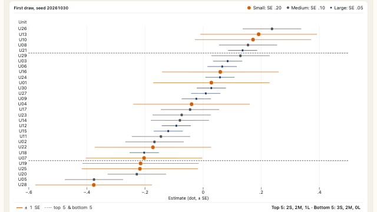
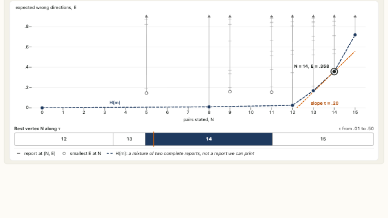
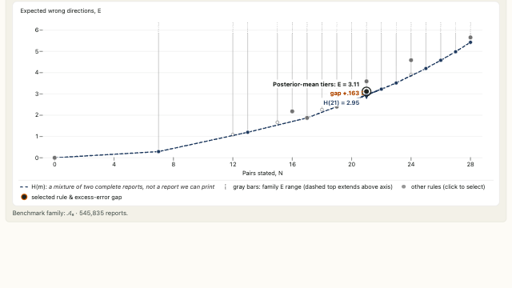
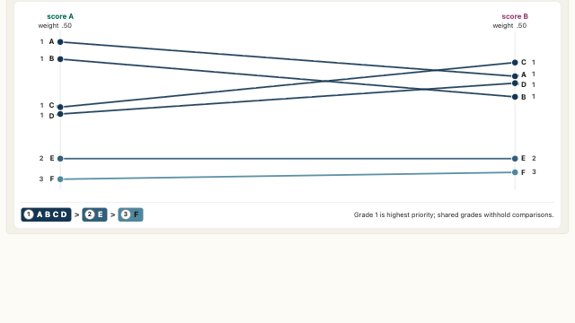
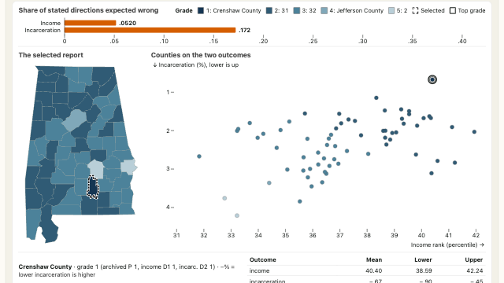
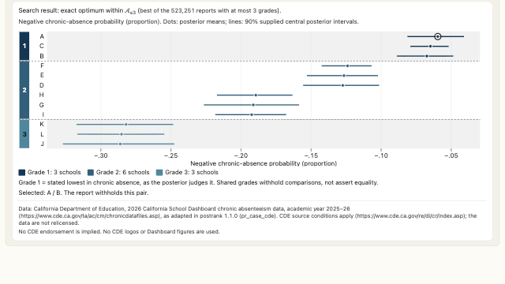

Ordered grade reports state directions across grades while leaving unresolved comparisons within a grade unstated, and multidomain profiles retain a separate grade column for each outcome. These 84 interactive illustrations accompany the `postrank` R package across simulated posteriors and released studies of firms, schools, and counties.

## Applications by topic {#organisation}

```{=html}
<div class="prx-story">
<ul class="prx-home-tiles">
  <li class="prx-home-tile">
    <a class="prx-tile-thumb" href="pages/uncertainty/noisy-league.html" tabindex="-1"></a>
    <span class="prx-tile-meta">Part 1 · 18 apps</span>
    <strong class="prx-tile-head"><a href="pages/uncertainty/index.html">Uncertainty</a></strong>
    <span class="prx-tile-copy">How sampling error distorts strict league tables and how the posterior measures pairwise direction certainty. <a href="pages/uncertainty/noisy-league.html">Ranking noisy estimates</a>.</span>
  </li>
  <li class="prx-home-tile">
    <a class="prx-tile-thumb" href="pages/grades/frontier.html" tabindex="-1"></a>
    <span class="prx-tile-meta">Part 2 · 20 apps</span>
    <strong class="prx-tile-head"><a href="pages/grades/index.html">Grade reports</a></strong>
    <span class="prx-tile-copy">How ordered grades trade expected wrong directions against withheld pairs along the error–disclosure frontier. <a href="pages/grades/frontier.html">The error–disclosure frontier</a>.</span>
  </li>
  <li class="prx-home-tile">
    <a class="prx-tile-thumb" href="pages/rules/rule-comparison.html" tabindex="-1"></a>
    <span class="prx-tile-meta">Part 3 · 13 apps</span>
    <strong class="prx-tile-head"><a href="pages/rules/index.html">Reporting rules</a></strong>
    <span class="prx-tile-copy">How fixed quantile tiers, evidence flags, and posterior cuts compare at matched disclosure and under repeated sampling. <a href="pages/rules/rule-comparison.html">Comparison at matched disclosure</a>.</span>
  </li>
  <li class="prx-home-tile">
    <a class="prx-tile-thumb" href="pages/criteria/two-scores.html" tabindex="-1"></a>
    <span class="prx-tile-meta">Part 4 &amp; P · 19 apps</span>
    <strong class="prx-tile-head"><a href="pages/criteria/index.html">Multiple criteria</a></strong>
    <span class="prx-tile-copy">Compare one shared grade column across outcomes with separate domain columns under joint error limits. <a href="pages/criteria/two-scores.html">A common grade report for two scores</a>.</span>
    <ul class="prx-tile-sub">
      <li><strong><a href="pages/criteria/index.html#common-grades">Common grades</a></strong> <span>(14)</span></li>
      <li><strong><a href="pages/criteria/index.html#domain-profiles">Domain profiles</a></strong> <span>(5)</span></li>
    </ul>
  </li>
  <li class="prx-home-tile">
    <a class="prx-tile-thumb" href="pages/cases/alabama-map.html" tabindex="-1"></a>
    <span class="prx-tile-meta">Part 5 · 12 apps</span>
    <strong class="prx-tile-head"><a href="pages/cases/index.html">Cases</a></strong>
    <span class="prx-tile-copy">Firm contact gaps (KRW), California school chronic absence, and Alabama county income and incarceration outcomes. <a href="pages/cases/alabama-map.html">Alabama county outcomes</a>.</span>
  </li>
  <li class="prx-home-tile">
    <a class="prx-tile-thumb" href="pages/tools/report-designer.html" tabindex="-1"></a>
    <span class="prx-tile-meta">Part T · 2 apps</span>
    <strong class="prx-tile-head"><a href="pages/tools/index.html">Tools</a></strong>
    <span class="prx-tile-copy">Build a report from supplied posterior summaries in the browser or specify and export a released case analysis. <a href="pages/tools/report-designer.html">Case-report design and export</a>.</span>
  </li>
</ul>
</div>
```

Browse all 84 applications with search and topic filters in the [application catalog](catalog.qmd), look up symbols and reporting definitions in [terminology and notation](pages/words.qmd), or embed standalone views in slides ([embed instructions](catalog.qmd#embedding)).

## Numerical verification

Every application's displayed quantities are checked against `postrank` 1.1.0 / 1.2.0 and independent base-R calculations, including exact rational checks for finite-law multidomain profiles. Each result names the report family searched; numerical agreement verifies implementation consistency on the tested inputs rather than external posterior calibration. Chapter references follow the `postrank` theory book (v5); source provenance, field definitions, licenses, and checksums live in `verification/` and `r-export/`.

## About

Developed by JoonHo Lee, The University of Alabama ([jlee296@ua.edu](mailto:jlee296@ua.edu)), accompanying research on posterior ranking, ordered grade reporting, and multidomain profiles.

## Acknowledgments {#acknowledgements}

The research underlying this website was supported primarily by the National Academy of Education and the Spencer Foundation through the 2025 National Academy of Education/Spencer Postdoctoral Fellowship awarded to JoonHo Lee. Additional support was provided by the Institute of Education Sciences, U.S. Department of Education, through Grant R305D240078 to The University of Alabama.
