<!-- Build inputs: the catalog; do not edit. -->
```{=html}
<div class="prx-cards">
<article class="prx-card prx-card-built">
<a class="prx-card-thumb" href="../../pages/cases/lambda-tau.html" tabindex="-1" aria-hidden="true">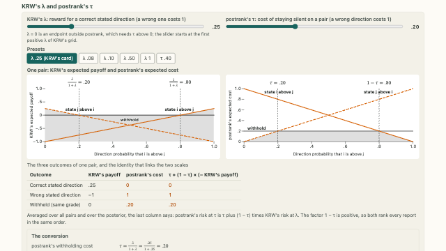</a>
<div class="prx-card-body">
<p class="prx-card-id">5.1</p>
<h3><a href="../../pages/cases/lambda-tau.html">KRW's reward and postrank's withholding cost</a></h3>
<p>Conversion between λ and τ under common posterior and report-family assumptions.</p>
<p class="prx-card-links"><a href="../../embed/lambda-tau.html">standalone</a></p>
</div>
</article>
<article class="prx-card prx-card-built">
<a class="prx-card-thumb" href="../../pages/cases/krw-axes.html" tabindex="-1" aria-hidden="true">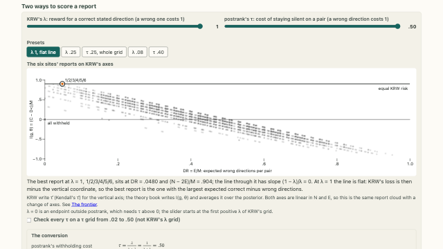</a>
<div class="prx-card-body">
<p class="prx-card-id">5.2</p>
<h3><a href="../../pages/cases/krw-axes.html">Equivalent reporting-loss scales</a></h3>
<p>Affine equivalence of KRW's loss and postrank's risk over the six-site report family.</p>
<p class="prx-card-credit">Data: Kline, Rose and Walters (2024) · CC-BY-NC</p>
<p class="prx-card-links"><a href="../../embed/krw-axes.html">standalone</a></p>
</div>
</article>
<article class="prx-card prx-card-built">
<a class="prx-card-thumb" href="../../pages/cases/krw-card.html" tabindex="-1" aria-hidden="true">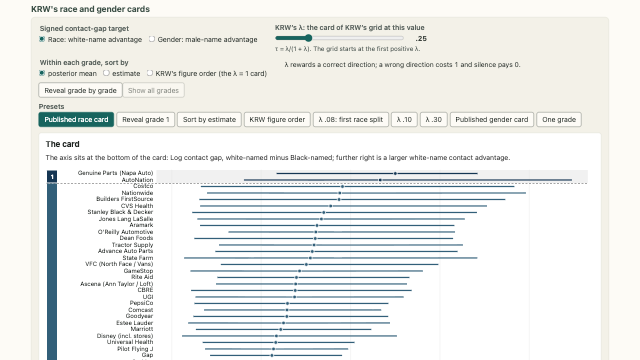</a>
<div class="prx-card-body">
<p class="prx-card-id">5.3</p>
<h3><a href="../../pages/cases/krw-card.html">KRW's race and gender report cards</a></h3>
<p>Marginal summaries and pairwise statements in the archived cards for 97 firms.</p>
<p class="prx-card-credit">Data: Kline, Rose and Walters (2024) · CC-BY-NC</p>
<p class="prx-card-links"><a href="../../embed/krw-card.html">standalone</a></p>
</div>
</article>
<article class="prx-card prx-card-built">
<a class="prx-card-thumb" href="../../pages/cases/krw-heatmap.html" tabindex="-1" aria-hidden="true">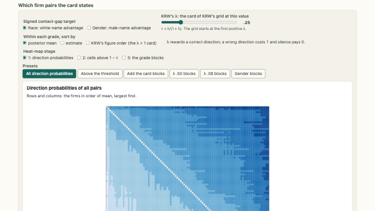</a>
<div class="prx-card-body">
<p class="prx-card-id">5.4</p>
<h3><a href="../../pages/cases/krw-heatmap.html">Firm-pair probabilities and report-card blocks</a></h3>
<p>Comparison of isolated-pair thresholds with the relations in KRW's coherent cards.</p>
<p class="prx-card-credit">Data: Kline, Rose and Walters (2024) · CC-BY-NC</p>
<p class="prx-card-links"><a href="../../embed/krw-heatmap.html">standalone</a></p>
</div>
</article>
<article class="prx-card prx-card-built">
<a class="prx-card-thumb" href="../../pages/cases/krw-lambda.html" tabindex="-1" aria-hidden="true">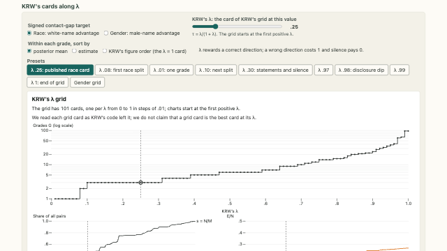</a>
<div class="prx-card-body">
<p class="prx-card-id">5.5</p>
<h3><a href="../../pages/cases/krw-lambda.html">KRW's archived reward path</a></h3>
<p>Disclosure and expected errors of archived cards across the λ grid.</p>
<p class="prx-card-credit">Data: Kline, Rose and Walters (2024) · CC-BY-NC</p>
<p class="prx-card-links"><a href="../../embed/krw-lambda.html">standalone</a></p>
</div>
</article>
<article class="prx-card prx-card-built">
<a class="prx-card-thumb" href="../../pages/cases/signed-or-absolute.html" tabindex="-1" aria-hidden="true">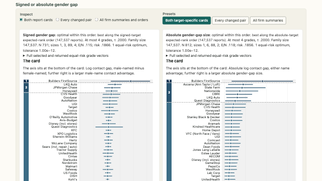</a>
<div class="prx-card-body">
<p class="prx-card-id">5.6</p>
<h3><a href="../../pages/cases/signed-or-absolute.html">Signed and absolute gender-gap targets</a></h3>
<p>Target-specific posterior probabilities and fixed-order reports for signed and absolute contact gaps.</p>
<p class="prx-card-credit">Data: Kline, Rose and Walters (2024) · CC-BY-NC</p>
<p class="prx-card-links"><a href="../../embed/signed-or-absolute.html">standalone</a></p>
</div>
</article>
<article class="prx-card prx-card-built">
<a class="prx-card-thumb" href="../../pages/cases/krw-two.html" tabindex="-1" aria-hidden="true">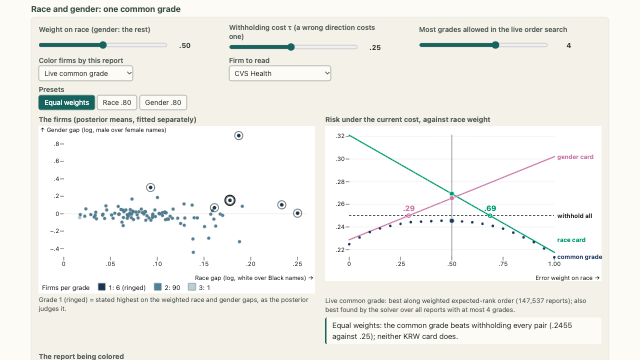</a>
<div class="prx-card-body">
<p class="prx-card-id">5.7</p>
<h3><a href="../../pages/cases/krw-two.html">A common report for race and gender gaps</a></h3>
<p>Weighted expected-risk evaluation of a common report and two fixed KRW cards.</p>
<p class="prx-card-credit">Data: Kline, Rose and Walters (2024) · CC-BY-NC</p>
<p class="prx-card-links"><a href="../../embed/krw-two.html">standalone</a></p>
</div>
</article>
<article class="prx-card prx-card-built">
<a class="prx-card-thumb" href="../../pages/cases/cde-cuts.html" tabindex="-1" aria-hidden="true">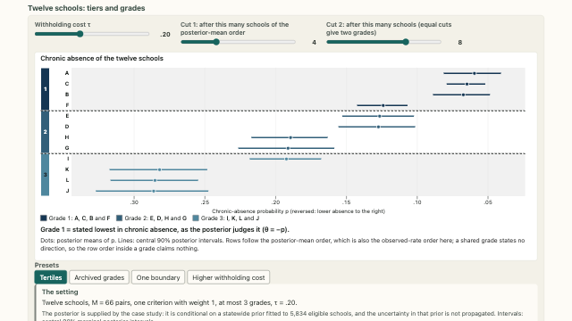</a>
<div class="prx-card-body">
<p class="prx-card-id">5.8</p>
<h3><a href="../../pages/cases/cde-cuts.html">School tertiles and minimum-risk grades</a></h3>
<p>Fixed cuts and unrestricted three-grade reporting for a twelve-school chronic-absence example.</p>
<p class="prx-card-credit">Data: California Department of Education, 2026 California School Dashboard chronic absenteeism data, academic year 2025–26 · No CDE endorsement is implied</p>
<p class="prx-card-links"><a href="../../embed/cde-cuts.html">standalone</a></p>
</div>
</article>
<article class="prx-card prx-card-built">
<a class="prx-card-thumb" href="../../pages/cases/cde-one-disclosure.html" tabindex="-1" aria-hidden="true">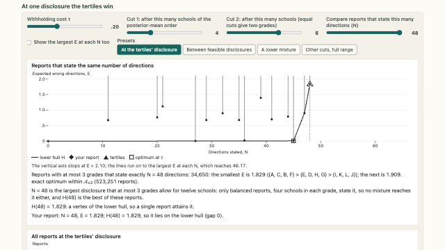</a>
<div class="prx-card-body">
<p class="prx-card-id">5.9</p>
<h3><a href="../../pages/cases/cde-one-disclosure.html">School reports at matched disclosure</a></h3>
<p>Expected-error distribution of the three-grade reports that state 48 pairs.</p>
<p class="prx-card-credit">Data: California Department of Education, 2026 California School Dashboard chronic absenteeism data, academic year 2025–26 · No CDE endorsement is implied</p>
<p class="prx-card-links"><a href="../../embed/cde-one-disclosure.html">standalone</a></p>
</div>
</article>
<article class="prx-card prx-card-built">
<a class="prx-card-thumb" href="../../pages/cases/cde-pair.html" tabindex="-1" aria-hidden="true">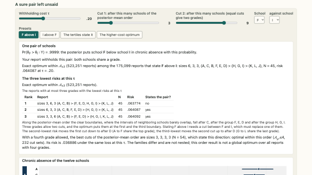</a>
<div class="prx-card-body">
<p class="prx-card-id">5.10</p>
<h3><a href="../../pages/cases/cde-pair.html">A high-probability school comparison withheld</a></h3>
<p>Full-report cost of requiring the F-above-I direction under declared family restrictions.</p>
<p class="prx-card-credit">Data: California Department of Education, 2026 California School Dashboard chronic absenteeism data, academic year 2025–26 · No CDE endorsement is implied</p>
<p class="prx-card-links"><a href="../../embed/cde-pair.html">standalone</a></p>
</div>
</article>
<article class="prx-card prx-card-built">
<a class="prx-card-thumb" href="../../pages/cases/cde-tau-path.html" tabindex="-1" aria-hidden="true">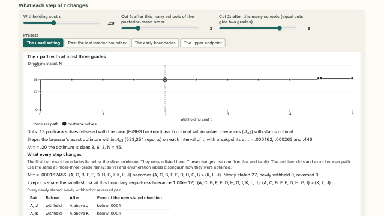</a>
<div class="prx-card-body">
<p class="prx-card-id">5.11</p>
<h3><a href="../../pages/cases/cde-tau-path.html">School-report changes along the withholding-cost path</a></h3>
<p>Exact optimal disclosure and changes in individual school-pair relations as τ varies.</p>
<p class="prx-card-credit">Data: California Department of Education, 2026 California School Dashboard chronic absenteeism data, academic year 2025–26 · No CDE endorsement is implied</p>
<p class="prx-card-links"><a href="../../embed/cde-tau-path.html">standalone</a></p>
</div>
</article>
<article class="prx-card prx-card-built">
<a class="prx-card-thumb" href="../../pages/cases/alabama-map.html" tabindex="-1" aria-hidden="true">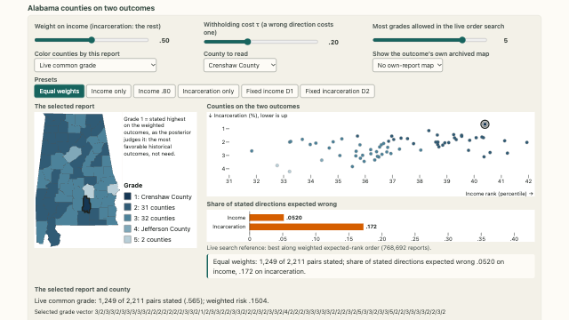</a>
<div class="prx-card-body">
<p class="prx-card-id">5.12</p>
<h3><a href="../../pages/cases/alabama-map.html">A common report for Alabama county outcomes</a></h3>
<p>Criterion-specific evaluation of common grades for historical income and incarceration outcomes.</p>
<p class="prx-card-credit">Data: Chetty, Friedman, Hendren, Jones and Porter (2022) · CC BY 4.0 · Opportunity Insights and U.S. Census Bureau · U.S. Census Bureau, Cartographic Boundary Files, 2025 (1:20m), via usmapdata 1.1.0</p>
<p class="prx-card-links"><a href="../../embed/alabama-map.html">standalone</a></p>
</div>
</article>
</div>
```
