<!-- Build inputs: the catalog; do not edit. -->
```{=html}
<div class="prx-cards">
<article class="prx-card prx-card-built">
<a class="prx-card-thumb" href="../../pages/criteria/several-criteria.html" tabindex="-1">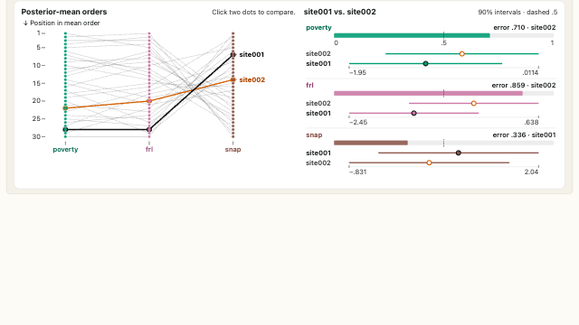</a>
<div class="prx-card-body">
<p class="prx-card-id">4.1</p>
<h3 class="no-anchor"><a href="../../pages/criteria/several-criteria.html">Posterior profiles on multiple criteria</a></h3>
<p>Compare the same units on two scores. Their posterior order and direction probabilities can differ by score.</p>
<p class="prx-card-links"><a href="../../embed/several-criteria.html">Open standalone</a></p>
</div>
</article>
<article class="prx-card prx-card-built">
<a class="prx-card-thumb" href="../../pages/criteria/conflict-pairs.html" tabindex="-1">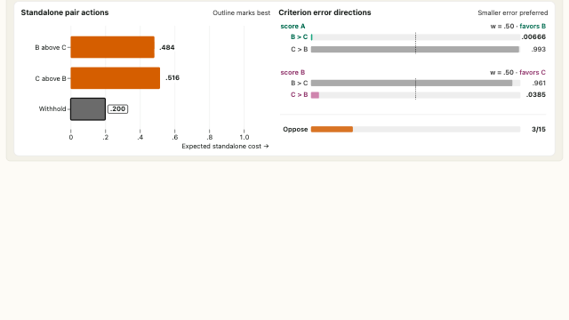</a>
<div class="prx-card-body">
<p class="prx-card-id">4.2</p>
<h3 class="no-anchor"><a href="../../pages/criteria/conflict-pairs.html">Opposing criterion directions</a></h3>
<p>When two criteria favor different directions, compare the posterior evidence and the costs of stating either one.</p>
<p class="prx-card-links"><a href="../../embed/conflict-pairs.html">Open standalone</a></p>
</div>
</article>
<article class="prx-card prx-card-built">
<a class="prx-card-thumb" href="../../pages/criteria/two-scores.html" tabindex="-1">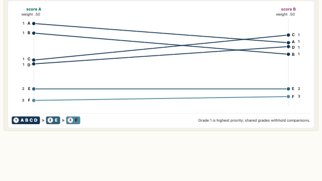</a>
<div class="prx-card-body">
<p class="prx-card-id">4.3</p>
<h3 class="no-anchor"><a href="../../pages/criteria/two-scores.html">A common grade report for two scores</a></h3>
<p>Use one grade column for both scores and see how its expected errors are distributed across the criteria.</p>
<p class="prx-card-links"><a href="../../embed/two-scores.html">Open standalone</a></p>
</div>
</article>
<article class="prx-card prx-card-built">
<a class="prx-card-thumb" href="../../pages/criteria/weight-path.html" tabindex="-1">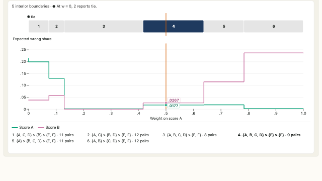</a>
<div class="prx-card-body">
<p class="prx-card-id">4.4</p>
<h3 class="no-anchor"><a href="../../pages/criteria/weight-path.html">Optimal reports along the criterion-weight path</a></h3>
<p>As the criterion weights change, a different report can minimize risk. The graph marks the weight ranges for each report.</p>
<p class="prx-card-links"><a href="../../embed/weight-path.html">Open standalone</a></p>
</div>
</article>
<article class="prx-card prx-card-built">
<a class="prx-card-thumb" href="../../pages/criteria/common-grade-cost.html" tabindex="-1">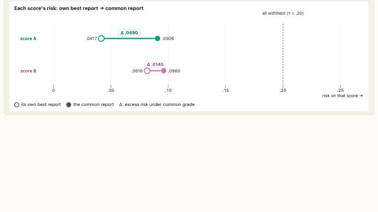</a>
<div class="prx-card-body">
<p class="prx-card-id">4.5</p>
<h3 class="no-anchor"><a href="../../pages/criteria/common-grade-cost.html">Criterion-specific excess risk of a common report</a></h3>
<p>Compare each criterion’s risk under the common grades with its minimum risk in the same report family.</p>
<p class="prx-card-links"><a href="../../embed/common-grade-cost.html">Open standalone</a></p>
</div>
</article>
<article class="prx-card prx-card-built">
<a class="prx-card-thumb" href="../../pages/criteria/composite-or-criterion.html" tabindex="-1">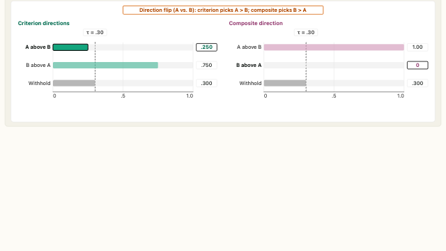</a>
<div class="prx-card-body">
<p class="prx-card-id">4.6</p>
<h3 class="no-anchor"><a href="../../pages/criteria/composite-or-criterion.html">Composite targets and criterion directions</a></h3>
<p>A statement about a weighted composite and a statement about the component criteria can favor different reports.</p>
<p class="prx-card-links"><a href="../../embed/composite-or-criterion.html">Open standalone</a></p>
</div>
</article>
<article class="prx-card prx-card-built">
<a class="prx-card-thumb" href="../../pages/criteria/error-budgets.html" tabindex="-1">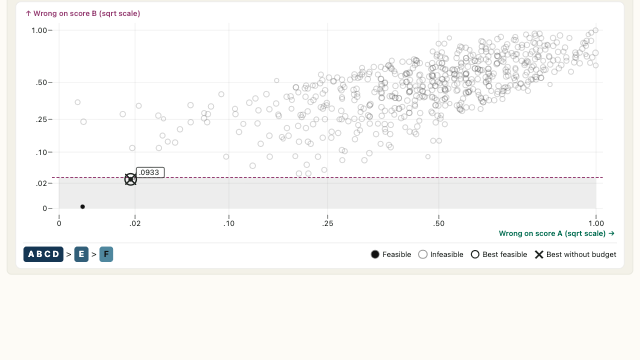</a>
<div class="prx-card-body">
<p class="prx-card-id">4.7</p>
<h3 class="no-anchor"><a href="../../pages/criteria/error-budgets.html">Criterion-specific expected-error budgets</a></h3>
<p>An error limit on each criterion restricts which grade reports can be selected.</p>
<p class="prx-card-links"><a href="../../embed/error-budgets.html">Open standalone</a></p>
</div>
</article>
<article class="prx-card prx-card-built">
<a class="prx-card-thumb" href="../../pages/criteria/criterion-mixture.html" tabindex="-1">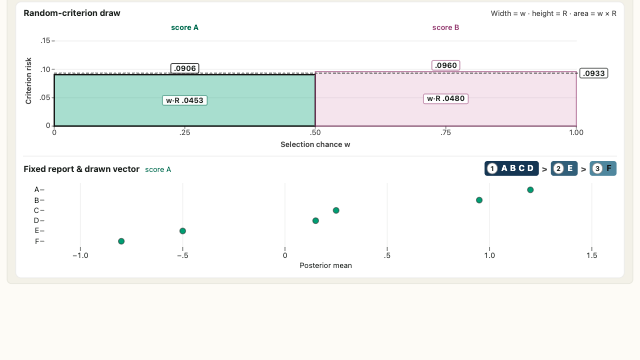</a>
<div class="prx-card-body">
<p class="prx-card-id">4.8</p>
<h3 class="no-anchor"><a href="../../pages/criteria/criterion-mixture.html">A random-criterion representation of weighted risk</a></h3>
<p>For a fixed report, weighting criterion risks gives the same expected risk as randomly drawing a criterion with those weights.</p>
<p class="prx-card-links"><a href="../../embed/criterion-mixture.html">Open standalone</a></p>
</div>
</article>
<article class="prx-card prx-card-built">
<a class="prx-card-thumb" href="../../pages/criteria/worst-criterion.html" tabindex="-1">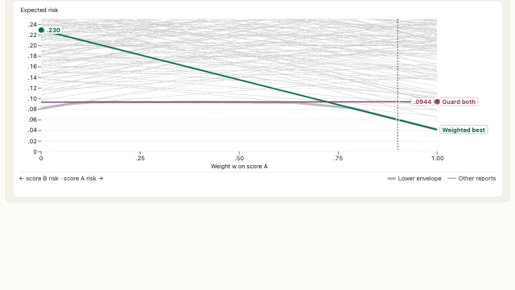</a>
<div class="prx-card-body">
<p class="prx-card-id">4.9</p>
<h3 class="no-anchor"><a href="../../pages/criteria/worst-criterion.html">Minimizing the largest criterion risk</a></h3>
<p>Compare the report that minimizes weighted risk with the report that minimizes the largest criterion risk.</p>
<p class="prx-card-links"><a href="../../embed/worst-criterion.html">Open standalone</a></p>
</div>
</article>
<article class="prx-card prx-card-built">
<a class="prx-card-thumb" href="../../pages/criteria/choosing-settings.html" tabindex="-1">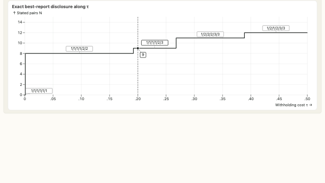</a>
<div class="prx-card-body">
<p class="prx-card-id">4.10</p>
<h3 class="no-anchor"><a href="../../pages/criteria/choosing-settings.html">Sensitivity to costs, weights and grade restrictions</a></h3>
<p>Change withholding costs, weights, and grade restrictions separately to see why the chosen report changes.</p>
<p class="prx-card-links"><a href="../../embed/choosing-settings.html">Open standalone</a></p>
</div>
</article>
<article class="prx-card prx-card-built">
<a class="prx-card-thumb" href="../../pages/criteria/draws-to-errors.html" tabindex="-1">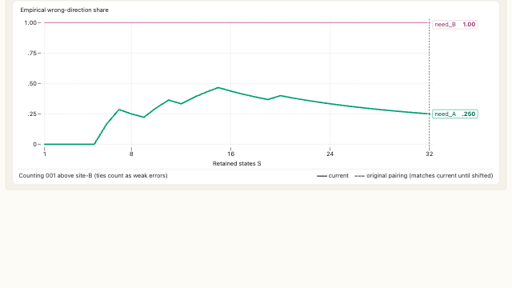</a>
<div class="prx-card-body">
<p class="prx-card-id">4.11</p>
<h3 class="no-anchor"><a href="../../pages/criteria/draws-to-errors.html">Pairwise errors from joint posterior draws</a></h3>
<p>Pairwise errors depend on which unit values occur together in the same posterior draw.</p>
<p class="prx-card-links"><a href="../../embed/draws-to-errors.html">Open standalone</a></p>
</div>
</article>
<article class="prx-card prx-card-built">
<a class="prx-card-thumb" href="../../pages/criteria/why-withheld.html" tabindex="-1">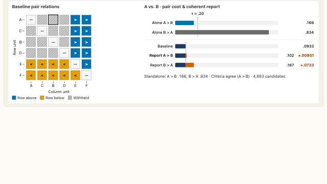</a>
<div class="prx-card-body">
<p class="prx-card-id">4.12</p>
<h3 class="no-anchor"><a href="../../pages/criteria/why-withheld.html">Reasons for a withheld comparison</a></h3>
<p>A pair can share a grade because of its own error probabilities, a conflict between criteria, or restrictions on the full report.</p>
<p class="prx-card-credit">Data: California Department of Education, 2026 California School Dashboard chronic absenteeism data, academic year 2025–26 · No CDE endorsement is implied · Kline, Rose and Walters (2024) · CC-BY-NC</p>
<p class="prx-card-links"><a href="../../embed/why-withheld.html">Open standalone</a></p>
</div>
</article>
<article class="prx-card prx-card-built">
<a class="prx-card-thumb" href="../../pages/criteria/pairs-leave-open.html" tabindex="-1">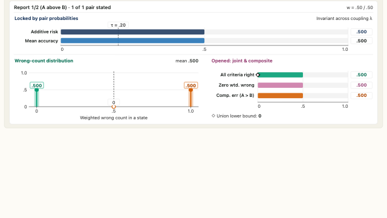</a>
<div class="prx-card-body">
<p class="prx-card-id">4.13</p>
<h3 class="no-anchor"><a href="../../pages/criteria/pairs-leave-open.html">Quantities not identified by pairwise probabilities</a></h3>
<p>The same pairwise probabilities can accompany different probabilities for a composite direction or for all statements being correct.</p>
<p class="prx-card-links"><a href="../../embed/pairs-leave-open.html">Open standalone</a></p>
</div>
</article>
<article class="prx-card prx-card-built">
<a class="prx-card-thumb" href="../../pages/criteria/estimated-budgets.html" tabindex="-1">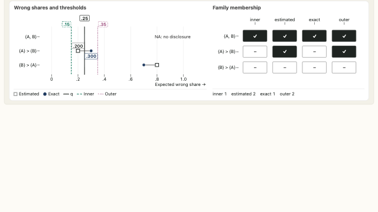</a>
<div class="prx-card-body">
<p class="prx-card-id">4.14</p>
<h3 class="no-anchor"><a href="../../pages/criteria/estimated-budgets.html">Error budgets under estimated pairwise probabilities</a></h3>
<p>When a proposed bound on Monte Carlo error holds, it identifies reports that meet an error budget under the exact probabilities.</p>
<p class="prx-card-links"><a href="../../embed/estimated-budgets.html">Open standalone</a></p>
</div>
</article>
</div>
```
