<!-- Build inputs: the catalog; do not edit. -->
```{=html}
<div class="prx-cards">
<article class="prx-card prx-card-built">
<a class="prx-card-thumb" href="../../pages/criteria/several-criteria.html" tabindex="-1" aria-hidden="true">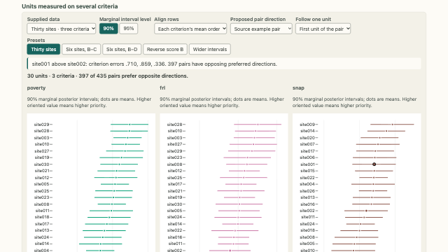</a>
<div class="prx-card-body">
<p class="prx-card-id">4.1</p>
<h3><a href="../../pages/criteria/several-criteria.html">Posterior profiles on multiple criteria</a></h3>
<p>Criterion-specific scales, orderings and pairwise direction probabilities for common units.</p>
<p class="prx-card-links"><a href="../../embed/several-criteria.html">standalone</a></p>
</div>
</article>
<article class="prx-card prx-card-built">
<a class="prx-card-thumb" href="../../pages/criteria/conflict-pairs.html" tabindex="-1" aria-hidden="true">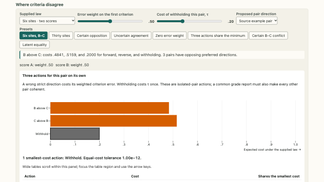</a>
<div class="prx-card-body">
<p class="prx-card-id">4.2</p>
<h3><a href="../../pages/criteria/conflict-pairs.html">Opposing criterion directions</a></h3>
<p>Comparison of directional disagreement, posterior uncertainty and isolated-pair expected costs.</p>
<p class="prx-card-links"><a href="../../embed/conflict-pairs.html">standalone</a></p>
</div>
</article>
<article class="prx-card prx-card-built">
<a class="prx-card-thumb" href="../../pages/criteria/two-scores.html" tabindex="-1" aria-hidden="true">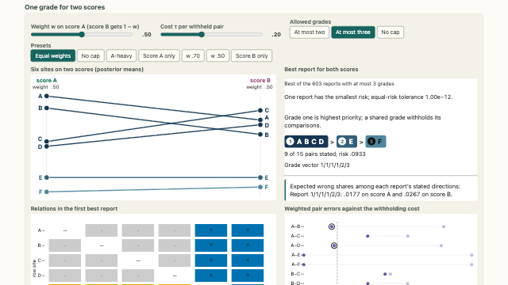</a>
<div class="prx-card-body">
<p class="prx-card-id">4.3</p>
<h3><a href="../../pages/criteria/two-scores.html">A common grade report for two scores</a></h3>
<p>Weighted directional errors and criterion-specific profiles of a common report.</p>
<p class="prx-card-links"><a href="../../embed/two-scores.html">standalone</a></p>
</div>
</article>
<article class="prx-card prx-card-built">
<a class="prx-card-thumb" href="../../pages/criteria/weight-path.html" tabindex="-1" aria-hidden="true">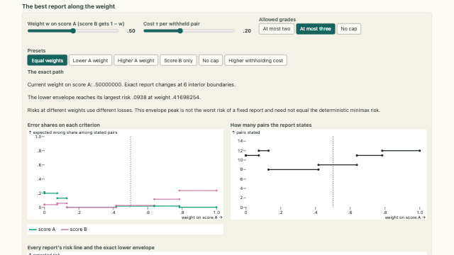</a>
<div class="prx-card-body">
<p class="prx-card-id">4.4</p>
<h3><a href="../../pages/criteria/weight-path.html">Optimal reports along the criterion-weight path</a></h3>
<p>Exact weight intervals and criterion-specific errors of minimum-risk reports.</p>
<p class="prx-card-links"><a href="../../embed/weight-path.html">standalone</a></p>
</div>
</article>
<article class="prx-card prx-card-built">
<a class="prx-card-thumb" href="../../pages/criteria/common-grade-cost.html" tabindex="-1" aria-hidden="true">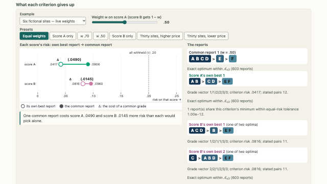</a>
<div class="prx-card-body">
<p class="prx-card-id">4.5</p>
<h3><a href="../../pages/criteria/common-grade-cost.html">Criterion-specific excess risk of a common report</a></h3>
<p>Increase in each criterion's risk relative to its own optimum in the same report family.</p>
<p class="prx-card-links"><a href="../../embed/common-grade-cost.html">standalone</a></p>
</div>
</article>
<article class="prx-card prx-card-built">
<a class="prx-card-thumb" href="../../pages/criteria/composite-or-criterion.html" tabindex="-1" aria-hidden="true">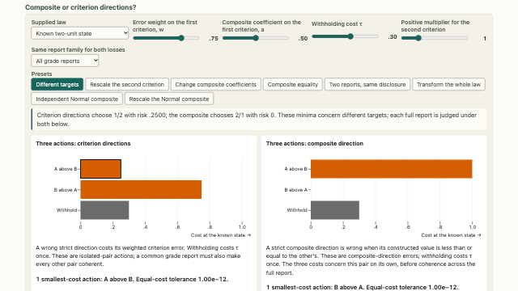</a>
<div class="prx-card-body">
<p class="prx-card-id">4.6</p>
<h3><a href="../../pages/criteria/composite-or-criterion.html">Composite targets and criterion directions</a></h3>
<p>Comparison of reporting objectives based on composite values and criterion-specific directions.</p>
<p class="prx-card-links"><a href="../../embed/composite-or-criterion.html">standalone</a></p>
</div>
</article>
<article class="prx-card prx-card-built">
<a class="prx-card-thumb" href="../../pages/criteria/error-budgets.html" tabindex="-1" aria-hidden="true">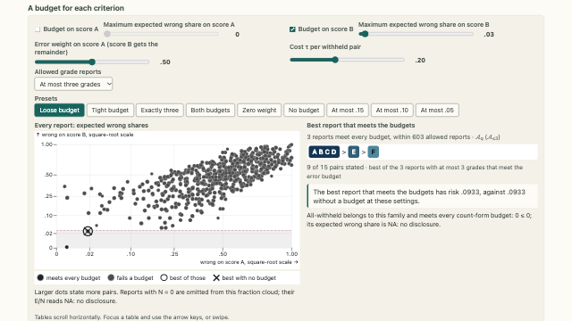</a>
<div class="prx-card-body">
<p class="prx-card-id">4.7</p>
<h3><a href="../../pages/criteria/error-budgets.html">Criterion-specific expected-error budgets</a></h3>
<p>Feasible report families under bounds on criterion-specific expected error shares.</p>
<p class="prx-card-links"><a href="../../embed/error-budgets.html">standalone</a></p>
</div>
</article>
<article class="prx-card prx-card-built">
<a class="prx-card-thumb" href="../../pages/criteria/criterion-mixture.html" tabindex="-1" aria-hidden="true">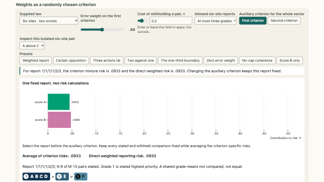</a>
<div class="prx-card-body">
<p class="prx-card-id">4.8</p>
<h3><a href="../../pages/criteria/criterion-mixture.html">A random-criterion representation of weighted risk</a></h3>
<p>Equality of weighted risk and risk averaged over an auxiliary criterion selected for a fixed report.</p>
<p class="prx-card-links"><a href="../../embed/criterion-mixture.html">standalone</a></p>
</div>
</article>
<article class="prx-card prx-card-built">
<a class="prx-card-thumb" href="../../pages/criteria/worst-criterion.html" tabindex="-1" aria-hidden="true">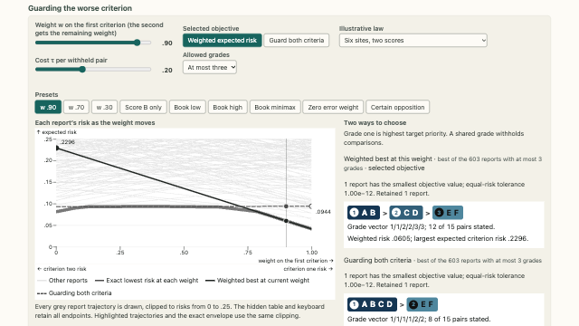</a>
<div class="prx-card-body">
<p class="prx-card-id">4.9</p>
<h3><a href="../../pages/criteria/worst-criterion.html">Minimising the largest criterion risk</a></h3>
<p>Comparison of weighted-risk and deterministic minimax report selection.</p>
<p class="prx-card-links"><a href="../../embed/worst-criterion.html">standalone</a></p>
</div>
</article>
<article class="prx-card prx-card-built">
<a class="prx-card-thumb" href="../../pages/criteria/choosing-settings.html" tabindex="-1" aria-hidden="true">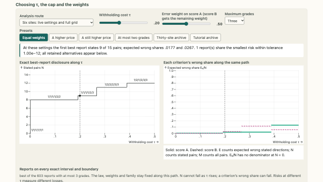</a>
<div class="prx-card-body">
<p class="prx-card-id">4.10</p>
<h3><a href="../../pages/criteria/choosing-settings.html">Sensitivity to costs, weights and grade restrictions</a></h3>
<p>Separate effects of changing the reporting loss and the feasible report family.</p>
<p class="prx-card-links"><a href="../../embed/choosing-settings.html">standalone</a></p>
</div>
</article>
<article class="prx-card prx-card-built">
<a class="prx-card-thumb" href="../../pages/criteria/draws-to-errors.html" tabindex="-1" aria-hidden="true">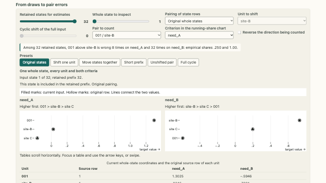</a>
<div class="prx-card-body">
<p class="prx-card-id">4.11</p>
<h3><a href="../../pages/criteria/draws-to-errors.html">Pairwise errors from joint posterior draws</a></h3>
<p>Dependence of empirical pairwise errors on the alignment of unit values within posterior states.</p>
<p class="prx-card-links"><a href="../../embed/draws-to-errors.html">standalone</a></p>
</div>
</article>
<article class="prx-card prx-card-built">
<a class="prx-card-thumb" href="../../pages/criteria/why-withheld.html" tabindex="-1" aria-hidden="true">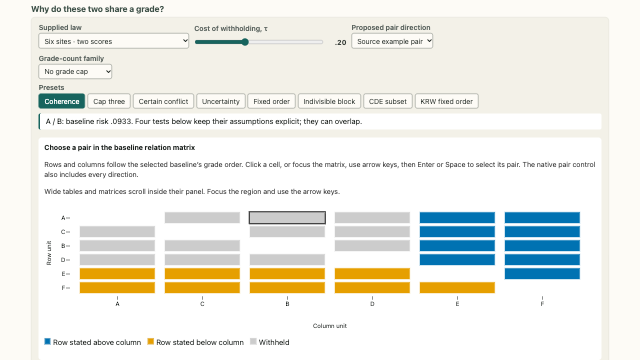</a>
<div class="prx-card-body">
<p class="prx-card-id">4.12</p>
<h3><a href="../../pages/criteria/why-withheld.html">Reasons for a withheld comparison</a></h3>
<p>Isolated-pair costs, criterion conflict, coherence and family restrictions in shared-grade decisions.</p>
<p class="prx-card-credit">Data: California Department of Education, 2026 California School Dashboard chronic absenteeism data, academic year 2025–26 · No CDE endorsement is implied · Kline, Rose and Walters (2024) · CC-BY-NC</p>
<p class="prx-card-links"><a href="../../embed/why-withheld.html">standalone</a></p>
</div>
</article>
<article class="prx-card prx-card-built">
<a class="prx-card-thumb" href="../../pages/criteria/pairs-leave-open.html" tabindex="-1" aria-hidden="true">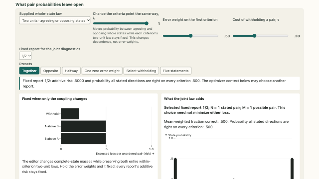</a>
<div class="prx-card-body">
<p class="prx-card-id">4.13</p>
<h3><a href="../../pages/criteria/pairs-leave-open.html">Quantities not identified by pairwise probabilities</a></h3>
<p>Limits of pairwise probabilities for composite targets and joint-correctness events.</p>
<p class="prx-card-links"><a href="../../embed/pairs-leave-open.html">standalone</a></p>
</div>
</article>
<article class="prx-card prx-card-built">
<a class="prx-card-thumb" href="../../pages/criteria/estimated-budgets.html" tabindex="-1" aria-hidden="true">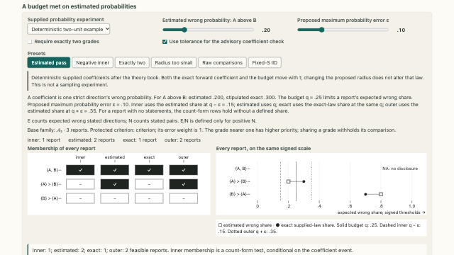</a>
<div class="prx-card-body">
<p class="prx-card-id">4.14</p>
<h3><a href="../../pages/criteria/estimated-budgets.html">Error budgets under estimated pairwise probabilities</a></h3>
<p>Inner and outer feasible families under bounds on Monte Carlo coefficient error.</p>
<p class="prx-card-links"><a href="../../embed/estimated-budgets.html">standalone</a></p>
</div>
</article>
</div>
```
