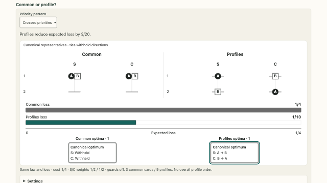
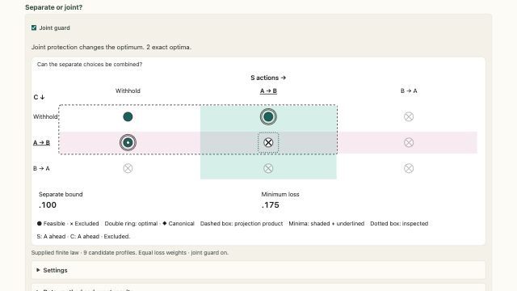
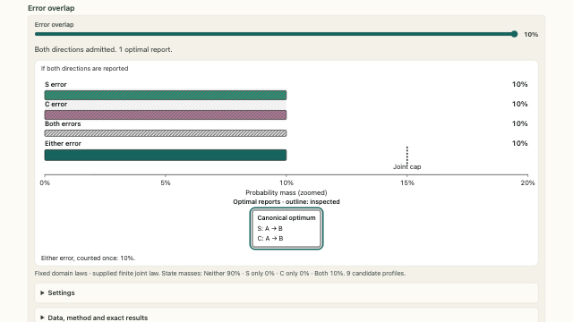
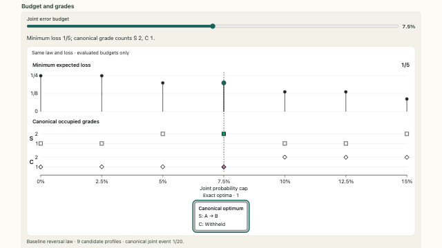
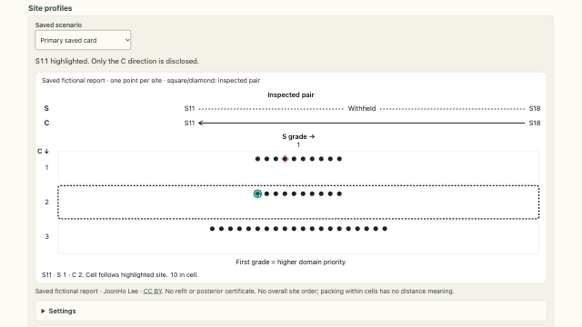

<!-- Build inputs: the catalog; do not edit. -->
```{=html}
<div class="prx-cards">
<article class="prx-card prx-card-built">
<a class="prx-card-thumb" href="../../pages/profiles/profile-common-vs-domain.html" tabindex="-1" aria-hidden="true"></a>
<div class="prx-card-body">
<p class="prx-card-id">P.1</p>
<h3><a href="../../pages/profiles/profile-common-vs-domain.html">Common or profile?</a></h3>
<p>Compare one shared grade column with two domain columns under the same posterior and loss.</p>
<p class="prx-card-links"><a href="../../embed/profile-common-vs-domain.html">standalone</a></p>
</div>
</article>
<article class="prx-card prx-card-built">
<a class="prx-card-thumb" href="../../pages/profiles/profile-separability.html" tabindex="-1" aria-hidden="true"></a>
<div class="prx-card-body">
<p class="prx-card-id">P.2</p>
<h3><a href="../../pages/profiles/profile-separability.html">Separate or joint?</a></h3>
<p>Separate domain choices can minimize additive loss. A joint error limit can make their combination infeasible.</p>
<p class="prx-card-links"><a href="../../embed/profile-separability.html">standalone</a></p>
</div>
</article>
<article class="prx-card prx-card-built">
<a class="prx-card-thumb" href="../../pages/profiles/profile-dependence.html" tabindex="-1" aria-hidden="true"></a>
<div class="prx-card-body">
<p class="prx-card-id">P.3</p>
<h3><a href="../../pages/profiles/profile-dependence.html">Error overlap</a></h3>
<p>The same domain posteriors can lead to different best profiles when their errors overlap differently.</p>
<p class="prx-card-links"><a href="../../embed/profile-dependence.html">standalone</a></p>
</div>
</article>
<article class="prx-card prx-card-built">
<a class="prx-card-thumb" href="../../pages/profiles/profile-resolution.html" tabindex="-1" aria-hidden="true"></a>
<div class="prx-card-body">
<p class="prx-card-id">P.4</p>
<h3><a href="../../pages/profiles/profile-resolution.html">Budget and grades</a></h3>
<p>A looser error limit can increase reporting detail in one domain and reduce it in another.</p>
<p class="prx-card-links"><a href="../../embed/profile-resolution.html">standalone</a></p>
</div>
</article>
<article class="prx-card prx-card-built">
<a class="prx-card-thumb" href="../../pages/profiles/fictional-site-profiles.html" tabindex="-1" aria-hidden="true"></a>
<div class="prx-card-body">
<p class="prx-card-id">P.5</p>
<h3><a href="../../pages/profiles/fictional-site-profiles.html">Site profiles</a></h3>
<p>Read two grades for each of forty fictional sites and compare the directions stated within each domain.</p>
<p class="prx-card-links"><a href="../../embed/fictional-site-profiles.html">standalone</a></p>
</div>
</article>
</div>
```
