<!-- Build inputs: the catalog; do not edit. -->
```{=html}
<div class="prx-cards">
<article class="prx-card prx-card-built">
<a class="prx-card-thumb" href="../../pages/grades/one-pair.html" tabindex="-1" aria-hidden="true">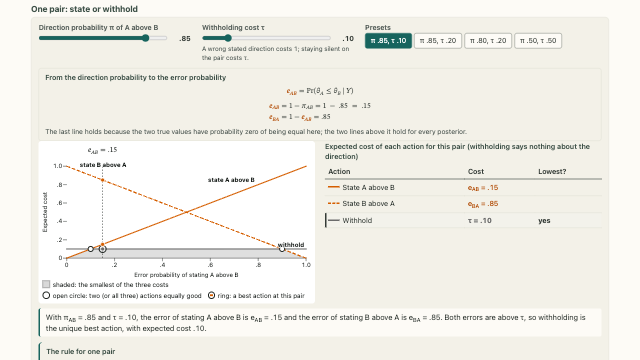</a>
<div class="prx-card-body">
<p class="prx-card-id">2.1</p>
<h3><a href="../../pages/grades/one-pair.html">The decision for an isolated pair</a></h3>
<p>The cheapest action for a single pair depends on its posterior direction probabilities and the cost of withholding.</p>
<p class="prx-card-links"><a href="../../embed/one-pair.html">standalone</a></p>
</div>
</article>
<article class="prx-card prx-card-built">
<a class="prx-card-thumb" href="../../pages/grades/report-builder.html" tabindex="-1" aria-hidden="true">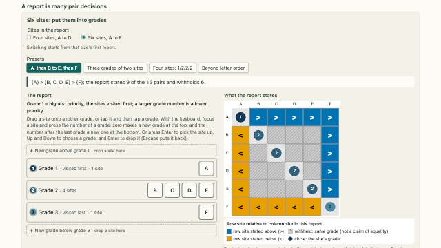</a>
<div class="prx-card-body">
<p class="prx-card-id">2.2</p>
<h3><a href="../../pages/grades/report-builder.html">Grade reports as pairwise decisions</a></h3>
<p>Assign units to ordered grades to see which pairwise directions the report states and which it leaves open.</p>
<p class="prx-card-links"><a href="../../embed/report-builder.html">standalone</a></p>
</div>
</article>
<article class="prx-card prx-card-built">
<a class="prx-card-thumb" href="../../pages/grades/how-many-reports.html" tabindex="-1" aria-hidden="true">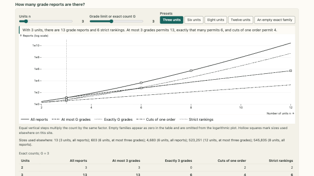</a>
<div class="prx-card-body">
<p class="prx-card-id">2.3</p>
<h3><a href="../../pages/grades/how-many-reports.html">The number of ordered grade reports</a></h3>
<p>Count the possible reports and see how a grade cap or a fixed order reduces the number of candidates.</p>
<p class="prx-card-links"><a href="../../embed/how-many-reports.html">standalone</a></p>
</div>
</article>
<article class="prx-card prx-card-built">
<a class="prx-card-thumb" href="../../pages/grades/price-of-silence.html" tabindex="-1" aria-hidden="true">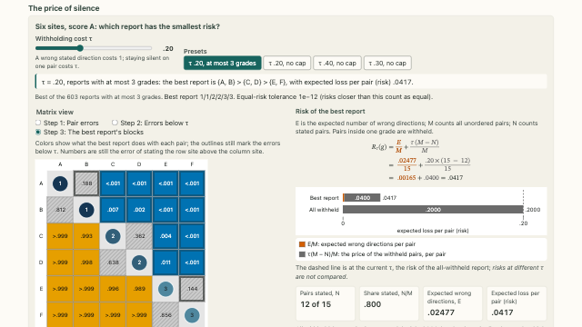</a>
<div class="prx-card-body">
<p class="prx-card-id">2.4</p>
<h3><a href="../../pages/grades/price-of-silence.html">Reporting risk and withholding cost</a></h3>
<p>Reporting risk adds expected wrong directions to the cost of leaving comparisons unstated.</p>
<p class="prx-card-links"><a href="../../embed/price-of-silence.html">standalone</a></p>
</div>
</article>
<article class="prx-card prx-card-built">
<a class="prx-card-thumb" href="../../pages/grades/tau-path.html" tabindex="-1" aria-hidden="true">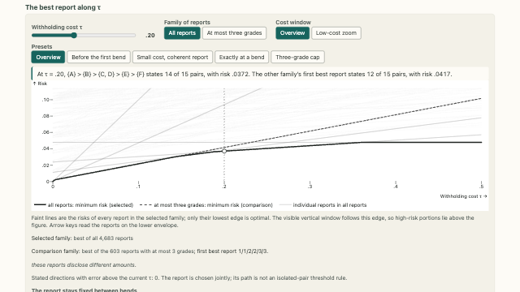</a>
<div class="prx-card-body">
<p class="prx-card-id">2.5</p>
<h3><a href="../../pages/grades/tau-path.html">Optimal reports along the withholding-cost path</a></h3>
<p>A report’s risk is a line in the withholding cost. The optimal report changes where the lowest line switches.</p>
<p class="prx-card-links"><a href="../../embed/tau-path.html">standalone</a></p>
</div>
</article>
<article class="prx-card prx-card-built">
<a class="prx-card-thumb" href="../../pages/grades/coherence.html" tabindex="-1" aria-hidden="true">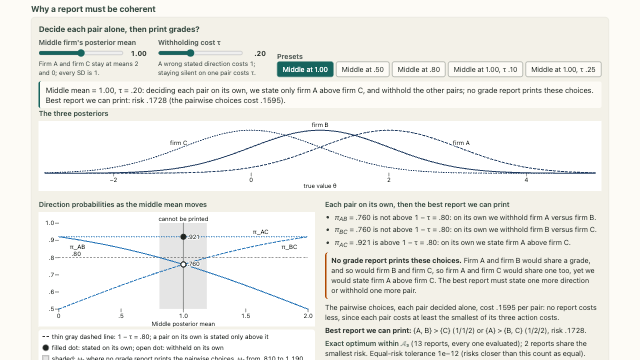</a>
<div class="prx-card-body">
<p class="prx-card-id">2.6</p>
<h3><a href="../../pages/grades/coherence.html">Coherence constraints on pairwise decisions</a></h3>
<p>Decisions made one pair at a time can conflict with the ordering required by a grade report.</p>
<p class="prx-card-links"><a href="../../embed/coherence.html">standalone</a></p>
</div>
</article>
<article class="prx-card prx-card-built">
<a class="prx-card-thumb" href="../../pages/grades/coherence-finite.html" tabindex="-1" aria-hidden="true">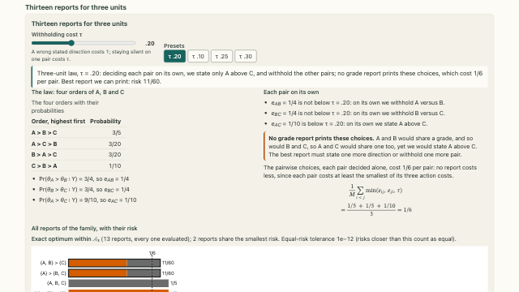</a>
<div class="prx-card-body">
<p class="prx-card-id">2.7</p>
<h3><a href="../../pages/grades/coherence-finite.html">Coherence in a finite three-unit example</a></h3>
<p>Evaluate all 13 reports for three units under the same four-state posterior.</p>
<p class="prx-card-links"><a href="../../embed/coherence-finite.html">standalone</a></p>
</div>
</article>
<article class="prx-card prx-card-built">
<a class="prx-card-thumb" href="../../pages/grades/disclosed-errors.html" tabindex="-1" aria-hidden="true">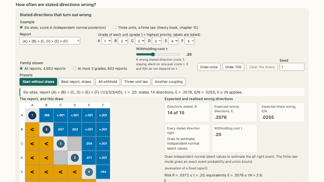</a>
<div class="prx-card-body">
<p class="prx-card-id">2.8</p>
<h3><a href="../../pages/grades/disclosed-errors.html">Expected and realized errors among stated directions</a></h3>
<p>Compare the expected wrong share, the wrong count in a posterior state, and the probability that every stated direction is correct.</p>
<p class="prx-card-links"><a href="../../embed/disclosed-errors.html">standalone</a></p>
</div>
</article>
<article class="prx-card prx-card-built">
<a class="prx-card-thumb" href="../../pages/grades/reported-and-realized.html" tabindex="-1" aria-hidden="true">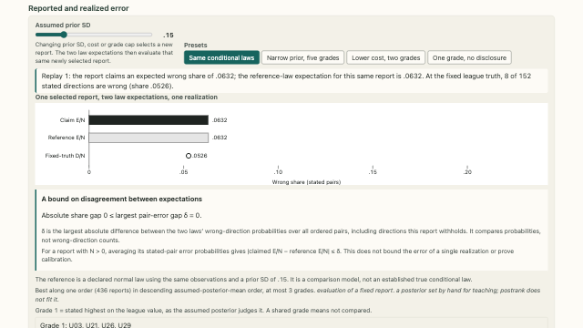</a>
<div class="prx-card-body">
<p class="prx-card-id">2.9</p>
<h3><a href="../../pages/grades/reported-and-realized.html">Reported error and reference-law evaluation</a></h3>
<p>Compare what the posterior predicts about errors with the errors observed when the true values are held fixed.</p>
<p class="prx-card-links"><a href="../../embed/reported-and-realized.html">standalone</a></p>
</div>
</article>
<article class="prx-card prx-card-built">
<a class="prx-card-thumb" href="../../pages/grades/frontier.html" tabindex="-1" aria-hidden="true">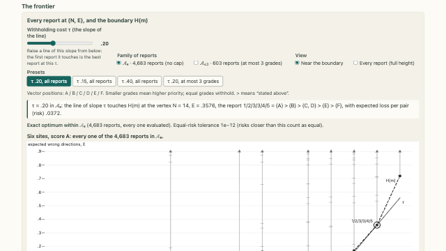</a>
<div class="prx-card-body">
<p class="prx-card-id">2.10</p>
<h3><a href="../../pages/grades/frontier.html">The error–disclosure frontier</a></h3>
<p>The lower convex boundary shows the smallest expected wrong count attainable at each mean number of stated pairs.</p>
<p class="prx-card-links"><a href="../../embed/frontier.html">standalone</a></p>
</div>
</article>
<article class="prx-card prx-card-built">
<a class="prx-card-thumb" href="../../pages/grades/frontier-mixtures.html" tabindex="-1" aria-hidden="true">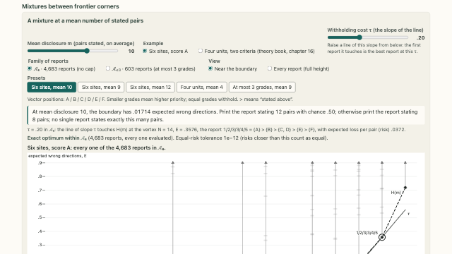</a>
<div class="prx-card-body">
<p class="prx-card-id">2.11</p>
<h3><a href="../../pages/grades/frontier-mixtures.html">Mixtures of frontier reports</a></h3>
<p>Choose between two complete reports at random to reach an intermediate expected number of stated pairs.</p>
<p class="prx-card-links"><a href="../../embed/frontier-mixtures.html">standalone</a></p>
</div>
</article>
<article class="prx-card prx-card-built">
<a class="prx-card-thumb" href="../../pages/grades/families.html" tabindex="-1" aria-hidden="true">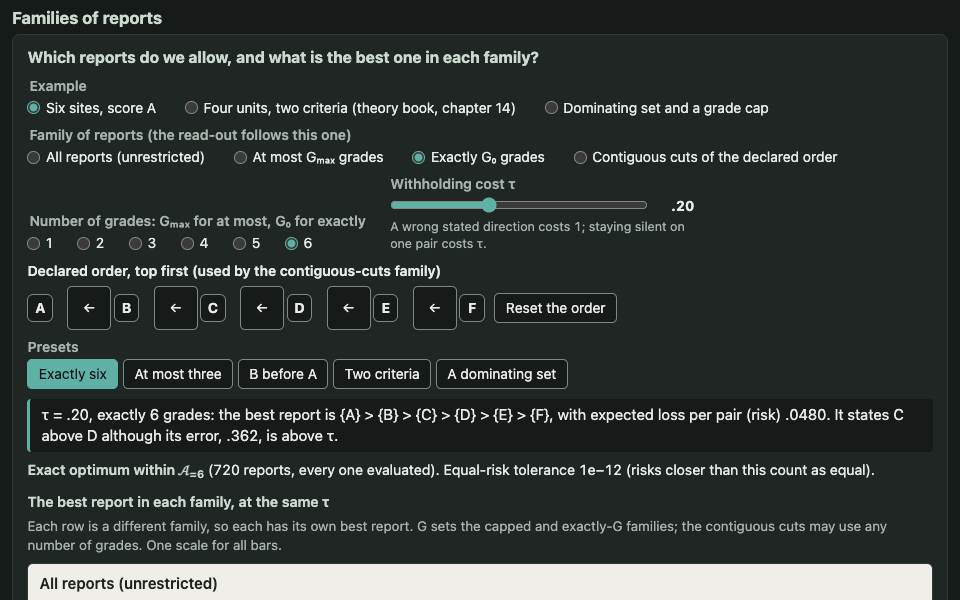</a>
<div class="prx-card-body">
<p class="prx-card-id">2.12</p>
<h3><a href="../../pages/grades/families.html">Restrictions on the report family</a></h3>
<p>Grade caps, exact grade counts, and fixed orders restrict the search in different ways. The minimum risk depends on the family.</p>
<p class="prx-card-links"><a href="../../embed/families.html">standalone</a></p>
</div>
</article>
<article class="prx-card prx-card-built">
<a class="prx-card-thumb" href="../../pages/grades/report-card.html" tabindex="-1" aria-hidden="true">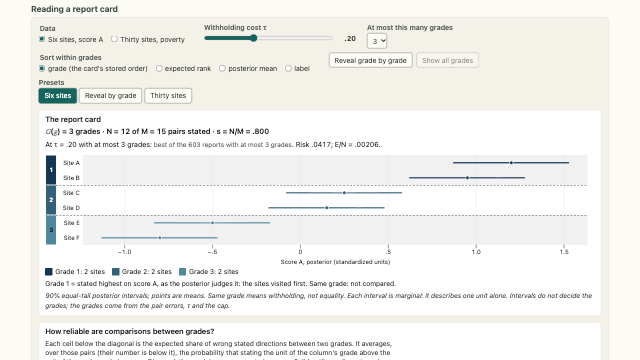</a>
<div class="prx-card-body">
<p class="prx-card-id">2.13</p>
<h3><a href="../../pages/grades/report-card.html">Posterior summaries in a grade report</a></h3>
<p>The card shows each unit’s posterior interval and the expected error of comparisons between grades.</p>
<p class="prx-card-links"><a href="../../embed/report-card.html">standalone</a></p>
</div>
</article>
<article class="prx-card prx-card-built">
<a class="prx-card-thumb" href="../../pages/grades/two-denominators.html" tabindex="-1" aria-hidden="true">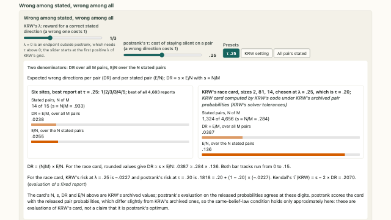</a>
<div class="prx-card-body">
<p class="prx-card-id">2.14</p>
<h3><a href="../../pages/grades/two-denominators.html">Error rates under two denominators</a></h3>
<p>The same expected wrong count can be expressed per possible pair or per stated pair. The two rates answer different questions.</p>
<p class="prx-card-credit">Data: Kline, Rose and Walters (2024) · CC-BY-NC</p>
<p class="prx-card-links"><a href="../../embed/two-denominators.html">standalone</a></p>
</div>
</article>
<article class="prx-card prx-card-built">
<a class="prx-card-thumb" href="../../pages/grades/ties-and-withholding.html" tabindex="-1" aria-hidden="true">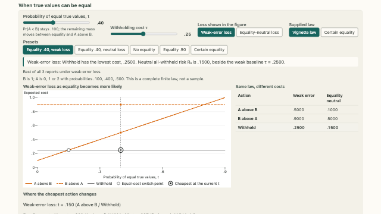</a>
<div class="prx-card-body">
<p class="prx-card-id">2.15</p>
<h3><a href="../../pages/grades/ties-and-withholding.html">Posterior equality and withholding</a></h3>
<p>Positive probability of equality changes the cost of making a strict statement. The preferred action depends on how equality is scored.</p>
<p class="prx-card-links"><a href="../../embed/ties-and-withholding.html">standalone</a></p>
</div>
</article>
<article class="prx-card prx-card-built">
<a class="prx-card-thumb" href="../../pages/grades/computing-grades.html" tabindex="-1" aria-hidden="true">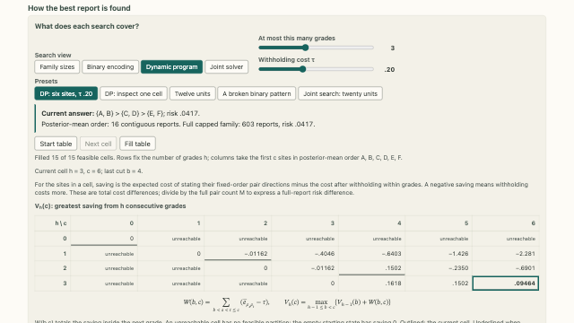</a>
<div class="prx-card-body">
<p class="prx-card-id">2.16</p>
<h3><a href="../../pages/grades/computing-grades.html">Computation of optimal grade reports</a></h3>
<p>Enumeration, cuts of a fixed order, and a joint search give different kinds of answers about which report is best.</p>
<p class="prx-card-links"><a href="../../embed/computing-grades.html">standalone</a></p>
</div>
</article>
<article class="prx-card prx-card-built">
<a class="prx-card-thumb" href="../../pages/grades/another-law.html" tabindex="-1" aria-hidden="true">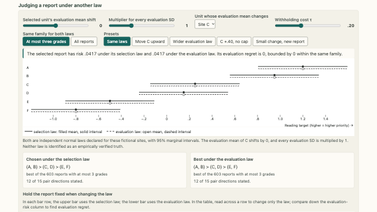</a>
<div class="prx-card-body">
<p class="prx-card-id">2.17</p>
<h3><a href="../../pages/grades/another-law.html">Evaluation under an alternative posterior law</a></h3>
<p>Evaluate the same report under two posterior laws to see how its risk and regret change.</p>
<p class="prx-card-links"><a href="../../embed/another-law.html">standalone</a></p>
</div>
</article>
<article class="prx-card prx-card-built">
<a class="prx-card-thumb" href="../../pages/grades/chosen-and-judged.html" tabindex="-1" aria-hidden="true">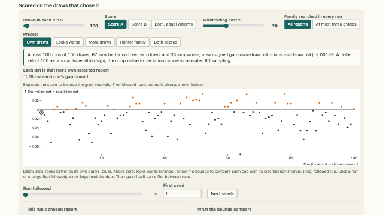</a>
<div class="prx-card-body">
<p class="prx-card-id">2.18</p>
<h3><a href="../../pages/grades/chosen-and-judged.html">Selection and evaluation using posterior draws</a></h3>
<p>A report can look better on the draws that selected it than when evaluated under the exact posterior law.</p>
<p class="prx-card-links"><a href="../../embed/chosen-and-judged.html">standalone</a></p>
</div>
</article>
<article class="prx-card prx-card-built">
<a class="prx-card-thumb" href="../../pages/grades/averaging-errors.html" tabindex="-1" aria-hidden="true">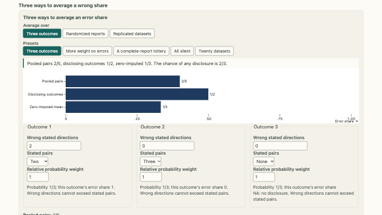</a>
<div class="prx-card-body">
<p class="prx-card-id">2.19</p>
<h3><a href="../../pages/grades/averaging-errors.html">Averaging error shares across reports</a></h3>
<p>When reports state different numbers of pairs, pooling their errors and averaging their error shares can give different answers.</p>
<p class="prx-card-links"><a href="../../embed/averaging-errors.html">standalone</a></p>
</div>
</article>
<article class="prx-card prx-card-built">
<a class="prx-card-thumb" href="../../pages/grades/one-correction.html" tabindex="-1" aria-hidden="true">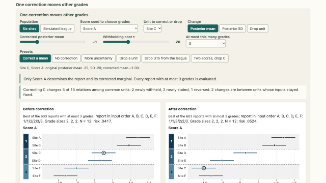</a>
<div class="prx-card-body">
<p class="prx-card-id">2.20</p>
<h3><a href="../../pages/grades/one-correction.html">Sensitivity to corrections and unit removal</a></h3>
<p>Compare which pairwise statements change after revising one unit’s marginal distribution or removing a unit.</p>
<p class="prx-card-links"><a href="../../embed/one-correction.html">standalone</a></p>
</div>
</article>
</div>
```
