<!-- Build inputs: the catalog; do not edit. -->
```{=html}
<div class="prx-cards">
<article class="prx-card prx-card-built">
<a class="prx-card-thumb" href="../../pages/rules/fixed-tiers.html" tabindex="-1" aria-hidden="true">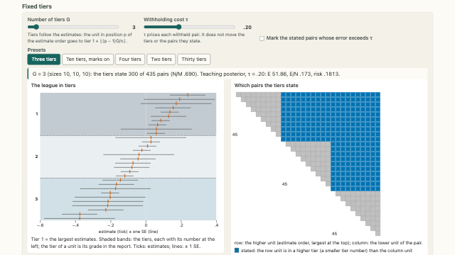</a>
<div class="prx-card-body">
<p class="prx-card-id">3.1</p>
<h3><a href="../../pages/rules/fixed-tiers.html">Fixed quantile tiers</a></h3>
<p>Group the estimates by quantiles, then use the posterior to count the expected mistakes in the resulting report.</p>
<p class="prx-card-links"><a href="../../embed/fixed-tiers.html">standalone</a></p>
</div>
</article>
<article class="prx-card prx-card-built">
<a class="prx-card-thumb" href="../../pages/rules/tier-sizes.html" tabindex="-1" aria-hidden="true">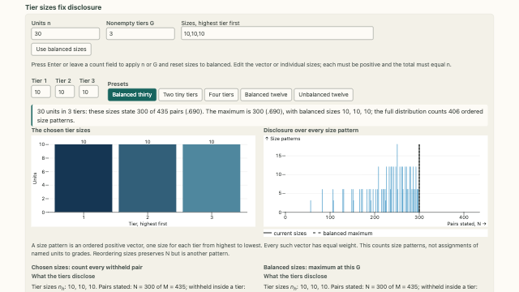</a>
<div class="prx-card-body">
<p class="prx-card-id">3.2</p>
<h3><a href="../../pages/rules/tier-sizes.html">Disclosure determined by tier sizes</a></h3>
<p>The number of stated pairs depends on the sizes of the tiers. Compare counts across all ordered size choices.</p>
<p class="prx-card-links"><a href="../../embed/tier-sizes.html">standalone</a></p>
</div>
</article>
<article class="prx-card prx-card-built">
<a class="prx-card-thumb" href="../../pages/rules/evidence-flags.html" tabindex="-1" aria-hidden="true">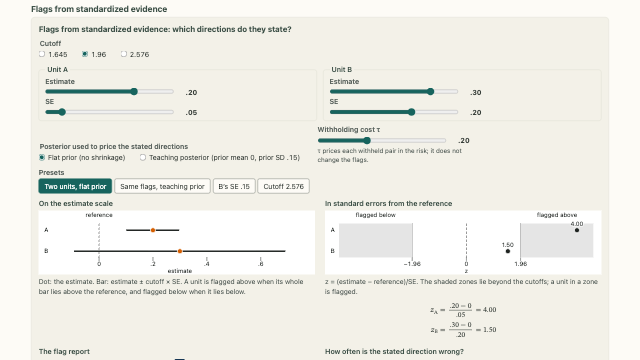</a>
<div class="prx-card-body">
<p class="prx-card-id">3.3</p>
<h3><a href="../../pages/rules/evidence-flags.html">Grades based on standardized evidence</a></h3>
<p>Turn estimates and standard errors into evidence flags, then examine the pairwise directions the flags imply.</p>
<p class="prx-card-links"><a href="../../embed/evidence-flags.html">standalone</a></p>
</div>
</article>
<article class="prx-card prx-card-built">
<a class="prx-card-thumb" href="../../pages/rules/flags-in-the-league.html" tabindex="-1" aria-hidden="true">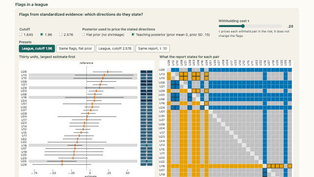</a>
<div class="prx-card-body">
<p class="prx-card-id">3.4</p>
<h3><a href="../../pages/rules/flags-in-the-league.html">Standardized-evidence flags in a league</a></h3>
<p>Evaluate the directions and posterior risk of a flag report for a simulated league of thirty units.</p>
<p class="prx-card-links"><a href="../../embed/flags-in-the-league.html">standalone</a></p>
</div>
</article>
<article class="prx-card prx-card-built">
<a class="prx-card-thumb" href="../../pages/rules/posterior-tiers.html" tabindex="-1" aria-hidden="true">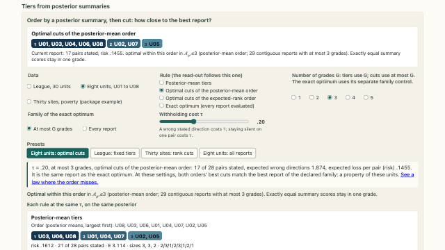</a>
<div class="prx-card-body">
<p class="prx-card-id">3.5</p>
<h3><a href="../../pages/rules/posterior-tiers.html">Tiers and optimized cuts of posterior rankings</a></h3>
<p>Compare fixed tiers, boundaries chosen along a posterior order, and a search over reports that can change that order.</p>
<p class="prx-card-links"><a href="../../embed/posterior-tiers.html">standalone</a></p>
</div>
</article>
<article class="prx-card prx-card-built">
<a class="prx-card-thumb" href="../../pages/rules/order-misses.html" tabindex="-1" aria-hidden="true">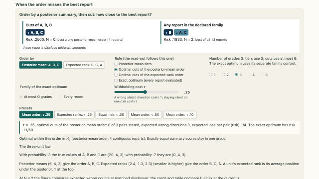</a>
<div class="prx-card-body">
<p class="prx-card-id">3.6</p>
<h3><a href="../../pages/rules/order-misses.html">Restrictions imposed by a fixed order</a></h3>
<p>At some withholding costs in this example, cuts of the posterior-mean order miss the best unrestricted report.</p>
<p class="prx-card-links"><a href="../../embed/order-misses.html">standalone</a></p>
</div>
</article>
<article class="prx-card prx-card-built">
<a class="prx-card-thumb" href="../../pages/rules/rule-comparison.html" tabindex="-1" aria-hidden="true">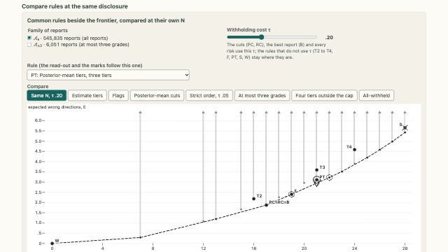</a>
<div class="prx-card-body">
<p class="prx-card-id">3.7</p>
<h3><a href="../../pages/rules/rule-comparison.html">Comparison at matched disclosure</a></h3>
<p>For each rule, compare its expected wrong count with the frontier at the same number of stated pairs.</p>
<p class="prx-card-links"><a href="../../embed/rule-comparison.html">standalone</a></p>
</div>
</article>
<article class="prx-card prx-card-built">
<a class="prx-card-thumb" href="../../pages/rules/same-tau-or-same-n.html" tabindex="-1" aria-hidden="true">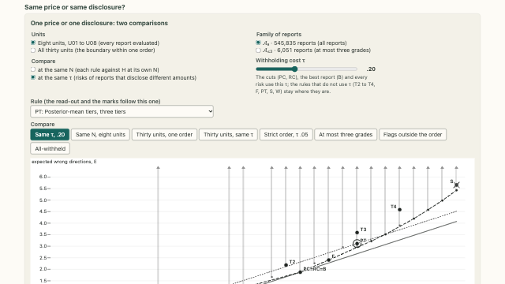</a>
<div class="prx-card-body">
<p class="prx-card-id">3.8</p>
<h3><a href="../../pages/rules/same-tau-or-same-n.html">Common withholding cost and matched disclosure</a></h3>
<p>A common withholding cost compares risk. A common number of stated pairs compares expected errors at the same disclosure.</p>
<p class="prx-card-links"><a href="../../embed/same-tau-or-same-n.html">standalone</a></p>
</div>
</article>
<article class="prx-card prx-card-built">
<a class="prx-card-thumb" href="../../pages/rules/deciles-quartiles.html" tabindex="-1" aria-hidden="true">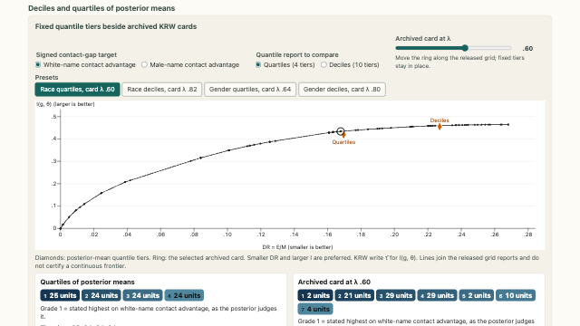</a>
<div class="prx-card-body">
<p class="prx-card-id">3.9</p>
<h3><a href="../../pages/rules/deciles-quartiles.html">Deciles and quartiles of posterior means</a></h3>
<p>Compare deciles and quartiles of posterior means on KRW’s measures of discordance and informativeness.</p>
<p class="prx-card-credit">Data: Kline, Rose and Walters (2024) · CC-BY-NC</p>
<p class="prx-card-links"><a href="../../embed/deciles-quartiles.html">standalone</a></p>
</div>
</article>
<article class="prx-card prx-card-built">
<a class="prx-card-thumb" href="../../pages/rules/naive-thresholding.html" tabindex="-1" aria-hidden="true">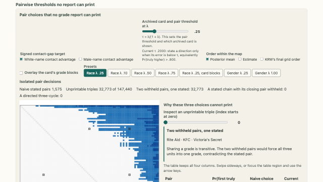</a>
<div class="prx-card-body">
<p class="prx-card-id">3.10</p>
<h3><a href="../../pages/rules/naive-thresholding.html">Coherence of pairwise threshold decisions</a></h3>
<p>Pairwise thresholds can produce incompatible triples. KRW’s archived cards show which directions a coherent report states.</p>
<p class="prx-card-credit">Data: Kline, Rose and Walters (2024) · CC-BY-NC</p>
<p class="prx-card-links"><a href="../../embed/naive-thresholding.html">standalone</a></p>
</div>
</article>
<article class="prx-card prx-card-built">
<a class="prx-card-thumb" href="../../pages/rules/better-on-average.html" tabindex="-1" aria-hidden="true">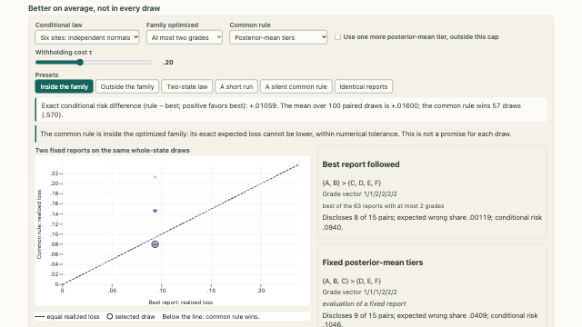</a>
<div class="prx-card-body">
<p class="prx-card-id">3.11</p>
<h3><a href="../../pages/rules/better-on-average.html">Expected and state-specific reporting loss</a></h3>
<p>A report with smaller posterior expected loss can still have larger loss in an individual posterior draw.</p>
<p class="prx-card-links"><a href="../../embed/better-on-average.html">standalone</a></p>
</div>
</article>
<article class="prx-card prx-card-built">
<a class="prx-card-thumb" href="../../pages/rules/stability.html" tabindex="-1" aria-hidden="true">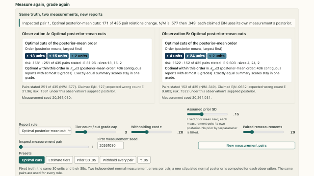</a>
<div class="prx-card-body">
<p class="prx-card-id">3.12</p>
<h3><a href="../../pages/rules/stability.html">Report stability under repeated measurement</a></h3>
<p>Repeat measurement at fixed true values to see which directions are newly stated, withheld, or reversed.</p>
<p class="prx-card-links"><a href="../../embed/stability.html">standalone</a></p>
</div>
</article>
<article class="prx-card prx-card-built">
<a class="prx-card-thumb" href="../../pages/rules/one-place.html" tabindex="-1" aria-hidden="true">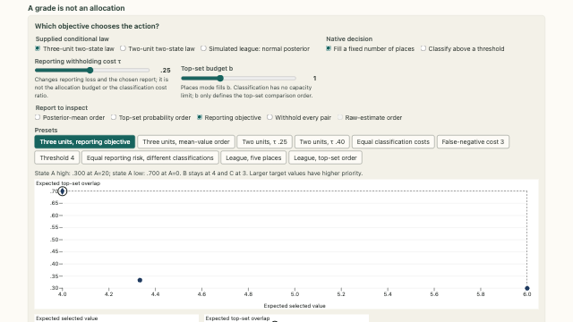</a>
<div class="prx-card-body">
<p class="prx-card-id">3.13</p>
<h3><a href="../../pages/rules/one-place.html">Reporting, allocation and classification</a></h3>
<p>Reporting a direction, allocating a place, and classifying a unit at a threshold use different decision rules.</p>
<p class="prx-card-links"><a href="../../embed/one-place.html">standalone</a></p>
</div>
</article>
</div>
```
