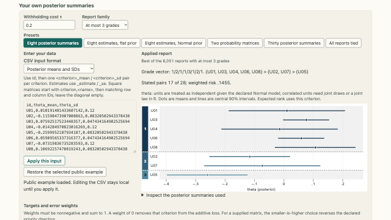
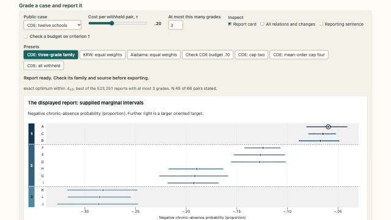

<!-- Build inputs: the catalog; do not edit. -->
```{=html}
<div class="prx-cards">
<article class="prx-card prx-card-built">
<a class="prx-card-thumb" href="../../pages/tools/your-data.html" tabindex="-1" aria-hidden="true"></a>
<div class="prx-card-body">
<p class="prx-card-id">T.1</p>
<h3><a href="../../pages/tools/your-data.html">Reports from supplied posterior summaries</a></h3>
<p>Enter normal summaries, estimates with a prior, or pairwise probabilities to calculate a grade report in the browser.</p>
<p class="prx-card-links"><a href="../../embed/your-data.html">standalone</a></p>
</div>
</article>
<article class="prx-card prx-card-built">
<a class="prx-card-thumb" href="../../pages/tools/report-designer.html" tabindex="-1" aria-hidden="true"></a>
<div class="prx-card-body">
<p class="prx-card-id">T.2</p>
<h3><a href="../../pages/tools/report-designer.html">Case-report specification and export</a></h3>
<p>Choose settings for a released case, check expected errors by criterion, and export the report and its inputs.</p>
<p class="prx-card-credit">Data: Kline, Rose and Walters (2024) · CC-BY-NC · California Department of Education, 2026 California School Dashboard chronic absenteeism data, academic year 2025–26 · No CDE endorsement is implied · Chetty, Friedman, Hendren, Jones and Porter (2022) · CC BY 4.0 · Opportunity Insights and U.S. Census Bureau</p>
<p class="prx-card-links"><a href="../../embed/report-designer.html">standalone</a></p>
</div>
</article>
</div>
```
