<!-- Build inputs: the catalog; do not edit. -->
```{=html}
<div class="prx-cards">
<article class="prx-card prx-card-built">
<a class="prx-card-thumb" href="../../pages/uncertainty/case-zero.html" tabindex="-1" aria-hidden="true">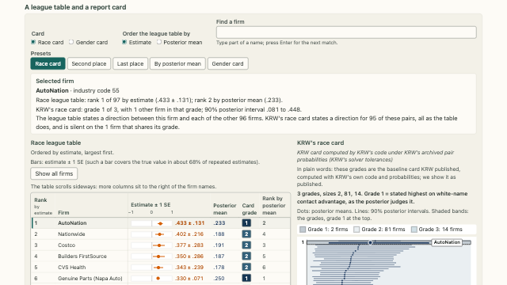</a>
<div class="prx-card-body">
<p class="prx-card-id">1.1</p>
<h3><a href="../../pages/uncertainty/case-zero.html">League tables and report cards</a></h3>
<p>Compare the directions stated by a strict ranking and by KRW’s report cards for 97 firms.</p>
<p class="prx-card-credit">Data: Kline, Rose and Walters (2024) · CC-BY-NC</p>
<p class="prx-card-links"><a href="../../embed/case-zero.html">standalone</a></p>
</div>
</article>
<article class="prx-card prx-card-built">
<a class="prx-card-thumb" href="../../pages/uncertainty/noisy-estimate.html" tabindex="-1" aria-hidden="true">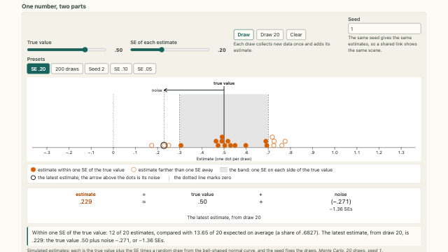</a>
<div class="prx-card-body">
<p class="prx-card-id">1.2</p>
<h3><a href="../../pages/uncertainty/noisy-estimate.html">Estimates and sampling error</a></h3>
<p>Repeated samples give different estimates of the same true value. The spread depends on the standard error.</p>
<p class="prx-card-links"><a href="../../embed/noisy-estimate.html">standalone</a></p>
</div>
</article>
<article class="prx-card prx-card-built">
<a class="prx-card-thumb" href="../../pages/uncertainty/noisy-league.html" tabindex="-1" aria-hidden="true">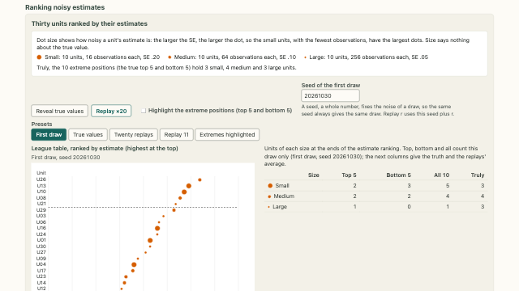</a>
<div class="prx-card-body">
<p class="prx-card-id">1.3</p>
<h3><a href="../../pages/uncertainty/noisy-league.html">Ranking noisy estimates</a></h3>
<p>Units estimated with less precision can appear at the extremes of a league table more often.</p>
<p class="prx-card-links"><a href="../../embed/noisy-league.html">standalone</a></p>
</div>
</article>
<article class="prx-card prx-card-built">
<a class="prx-card-thumb" href="../../pages/uncertainty/winners-curse.html" tabindex="-1" aria-hidden="true">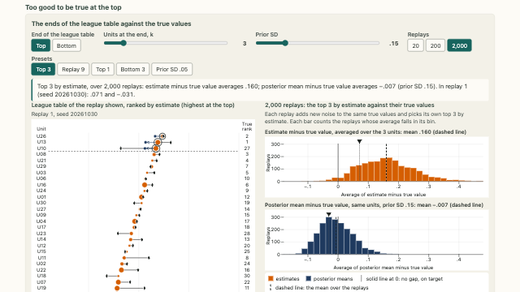</a>
<div class="prx-card-body">
<p class="prx-card-id">1.4</p>
<h3><a href="../../pages/uncertainty/winners-curse.html">Selection bias at the extremes of a ranking</a></h3>
<p>Selecting the highest or lowest estimates can introduce bias. The choice of prior changes the bias after shrinkage.</p>
<p class="prx-card-links"><a href="../../embed/winners-curse.html">standalone</a></p>
</div>
</article>
<article class="prx-card prx-card-built">
<a class="prx-card-thumb" href="../../pages/uncertainty/shrinkage.html" tabindex="-1" aria-hidden="true">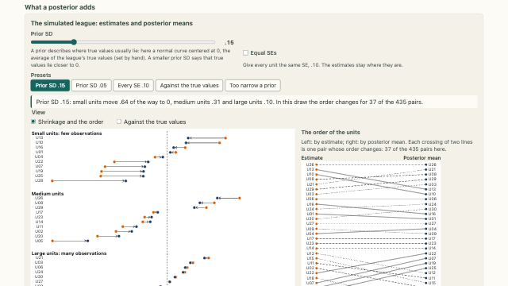</a>
<div class="prx-card-body">
<p class="prx-card-id">1.5</p>
<h3><a href="../../pages/uncertainty/shrinkage.html">Normal–normal posterior shrinkage</a></h3>
<p>Larger standard errors give the prior mean more weight. The units can change order after shrinkage.</p>
<p class="prx-card-links"><a href="../../embed/shrinkage.html">standalone</a></p>
</div>
</article>
<article class="prx-card prx-card-built">
<a class="prx-card-thumb" href="../../pages/uncertainty/shrinkage-price.html" tabindex="-1" aria-hidden="true">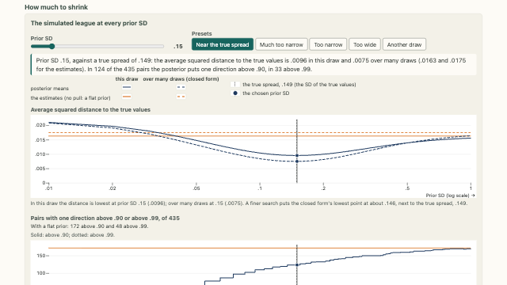</a>
<div class="prx-card-body">
<p class="prx-card-id">1.6</p>
<h3><a href="../../pages/uncertainty/shrinkage-price.html">Sensitivity to the prior standard deviation</a></h3>
<p>A change in the prior standard deviation affects squared error and the certainty of pairwise comparisons differently.</p>
<p class="prx-card-links"><a href="../../embed/shrinkage-price.html">standalone</a></p>
</div>
</article>
<article class="prx-card prx-card-built">
<a class="prx-card-thumb" href="../../pages/uncertainty/posterior-pipeline.html" tabindex="-1" aria-hidden="true">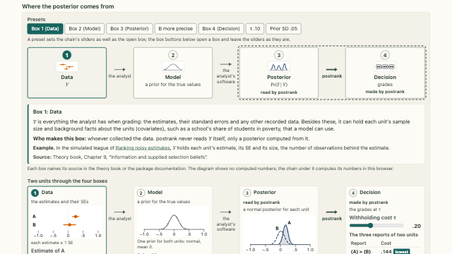</a>
<div class="prx-card-body">
<p class="prx-card-id">1.7</p>
<h3><a href="../../pages/uncertainty/posterior-pipeline.html">From data to posterior decisions</a></h3>
<p>Follow two estimates through posterior shrinkage to a decision about whether to state their order.</p>
<p class="prx-card-links"><a href="../../embed/posterior-pipeline.html">standalone</a></p>
</div>
</article>
<article class="prx-card prx-card-built">
<a class="prx-card-thumb" href="../../pages/uncertainty/two-units.html" tabindex="-1" aria-hidden="true">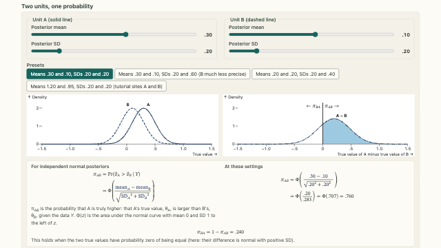</a>
<div class="prx-card-body">
<p class="prx-card-id">1.8</p>
<h3><a href="../../pages/uncertainty/two-units.html">Pairwise posterior direction probabilities</a></h3>
<p>With two independent normal posteriors, the probability that A is higher depends on the mean and standard deviation of their difference.</p>
<p class="prx-card-links"><a href="../../embed/two-units.html">standalone</a></p>
</div>
</article>
<article class="prx-card prx-card-built">
<a class="prx-card-thumb" href="../../pages/uncertainty/correlated-units.html" tabindex="-1" aria-hidden="true">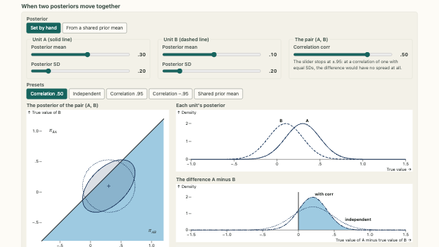</a>
<div class="prx-card-body">
<p class="prx-card-id">1.9</p>
<h3><a href="../../pages/uncertainty/correlated-units.html">Posterior dependence and pairwise comparisons</a></h3>
<p>Changing posterior correlation can change the probability that one unit is higher even when both marginal distributions stay fixed.</p>
<p class="prx-card-links"><a href="../../embed/correlated-units.html">standalone</a></p>
</div>
</article>
<article class="prx-card prx-card-built">
<a class="prx-card-thumb" href="../../pages/uncertainty/beyond-normal.html" tabindex="-1" aria-hidden="true">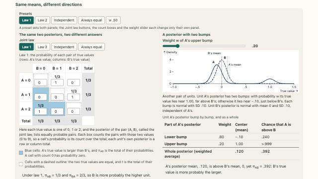</a>
<div class="prx-card-body">
<p class="prx-card-id">1.10</p>
<h3><a href="../../pages/uncertainty/beyond-normal.html">Marginal summaries and joint direction probabilities</a></h3>
<p>Two examples show how posterior shape and dependence can change direction probabilities at fixed marginal means.</p>
<p class="prx-card-links"><a href="../../embed/beyond-normal.html">standalone</a></p>
</div>
</article>
<article class="prx-card prx-card-built">
<a class="prx-card-thumb" href="../../pages/uncertainty/interval-overlap.html" tabindex="-1" aria-hidden="true">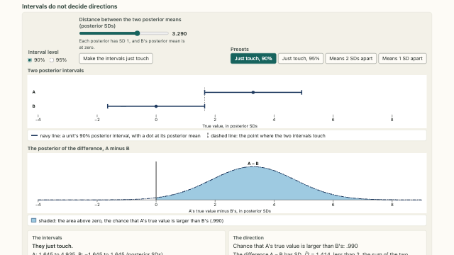</a>
<div class="prx-card-body">
<p class="prx-card-id">1.11</p>
<h3><a href="../../pages/uncertainty/interval-overlap.html">Marginal interval overlap and direction probabilities</a></h3>
<p>The probability that one unit is higher can be substantial even when their marginal credible intervals overlap.</p>
<p class="prx-card-links"><a href="../../embed/interval-overlap.html">standalone</a></p>
</div>
</article>
<article class="prx-card prx-card-built">
<a class="prx-card-thumb" href="../../pages/uncertainty/overlap-in-the-league.html" tabindex="-1" aria-hidden="true">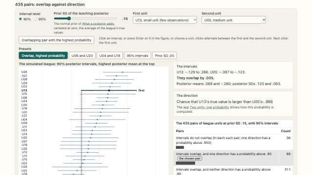</a>
<div class="prx-card-body">
<p class="prx-card-id">1.12</p>
<h3><a href="../../pages/uncertainty/overlap-in-the-league.html">Interval overlap across 435 pairs</a></h3>
<p>Compare interval overlap and posterior direction probabilities for all 435 pairs in a simulated league.</p>
<p class="prx-card-links"><a href="../../embed/overlap-in-the-league.html">standalone</a></p>
</div>
</article>
<article class="prx-card prx-card-built">
<a class="prx-card-thumb" href="../../pages/uncertainty/pairwise-matrix.html" tabindex="-1" aria-hidden="true">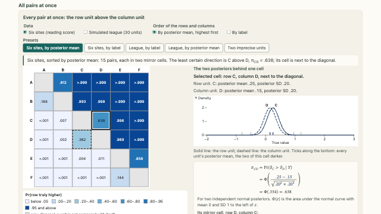</a>
<div class="prx-card-body">
<p class="prx-card-id">1.13</p>
<h3><a href="../../pages/uncertainty/pairwise-matrix.html">The matrix of pairwise posterior probabilities</a></h3>
<p>Reordering the units moves the cells of the matrix while preserving the probability attached to each pair.</p>
<p class="prx-card-links"><a href="../../embed/pairwise-matrix.html">standalone</a></p>
</div>
</article>
<article class="prx-card prx-card-built">
<a class="prx-card-thumb" href="../../pages/uncertainty/which-ranking.html" tabindex="-1" aria-hidden="true">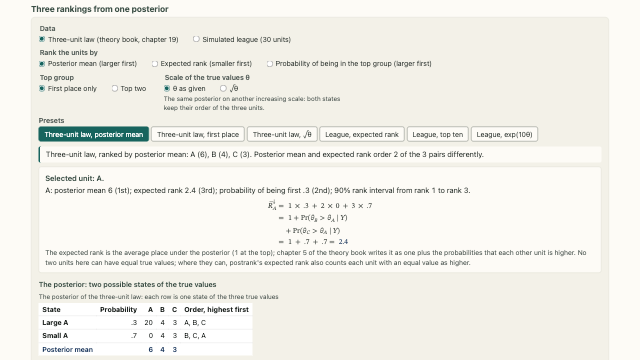</a>
<div class="prx-card-body">
<p class="prx-card-id">1.14</p>
<h3><a href="../../pages/uncertainty/which-ranking.html">Alternative rankings from a posterior distribution</a></h3>
<p>Ranking units by posterior mean, expected rank, or probability of reaching a top group can produce different orders.</p>
<p class="prx-card-links"><a href="../../embed/which-ranking.html">standalone</a></p>
</div>
</article>
<article class="prx-card prx-card-built">
<a class="prx-card-thumb" href="../../pages/uncertainty/majority-wins.html" tabindex="-1" aria-hidden="true">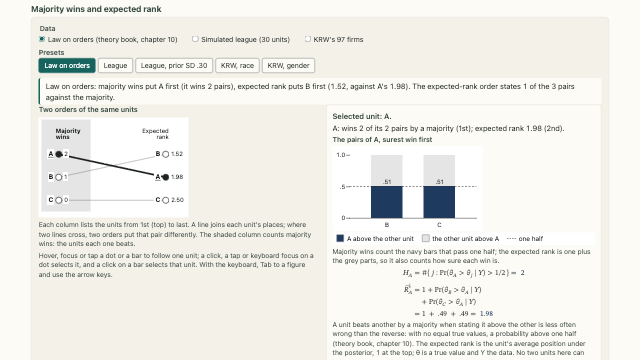</a>
<div class="prx-card-body">
<p class="prx-card-id">1.15</p>
<h3><a href="../../pages/uncertainty/majority-wins.html">Majority comparisons and expected ranks</a></h3>
<p>A count of pairwise majority wins records which direction is more likely. Expected rank also uses the size of each probability.</p>
<p class="prx-card-credit">Data: Kline, Rose and Walters (2024) · CC-BY-NC</p>
<p class="prx-card-links"><a href="../../embed/majority-wins.html">standalone</a></p>
</div>
</article>
<article class="prx-card prx-card-built">
<a class="prx-card-thumb" href="../../pages/uncertainty/ranking-claims.html" tabindex="-1" aria-hidden="true">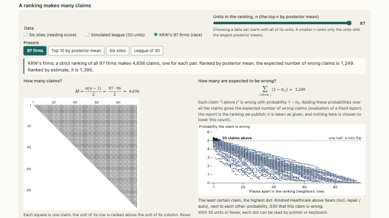</a>
<div class="prx-card-body">
<p class="prx-card-id">1.16</p>
<h3><a href="../../pages/uncertainty/ranking-claims.html">Expected errors in a strict ranking</a></h3>
<p>Add the posterior error probabilities for all pairwise directions in a strict ranking to find its expected wrong count.</p>
<p class="prx-card-credit">Data: Kline, Rose and Walters (2024) · CC-BY-NC · California Department of Education, 2026 California School Dashboard chronic absenteeism data, academic year 2025–26 · No CDE endorsement is implied</p>
<p class="prx-card-links"><a href="../../embed/ranking-claims.html">standalone</a></p>
</div>
</article>
<article class="prx-card prx-card-built">
<a class="prx-card-thumb" href="../../pages/uncertainty/mc-error.html" tabindex="-1" aria-hidden="true">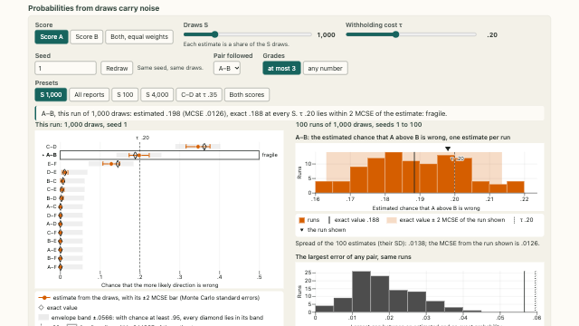</a>
<div class="prx-card-body">
<p class="prx-card-id">1.17</p>
<h3><a href="../../pages/uncertainty/mc-error.html">Monte Carlo error in pairwise probabilities</a></h3>
<p>With a finite set of posterior draws, sampling error can change the report chosen near a decision boundary.</p>
<p class="prx-card-links"><a href="../../embed/mc-error.html">standalone</a></p>
</div>
</article>
<article class="prx-card prx-card-built">
<a class="prx-card-thumb" href="../../pages/uncertainty/chain-draws.html" tabindex="-1" aria-hidden="true">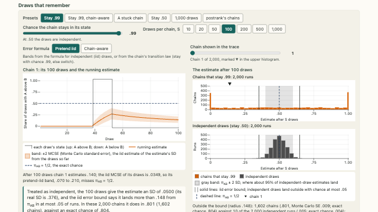</a>
<div class="prx-card-body">
<p class="prx-card-id">1.18</p>
<h3><a href="../../pages/uncertainty/chain-draws.html">Monte Carlo error with dependent draws</a></h3>
<p>Draws from a stationary two-state Markov chain show how dependence affects estimates of a direction probability.</p>
<p class="prx-card-links"><a href="../../embed/chain-draws.html">standalone</a></p>
</div>
</article>
</div>
```
